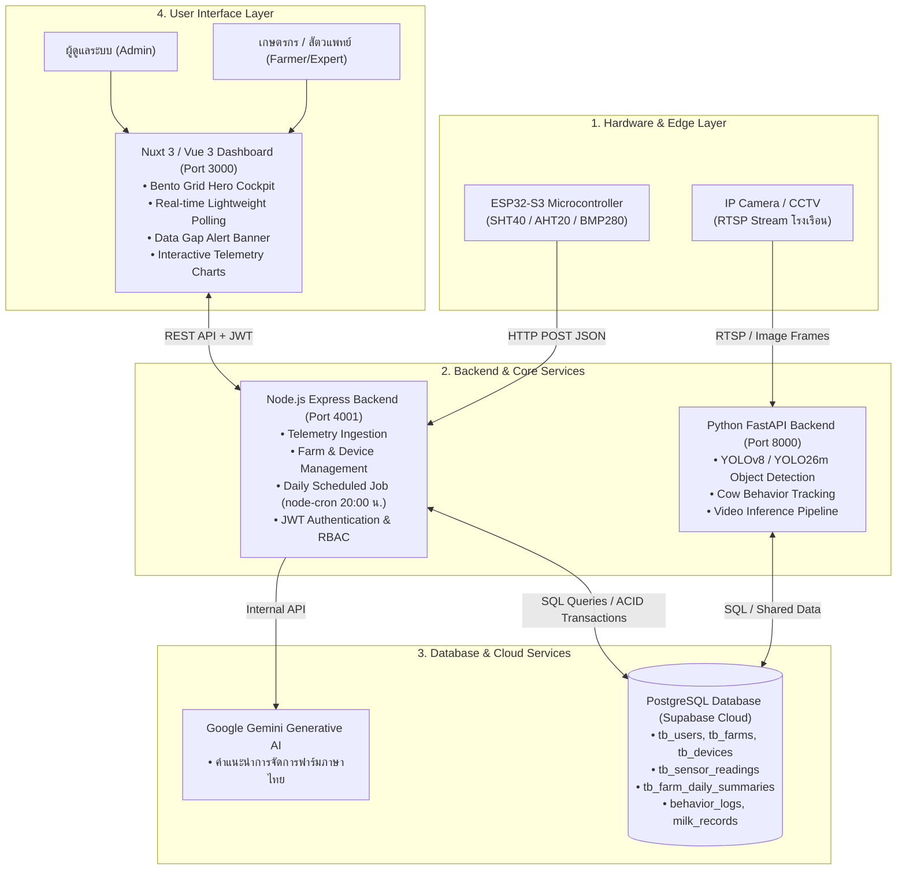
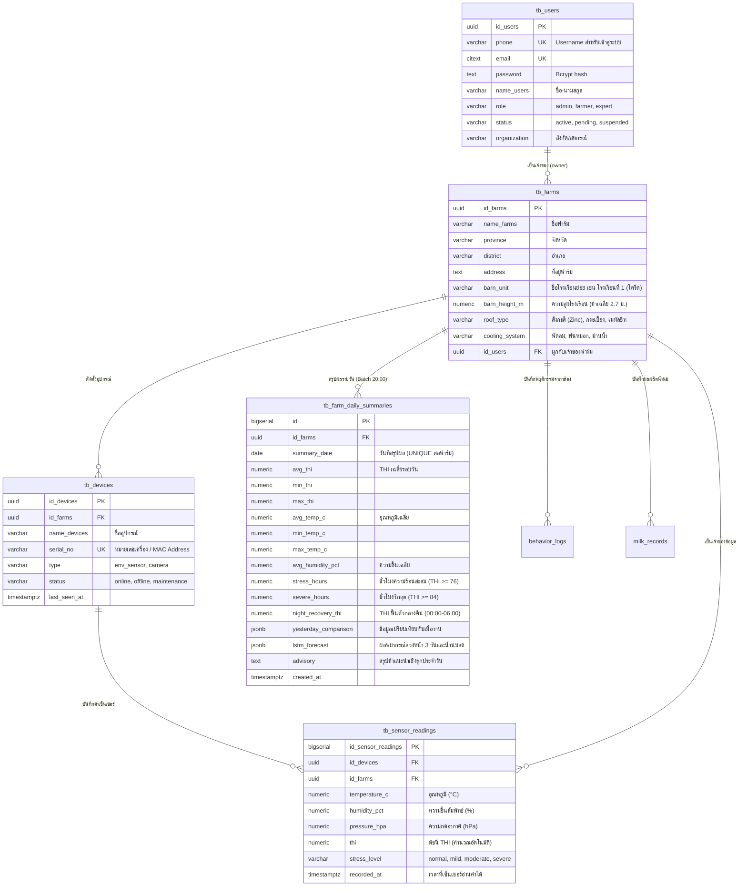

# รายงานภาพรวมระบบฉบับสมบูรณ์: PH Detection System
**Precision Herd Heat Stress & Cow Behavior Detection System for Dairy Farms**  
**วันที่ปรับปรุงล่าสุด:** 18 ตุลาคม 2026  
**เวอร์ชันระบบ:** 3.0.0 (Enterprise Multi-Module Suite)  

---

## สารบัญ (Table of Contents)
1. [บทนำและเป้าหมายของโครงการ (Project Overview & Objectives)](#1-บทนำและเป้าหมายของโครงการ)
2. [สถาปัตยกรรมระบบโดยรวม (System Architecture & Data Flow)](#2-สถาปัตยกรรมระบบโดยรวม)
3. [ฮาร์ดแวร์ IoT และการรับส่งข้อมูลสภาพแวดล้อม (IoT Hardware & Ingestion)](#3-ฮาร์ดแวร์-iot-และการรับส่งข้อมูลสภาพแวดล้อม)
4. [โครงสร้างฐานข้อมูลเชิงลึก (Database Architecture & Schema Specification)](#4-โครงสร้างฐานข้อมูลเชิงลึก)
5. [ระบบ AI และแบบจำลองการคำนวณทางวิทยาศาสตร์ (AI & Scientific Models)](#5-ระบบ-ai-และแบบจำลองการคำนวณทางวิทยาศาสตร์)
6. [ระบบ Daily Scheduled Batch Job (รันวันละ 1 ครั้ง)](#6-ระบบ-daily-scheduled-batch-job)
7. [ระบบส่วนหน้าและแดชบอร์ด (Frontend Dashboard & Cockpit UX)](#7-ระบบส่วนหน้าและแดชบอร์ด)
8. [คู่มือการติดตั้งและคำสั่งการรันระบบ (Deployment & Operations Guide)](#8-คู่มือการติดตั้งและคำสั่งการรันระบบ)

---

## 1. บทนำและเป้าหมายของโครงการ

**PH Detection System** เป็นระบบตรวจจับ แจ้งเตือน และพยากรณ์ความเครียดความร้อน (Heat Stress) ควบคู่กับการวิเคราะห์พฤติกรรมโคนมแบบแม่นยำสูง ออกแบบมาเพื่อยกระดับฟาร์มโคนมไทย (โดยเฉพาะฟาร์มรายย่อยและฟาร์มมาตรฐาน) ให้อยู่รอดและคงผลผลิตน้ำนมได้ท่ามกลางสภาพอากาศร้อนชื้นของประเทศไทย

### ปัญหาหลักที่ระบบแก้ไข (Core Problems Addressed)
1. **ภาวะน้ำนมดิ่งจากความร้อนสะสม (Milk Yield Drop):** สภาพอากาศร้อนชื้นทำให้โคนมเกิดความเครียดความร้อน ส่งผลให้น้ำนมลดลงอย่างรุนแรง โดยมีผลกระทบตามหลัง 5 วัน (Biological Lag Effect) หากไม่ระบายอากาศล่วงหน้า
2. **การฟื้นตัวกลางคืนล้มเหลว (Night-time Thermal Inefficiency):** หากอุณหภูมิโรงเรือนช่วงกลางคืน (00:00–06:00 น.) ไม่ลดลง แม่โคจะไม่สามารถระบายความร้อนสะสมจากช่วงกลางวันได้
3. **การสูญเสียทางเศรษฐกิจและการตรวจพบที่ช้าเกินไป:** เกษตรกรส่วนใหญ่รับรู้ปัญหาเมื่อน้ำนมลดลงแล้ว ซึ่งสายเกินไป ระบบนี้จึงเปลี่ยนจากการ **"ตั้งรับ (Reactive)"** มาเป็นการ **"พยากรณ์เชิงรุก (Proactive Management)"**

---

## 2. สถาปัตยกรรมระบบโดยรวม

ระบบถูกออกแบบด้วยสถาปัตยกรรม **3-Tier Containerized Microservices** แยกส่วนการทำงานชัดเจน:



---

## 3. ฮาร์ดแวร์ IoT และการรับส่งข้อมูลสภาพแวดล้อม

### 3.1 คุณสมบัติฮาร์ดแวร์
- **บอร์ดประมวลผล:** ESP32-S3 (รองรับ Wi-Fi / RS485 Modbus)
- **เซ็นเซอร์อุณหภูมิและความชื้น:** 
  - เซ็นเซอร์อุตสาหกรรม SHT40 หุ้มปลอกกรองฝุ่น หรือ AHT20 ความแม่นยำสูง
  - ช่วงวัดอุณหภูมิ: $-40^\circ\text{C}$ ถึง $+125^\circ\text{C}$ (ความแม่นยำ $\pm 0.2^\circ\text{C}$)
  - ช่วงวัดความชื้น: $0\%$ ถึง $100\%\text{ RH}$ (ความแม่นยำ $\pm 1.8\%\text{ RH}$)
- **เซ็นเซอร์ความกดอากาศ (อุปกรณ์เสริม):** BMP280 วัดความกดอากาศ ($300$ ถึง $1100\text{ hPa}$)

### 3.2 โครงสร้าง Payload ข้อมูลเซ็นเซอร์ (HTTP POST JSON)
ส่งเข้ามาที่ Endpoint: `POST /api/Admin/sensors/data` (หรือ `/api/sensors/data`)

```json
{
  "serial_no": "ESP32-S3-01",
  "temperature_c": 29.6,
  "humidity_pct": 70.8,
  "pressure_hpa": 1012.25
}
```

### 3.3 การประมวลผลทันทีเมื่อรับข้อมูล (Real-Time Ingestion Logic)
1. ตรวจสอบและค้นหา `id_devices` และ `id_farms` จากหมายเลข `serial_no`
2. อัปเดตสถานะอุปกรณ์เป็น `online` และบันทึกเวลา `last_seen_at = NOW()`
3. คำนวณค่าดัชนี **THI (NRC 1971)** ทันที
4. ประเมินระดับความเครียดความร้อน (`stress_level`): `normal`, `mild`, `moderate`, `severe`
5. บันทึกข้อมูลลงตาราง `tb_sensor_readings` ในฐานข้อมูล

---

## 4. โครงสร้างฐานข้อมูลเชิงลึก

ระบบใช้ฐานข้อมูล **PostgreSQL บน Supabase Cloud** พร้อมระบบความปลอดภัย **Row-Level Security (RLS)**



### 4.1 ตาราง `tb_farm_daily_summaries` (หัวใจของระบบ Daily Batch)
โครงสร้างคอลัมน์และคำอธิบาย:
- `id_farms`: รหัสฟาร์ม (เชื่อมโยงแบบ `ON DELETE CASCADE`)
- `summary_date`: วันที่ของชุดสรุปผล (มี `UNIQUE(id_farms, summary_date)`)
- `avg_thi`, `min_thi`, `max_thi`: ค่าดัชนีความร้อนสะสมต่ำสุด สูงสุด และเฉลี่ยของวัน
- `avg_temp_c`, `min_temp_c`, `max_temp_c`: อุณหภูมิอากาศ
- `avg_humidity_pct`, `min_humidity_pct`, `max_humidity_pct`: ความชื้นสัมพัทธ์
- `stress_hours`: จำนวนชั่วโมงในวันนั้นที่ค่า $\text{THI} \ge 76.0$
- `severe_hours`: จำนวนชั่วโมงในวันนั้นที่ค่า $\text{THI} \ge 84.0$
- `night_recovery_thi`: ค่าเฉลี่ย THI ในช่วงเวลา 00:00 - 06:00 น. (ตัวชี้วัดการฟื้นตัวเวลากลางคืน)
- `yesterday_comparison` (JSONB):
  ```json
  {
    "has_yesterday_data": true,
    "yesterday_date": "2026-10-14",
    "diff_avg_thi": 0.5,
    "diff_max_temp": 1.2,
    "diff_stress_hours": -1.0,
    "trend": "increasing",
    "trend_description": "ความร้อนสะสมเฉลี่ยเพิ่มขึ้น +0.5 THI เทียบกับเมื่อวาน"
  }
  ```
- `lstm_forecast` (JSONB): เก็บผลการพยากรณ์ล่วงหน้า 3 วัน (Day +1, +2, +3) พร้อมปริมาณน้ำนมที่ลดลง
- `advisory`: ข้อความสรุปเชิงรุกสำหรับแจ้งเตือนเกษตรกร

### 4.2 ระบบความปลอดภัยและความสมบูรณ์ของข้อมูล (ACID Transactions)
- **การเพิ่มฟาร์ม (`POST /api/Admin/farms`):** ใช้ `db.pool.connect()` เริ่มด้วย `BEGIN` สร้างข้อมูลฟาร์ม และเชื่อมโยงอุปกรณ์ IoT หากจุดใดล้มเหลวจะทำ `ROLLBACK` ทันที ป้องกันปัญหาฟาร์มค้างโดยไม่มีอุปกรณ์
- **การลบฟาร์ม (`DELETE /api/Admin/farms/:id`):** ทำงานในระดับ Transaction ปลดการผูกอุปกรณ์ (`tb_devices`), ล้างประวัติเซ็นเซอร์ (`tb_sensor_readings`), ลบสมาชิกฟาร์ม (`tb_farm_members`) และลบข้อมูลฟาร์ม ป้องกัน Foreign Key Constraint Error
- **ไม่มีการจำลองข้อมูลเท็จ (Strict Real Data Mode):** ปิดการแทรก mock data ลงฐานข้อมูลทั้งหมด แสดงเฉพาะสิ่งที่อ่านได้จริงจากฮาร์ดแวร์ หากไม่มีข้อมูลจะแสดงสถานะ Offline พร้อมเวลาล่าสุด

---

## 5. ระบบ AI และแบบจำลองการคำนวณทางวิทยาศาสตร์

ระบบผสานการทำงานระหว่าง **ชีววิทยาโคนมเขตร้อน** และ **แบบจำลองปัญญาประดิษฐ์ Deep Learning**:

### 5.1 สมการทางวิทยาศาสตร์และงานวิจัยที่ใช้อ้างอิง

1. **สมการดัชนีอุณหภูมิและความชื้น (NRC 1971 / NOAA 1976):**
   $$\text{THI} = (1.8 \times T + 32) - (0.55 - 0.0055 \times RH) \times (1.8 \times T - 26)$$
   *หมายเหตุสำคัญ:* ไม่มีการบวกค่าชดเชยโรงเรือนเข้ากับค่าเซ็นเซอร์แบบ Real-time เพราะเซ็นเซอร์ติดตั้งอยู่ในโรงเรือนและบันทึกอุณหภูมิ/ความชื้นจริงอยู่แล้ว โครงสร้างโรงเรือนจะถูกใช้เป็นฟีเจอร์คงที่ (Static Features) ในโมเดลพยากรณ์อนาคตเท่านั้น

2. **เกณฑ์ความเครียดความร้อนสำหรับโคนมลูกผสมไทย (Boonkum et al., 2024; Sungkhapreecha et al., 2022):**
   - $\text{THI} < 76.0$ (หรือ $T < 27.5^\circ\text{C}$ และ $\text{THI} < 77.5$ โดยไม่มีอาการหอบ): **Normal** (สภาวะปกติ โคสบายตัว Comfort Zone)
   - $76.0 \le \text{THI} < 80.0$: **Mild** (เริ่มเฝ้าระวัง การเคี้ยวเอื้องเริ่มลดลง)
   - $80.0 \le \text{THI} < 84.0$: **Moderate** (เริ่มกระทบผลผลิต น้ำนมเริ่มลด เซลล์โซมาติก SCS เพิ่มขึ้น)
   - $\text{THI} \ge 84.0$: **Severe** (วิกฤตรุนแรง แม่โคหอบ น้ำนมลดฮวบ อัตราผสมติดต่ำ)

3. **ความเสี่ยงน้ำนมลดเชิงทฤษฎีและ Biological Lag Effect 5 วัน (Abdourhamane 2026; Hasan et al. 2026):**
   - **Zero-Input Milk Loss Proxy:** ระบบคำนวณความเสี่ยงน้ำนมลดจากแบบจำลองทางฟิสิกส์และชีววิทยาโดยตรง **โดยไม่ต้องให้เกษตรกรกรอกข้อมูลปริมาณน้ำนมดิบรายวัน**
   - เริ่มคิดผลกระทบน้ำนมเมื่อ $\text{THI} > 76.0$ (เกณฑ์เฉพาะสำหรับโคนมลูกผสมเขตร้อนของไทย):
     $$\Delta Y_{\text{milk}} = \max\left(0, (\text{THI}_{\text{pred}} - 76.0) \times 0.45\right)\text{ kg/cow/day}$$
   - ผลกระทบต่อผลผลิตน้ำนมมีระยะหน่วงทางชีวภาพ (Biological Lag) สูงสุดในอีก **5 วันถัดไป**

4. **ดัชนีการฟื้นตัวกลางคืน (Thai Night-time Thermal Recovery - Mylostyvyi 2026):**
   - คำนวณค่าเฉลี่ย THI ช่วงเวลา 00:00 - 06:00 น.
   - เกณฑ์สำหรับบริบทไทย: ค่า THI กลางคืนที่ปลอดภัยคือ $< 74.0$ หาก $\text{THI} \ge 74.0$ โคจะไม่สามารถคายความร้อนสะสมได้

5. **บริบทฤดูกาลและการจัดการความชื้น (Maejo University Research):**
   - ฤดูฝน/สภาวะความชื้นสูง ($RH \ge 75\%$ และ $T \le 29.5^\circ\text{C}$): แนะนำเปิดพัดลมระบายอากาศแรงสุด แต่ **งดเปิดระบบพ่นละอองน้ำ (No Misting)** เพื่อป้องกันพื้นคอกแฉะและลดความเสี่ยงโรคเต้านมอักเสบ (Mastitis)
   - ฤดูร้อน/สภาวะแห้ง: เปิดพัดลมควบคู่กับระบบพ่นหมอกเหนือทางเดิน

### 5.2 ระบบ Computer Vision (YOLO)
- โค้ดอยู่ที่ `backend/app/` รันด้วย FastAPI บนพอร์ต 8000
- ไฟล์โมเดล: `backend/app/weights/best1.pt` และ `yolo26m.pt`
- ตรวจจับพฤติกรรม: **ยืน (standing)**, **นอน (lying)**, **กินอาหาร (eating)**, **กินน้ำ (drinking)**, **หอบ (panting)**
- ข้อมูลพฤติกรรมถูกดึงมารวมเป็นสัดส่วนการยืน (`standing_ratio`) และอัตราการหอบ (`panting_rate`) ส่งต่อให้โมเดล LSTM พยากรณ์

### 5.3 สถาปัตยกรรม True Deep Learning Bi-LSTM (ONNX Runtime)
ระบบได้พัฒนาและติดตั้งโมเดล True Deep Learning สมบูรณ์:
- **สถาปัตยกรรมโมเดล:** Multimodal Bidirectional LSTM (2 Layers, 128 Hidden Units) + Temporal Attention Mechanism + Static Feature Fusion
- **Lookback Window 72 ชั่วโมง (3 วัน):** ปรับลดจาก 336 ชม. เพื่อตอบโจทย์ฟาร์มรายย่อยไทย ลด Cold-start Latency พร้อมระบบ **Progressive Warm-up**:
  - $< 24$ ชั่วโมง: Heuristic Fallback อิงค่าเฉลี่ยเซ็นเซอร์จริง
  - $24 - 71$ ชั่วโมง: Diurnal Padding เติมข้อมูลวงจรความร้อนรายวันจนครบ 72 ชั่วโมง
  - $\ge 72$ ชั่วโมง: Full ONNX Bi-LSTM Inference
- **ไฟล์น้ำหนักโมเดล:** [`backend/app/weights/farm_lstm.onnx`](file:///Users/phattaradanai/Desktop/testYOLO26/backend/app/weights/farm_lstm.onnx) (ขนาดเพียง 124 KB)
- **High-Performance Inference:** รันบน Node.js ผ่านแพ็กเกจ `onnxruntime-node` ใช้เวลาประมวลผล **< 5 ms ต่อฟาร์ม** โดยไม่ต้องพึ่งพาเซิร์ฟเวอร์ GPU ขนาดใหญ่

---

## 6. ระบบ Daily Scheduled Batch Job

การทำงานของระบบสรุปผลรายวันรันผ่านโมดูล [`backend_node/app/services/dailyLstmScheduler.js`](file:///Users/phattaradanai/Desktop/testYOLO26/backend_node/app/services/dailyLstmScheduler.js):

### 6.1 วงจรรอบการทำงาน (Workflow)
1. **Trigger (20:00 น. เวลาไทย):** `cron.schedule('0 20 * * *', ...)` ทำงานอัตโนมัติ
2. **Data Extraction:** ดึงค่าเซ็นเซอร์ทั้งหมดของวันนั้น (00:00:00 - 23:59:59 เวลาไทย) จาก `tb_sensor_readings`
3. **Daily Aggregation:** คำนวณค่าต่ำสุด สูงสุด เฉลี่ย, ชั่วโมงความเครียด (`stress_hours`), ชั่วโมงวิกฤต (`severe_hours`), และค่าฟื้นตัวกลางคืน (`night_recovery_thi`)
4. **Historical Comparison:** ดึงสถิติของเมื่อวานมาเปรียบเทียบคำนวณผลต่าง (`diff_avg_thi`, `diff_max_temp`, `trend`)
5. **LSTM Projection:** คำนวณแนวโน้ม 3 วันข้างหน้า (Day +1, Day +2, Day +3) พร้อมคำนวณปริมาณน้ำนมที่เสี่ยงสูญเสีย
6. **Advisory Generation:** สร้างข้อความคำแนะนำการจัดการฟาร์มเชิงรุกภาษาไทย
7. **Atomic Upsert:** บันทึกลงตาราง `tb_farm_daily_summaries` ด้วยคำสั่ง `ON CONFLICT (id_farms, summary_date) DO UPDATE`

### 6.2 การสั่งรันด้วยมือ (Manual On-Demand Execution)
- รองรับการเรียกผ่าน API: `POST /api/Admin/farms/:id/run-daily-summary` หรือ `POST /api/Admin/farms/run-all-daily-summaries`
- บนหน้าเว็บ `farm_detail-[id].vue` มีปุ่ม **"รันสรุปประจำวัน (Daily Job)"** สำหรับกดทดสอบหรือประมวลผลทันที

---

## 7. ระบบส่วนหน้าและแดชบอร์ด

พัฒนาด้วย **Nuxt 3 + Tailwind CSS + Vuetify Icons + ApexCharts**:

### 7.1 หน้าจัดการฟาร์มรวม ([`farms.vue`](file:///Users/phattaradanai/Desktop/testYOLO26/frontend/app/pages/Admin/farms/farms.vue))
- **3-Tab Quick Filter:**
  - **ฟาร์มทั้งหมด (All):** แสดงทุกฟาร์มในระบบ
  - **ออนไลน์ / รับส่งข้อมูลปกติ (Active):** แสดงเฉพาะฟาร์มที่เซ็นเซอร์ส่งข้อมูลสม่ำเสมอ (< 10-15 นาที)
  - **รอเชื่อมต่อ / อุปกรณ์ขัดข้อง (Pending):** แยกฟาร์มที่ยังไม่ได้ติดตั้งอุปกรณ์ หรืออุปกรณ์ออฟไลน์ออกมาต่างหาก
- **Multi-Device & Sub-Barn Display:** การ์ดฟาร์มแต่ละใบแสดงชื่อโรงเรือนย่อย (`barn_unit`), ชื่อเจ้าของฟาร์ม และจำนวนอุปกรณ์ที่ติดตั้งโดยไม่มีการ์ดฟาร์มซ้ำซ้อน

### 7.2 หน้าห้องควบคุมฟาร์มเชิงลึก ([`farm_detail-[id].vue`](file:///Users/phattaradanai/Desktop/testYOLO26/frontend/app/pages/Admin/farms/farm_detail-[id].vue))
- **Data Gap Alert Banner:** ตรวจจับสัญญาณขาดหาย หากบอร์ดปิดหรือไม่ได้ส่งสัญญาณเกิน 10 นาที แบนเนอร์สีส้มจะแจ้งเตือนพร้อมระบุระยะเวลาที่สัญญาณหายไปอย่างแม่นยำ
- **Bento Grid Hero Cockpit:** แสดงค่า THI ขนาดใหญ่, ระดับความเครียดสีตามเกณฑ์, เกจวัดสัดส่วนความเสี่ยง
- **24-Hour Rolling Summary Ribbon:** 4 การ์ดแสดงค่าเฉลี่ย THI, ช่วงอุณหภูมิ (Min-Max), ช่วงความชื้น (Min-Max), และรอบเตือนความร้อนสะสม
- **AI LSTM Predictive Brain Section:**
  - การ์ดพยากรณ์ล่วงหน้า 3 วัน (Day +1 ถึง +3)
  - การคาดการณ์น้ำนมที่ลดลง ($\text{kg/ตัว/วัน}$) ตามหลัก Biological Lag Effect 5 วัน
  - แผนจัดการเชิงรุก (Proactive Strategy) แนะนำเวลาเปิดพัดลมพ่นหมอก
  - แถบแสดงสถานะ **สรุปผลรายวัน (Batch 20:00 น.)**, ค่าเปรียบเทียบเมื่อวาน, ค่า Night Recovery และปุ่มกดรัน Daily Job
- **Interactive ApexCharts:** กราฟแสดงแนวโน้มอุณหภูมิ ความชื้น THI และเส้นเกณฑ์ความเครียด พร้อมระบบตัดข้อมูลส่วนที่ขาดหาย ไม่พล็อตกราฟหลอก
- **Real-Time Lightweight Polling:** Polling ผ่าน `GET /api/Admin/farms/:id/latest` ทุก 8 วินาที (ขนาดแพ็กเก็ตเพียง ~200 bytes) ลดภาระฐานข้อมูลลงกว่า 95%

---

## 8. คู่มือการติดตั้งและคำสั่งการรันระบบ

### 8.1 การรันผ่าน Docker Compose (Production / Staging)
ในไดเรกทอรีรากของโปรเจกต์:
```bash
# ตรวจสอบการตั้งค่าและ build คอนเทนเนอร์
docker-compose build

# เริ่มการทำงานของทุกเซอร์วิสในพื้นหลัง
docker-compose up -d

# ดูบันทึกการทำงาน (Logs)
docker-compose logs -f
```

### 8.2 การรันแบบ Local Development แยกแต่ละส่วน

#### 1. Node.js Backend (Port 4001)
```bash
cd backend_node
npm install
npm run dev
# เซิร์ฟเวอร์จะเริ่มทำงานบน http://localhost:4001 พร้อมเปิด Daily LSTM Cron Job ที่ 20:00 น.
```

#### 2. Python FastAPI Backend (Port 8000)
```bash
cd backend
source venv/bin/activate  # หรือ venv\Scripts\activate สำหรับ Windows
pip install -r requirements.txt
uvicorn app.main:app --host 0.0.0.0 --port 8000 --reload
# ทดสอบ API ได้ที่ http://localhost:8000/docs
```

#### 3. Frontend Nuxt 3 (Port 3000)
```bash
cd frontend
npm install
npm run dev
# เปิดใช้งานหน้าเว็บที่ http://localhost:3000
```

### 8.3 สรุป Endpoint สำคัญของระบบ

| Service | Method | Endpoint | หน้าที่ |
| :--- | :---: | :--- | :--- |
| **Auth** | `POST` | `/api/auth/login` | เข้าสู่ระบบและรับ JWT Token |
| **Sensors** | `POST` | `/api/Admin/sensors/data` | รับ Telemetry จาก ESP32 IoT |
| **Farms** | `GET` | `/api/Admin/farms/all` | รายการฟาร์มทั้งหมด พร้อมสถานะเซ็นเซอร์ล่าสุด |
| **Farms** | `GET` | `/api/Admin/farms/:id` | ข้อมูลฟาร์มเชิงลึก, ประวัติ, สถิติ, และ LSTM |
| **Farms** | `GET` | `/api/Admin/farms/:id/latest` | Lightweight Polling ตรวจสอบสัญญาณและ Gap Alert |
| **Farms** | `POST` | `/api/Admin/farms` | เพิ่มฟาร์มใหม่พร้อมผูกอุปกรณ์ (ACID Transaction) |
| **Farms** | `PUT` | `/api/Admin/farms/:id` | แก้ไขข้อมูลฟาร์มและสเปกโรงเรือน |
| **Farms** | `DELETE` | `/api/Admin/farms/:id` | ลบฟาร์มอย่างปลอดภัย (ACID Transaction) |
| **Farms** | `GET` | `/api/Admin/farms/dashboard-stats` | ข้อมูลสถิติภาพรวมเครือข่ายสำหรับ Dashboard |
| **Daily Batch**| `POST` | `/api/Admin/farms/:id/run-daily-summary`| สั่งรันสรุปประจำวันเฉพาะฟาร์มนี้ |
| **Daily Batch**| `POST` | `/api/Admin/farms/run-all-daily-summaries`| สั่งรันสรุปประจำวันทุกฟาร์มในระบบ |
| **Daily Batch**| `GET` | `/api/Admin/farms/:id/daily-summaries` | ดึงประวัติ Daily Summaries ย้อนหลัง 14 วัน |
| **Devices** | `GET, POST, PUT, DELETE` | `/api/Admin/devices` | จัดการอุปกรณ์ IoT และกล้อง CCTV ในระบบ |
| **Alerts & LINE**| `GET, POST` | `/api/Admin/alerts` | ประวัติการแจ้งเตือนและส่ง LINE Flex Message |
| **Coop ESG** | `GET` | `/api/Admin/coop-report/:farmId` | ดึงสมุดความเสี่ยงสำหรับยื่นสหกรณ์และประเมินสินเชื่อ |
| **Camera AI**| `GET` | `/api/cam/stream` (FastAPI) | สตรีมวิดีโอสดตรวจจับพฤติกรรมโค (YOLO26m) |
| **YOLO AI** | `POST` | `/api/detect/image` | ส่งภาพเพื่อตรวจจับพฤติกรรมโคนมผ่าน YOLO |
