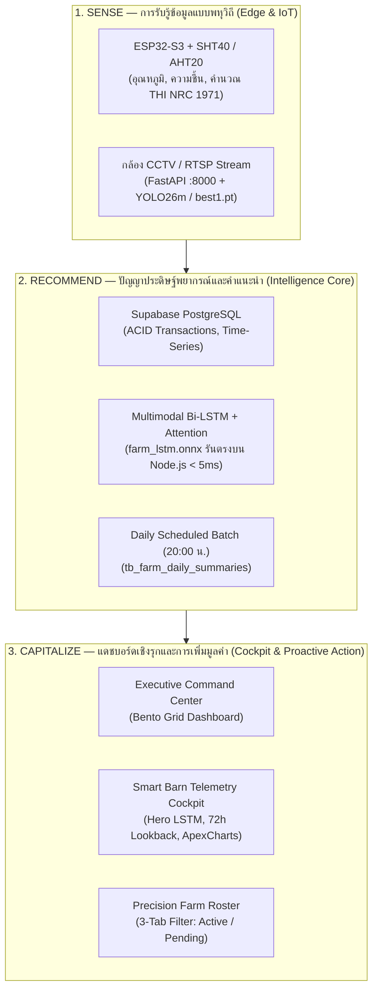
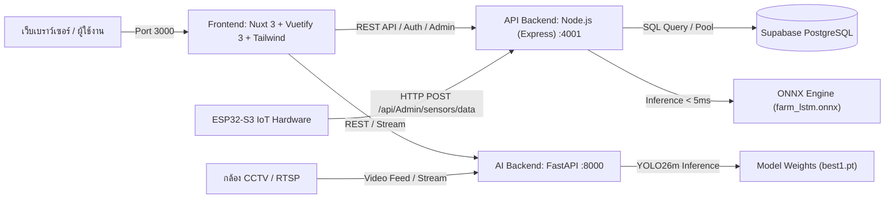

# PH Detection System — Precision Herd Heat Stress & Cow Behavior Intelligence
### (CowCare AI Initiative for Tropical Dairy Farms)

ระบบประเมิน ตรวจจับ และพยากรณ์ภาวะความเครียดจากความร้อน (**Heat Stress**) และพฤติกรรมโคนม ด้วยสถาปัตยกรรม **Multimodal Deep Learning & IoT Telemetry** (Computer Vision + IoT Microclimate + Bi-LSTM Temporal Attention + Daily Scheduled Batch) ออกแบบมาเพื่อยกระดับฟาร์มโคนมไทย (โดยเฉพาะเกษตรกรรายย่อย) เปลี่ยนรูปแบบการจัดการฟาร์มจาก **"ตั้งรับ (Reactive)" เป็น "เชิงรุก (Proactive Management)"** ป้องกันผลผลิตน้ำนมลดฮวบจากภาวะหน่วงทางชีวภาพ (Biological Lag Effect 5 วัน) และส่งเสริมมาตรฐานฟาร์มคาร์บอนต่ำ (ESG)

[](https://github.com/)
[](https://nuxt.com/)
[](https://fastapi.tiangolo.com/)
[](https://expressjs.com/)
[](https://onnxruntime.ai/)
[](https://supabase.com/)
[](https://ultralytics.com/)
[](https://www.docker.com/)

---

## 📌 สารบัญ (Table of Contents)

1. [ภาพรวมโครงการ (Project Overview)](#-ภาพรวมโครงการ-project-overview)
2. [สถาปัตยกรรมระบบ 3 ชั้น (3-Layer Architecture)](#-สถาปัตยกรรมระบบ-3-ชั้น-3-layer-architecture)
3. [สถาปัตยกรรมซอฟต์แวร์ (Microservices Ecosystem)](#-สถาปัตยกรรมซอฟต์แวร์-microservices-ecosystem)
4. [ระบบ AI & Multimodal Bi-LSTM Predictive Brain](#-ระบบ-ai--multimodal-bi-lstm-predictive-brain)
5. [ฟีเจอร์เด่นของระบบ (Core Features & Cockpit Modules)](#-ฟีเจอร์เด่นของระบบ-core-features--cockpit-modules)
6. [เทคโนโลยีที่ใช้ (Tech Stack)](#-เทคโนโลยีที่ใช้-tech-stack)
7. [โครงสร้างโปรเจกต์ (Project Structure)](#-โครงสร้างโปรเจกต์-project-structure)
8. [การติดตั้งและการรันระบบ (Getting Started)](#-การติดตั้งและการรันระบบ-getting-started)
9. [คู่มือ API Endpoints](#-คู่มือ-api-endpoints)
10. [เกณฑ์ประเมินความเครียดความร้อนโคนมไทย (Thai Tropical Calibration Matrix)](#-เกณฑ์ประเมินความเครียดความร้อนโคนมไทย-thai-tropical-calibration-matrix)
11. [แผนการพัฒนาระบบ (Roadmap)](#-แผนการพัฒนาระบบ-roadmap)
12. [งานวิจัยอ้างอิง (Academic References)](#-งานวิจัยอ้างอิง-academic-references)

---

## 🎯 ภาพรวมโครงการ (Project Overview)

อิงจากงานวิจัยชีววิทยาโคนมเขตร้อนชื้นระดับสากลและในประเทศไทย (ปี 2019–2026) พบว่าโคนมตอบสนองต่อความร้อนสะสมด้วย **"ความหน่วงทางชีวภาพ (Biological Lag Effect)"** โดยผลผลิตน้ำนมมักจะดิ่งลงต่ำสุดใน **5 วัน** หลังจากสัมผัสความร้อนจัด (Hasan et al., 2026; Abdourhamane, 2026) นอกจากนี้ หากค่า THI ในช่วงเวลากลางคืน (00:00–06:00 น.) ไม่ลดลงต่ำกว่าเกณฑ์ แม่โคจะไม่สามารถคายความร้อนสะสมได้ (Night Recovery Failure - Mylostyvyi, 2026)

| หัวข้อ | รายละเอียดเชิงวิชาการและบริบทจริง |
|---|---|
| **ปัญหาหลัก** | โคนมลูกผสมไทยต้องเผชิญกับ **THI ≥ 76 สูงถึง 250 วันต่อปี** ซึ่งเป็นจุดวิกฤตที่ทำให้ผลผลิตน้ำนมเริ่มลดลงเฉลี่ย **0.45 กก./THI unit**, อัตราผสมติดดิ่งลง, เสี่ยงเกิดภาวะ Subclinical Rumen Acidosis (FPR < 1.2) และทำให้วัวปล่อยก๊าซมีเทนต่อกิโลกรัมนม (**Methane Intensity**) สูงขึ้นถึง **17.5%** นอกจากนี้ ฟาร์มรายย่อยกว่า 80% มีข้อจำกัดเรื่องโรงเรือนเตี้ย (เฉลี่ย 2.7 ม.) และใช้หลังคาสังกะสีสะสมความร้อน (Tikul & Prachum, 2019) |
| **กลุ่มเป้าหมาย** | เกษตรกรผู้เลี้ยงโคนมรายย่อยในไทย ซึ่งส่วนใหญ่เป็นผู้สูงวัย ไม่มีเงินทุนติดตั้งอุปกรณ์สวมใส่ราคาแพง (Wearable Sensors / Ruminal Bolus) ก่อให้เกิดภาวะ **Digital Divide** และไม่สะดวกลงบันทึกตัวเลขน้ำนมดิบรายวัน |
| **แนวทางแก้ไข** | พัฒนาระบบเฝ้าระวังแบบไม่สัมผัสตัวสัตว์ (**Non-invasive Multimodal Sensing**) ด้วยกล้อง CCTV + Edge YOLO + IoT เซ็นเซอร์อุตสาหกรรม เชื่อมต่อกับ **Multimodal Bi-LSTM ONNX Engine** (Latency < 5ms) รันสรุปผลอัตโนมัติวันละ 1 ครั้ง (20:00 น.) และคำนวณ **Zero-Input Milk Loss Proxy** โดยไม่ต้องรบกวนให้เกษตรกรกรอกข้อมูลน้ำนมดิบ |

---

## 🏗️ สถาปัตยกรรมระบบ 3 ชั้น (3-Layer Architecture)

ออกแบบด้วยแนวคิด **Edge-to-Cloud Precision Livestock Farming (PLF)**:



1. **Sense (การรับรู้ข้อมูล):**
   - **Environmental IoT:** ESP32-S3 + เซ็นเซอร์ **SHT40 / AHT20** ส่งสัญญาณผ่าน HTTP POST เข้ามาที่ `/api/Admin/sensors/data` คำนวณค่า **THI (NRC 1971)** สดตามจริง (ไม่บวกค่าชดเชยโรงเรือนทับลงในค่าสด)
   - **Edge Vision AI:** กล้องวงจรปิดตรวจจับพฤติกรรมโคนมด้วยโมเดล **YOLO26m** (`best1.pt`: ยืน, นอน, กินน้ำ, กินอาหาร, หายใจหอบ) แปลงเป็นสัดส่วนการยืน (`standing_ratio`) และอัตราการหอบ (`panting_rate`)
2. **Recommend (การประมวลผลและการพยากรณ์):**
   - **Multimodal Bi-LSTM with Temporal Attention:** วิเคราะห์ Time-Series 72 ชม. ย้อนหลัง ผสานกับพฤติกรรมสัตว์และคุณลักษณะโรงเรือน พยากรณ์ THI และความเสี่ยงน้ำนมลดล่วงหน้า 3 วัน
   - **Daily Scheduled Batch Job (20:00 น. ทุกวัน):** รันอัตโนมัติด้วย `node-cron` บันทึกค่าสถิติประจำวัน, ค่าเปรียบเทียบเมื่อวาน, ดัชนี Night Recovery และผลพยากรณ์ลงตาราง `tb_farm_daily_summaries`
   - **Context-Aware Seasonal Advisory:** ปรับคำแนะนำตามฤดูกาล (เช่น ฤดูฝนชื้นจัด $\ge 75\%$ แนะนำเปิดพัดลมแรงสุดแต่งดเปิดระบบพ่นหมอก เพื่อป้องกันเต้านมอักเสบ)
3. **Capitalize (การสร้างคุณค่าและบริหารจัดการ):**
   - แดชบอร์ด Nuxt 3 แสดงผลค่าเฝ้าระวังแบบ Bento Grid พร้อม Data Gap Alert ตรวจจับสัญญาณหลุด
   - Digital Audit Log รองรับการขอมาตรฐานฟาร์มคาร์บอนต่ำ (ESG) และการประเมินสินเชื่อสีเขียว

---

## 🧩 สถาปัตยกรรมซอฟต์แวร์ (Microservices Ecosystem)



| Service | Container Name | Port | เทคโนโลยีหลัก | หน้าที่สำคัญ |
|---|---|---|---|---|
| **Frontend** | `cow_detect_frontend` | `3000` | Nuxt 3, Vue 3, Tailwind CSS, Vuetify 3, ApexCharts | เว็บแอปพลิเคชันระบบ Admin Command Center, Cockpit เฝ้าระวังฟาร์ม, และ Farm Roster |
| **API Backend** | `cow_detect_node` | `4001` | Node.js (LTS), Express 5, onnxruntime-node, node-cron, pg | Business Logic, Telemetry Ingestion, Daily Batch 20:00 น., ONNX Inference, ACID Transactions |
| **AI Backend** | `cow_detect_backend` | `8000` | FastAPI, Uvicorn, Ultralytics YOLO26m, OpenCV | AI Inference สำหรับวิเคราะห์พฤติกรรมโคนมจากภาพนิ่ง และ Live Video MJPEG Stream |
| **Database** | *Cloud Managed* | `5432/6543` | PostgreSQL (Supabase) + PgBouncer | จัดเก็บตารางผู้ใช้ (`tb_users`), ฟาร์ม (`tb_farms`), อุปกรณ์ (`tb_devices`), เซนเซอร์ (`tb_sensor_readings`), สรุปรายวัน (`tb_farm_daily_summaries`) |

---

## 🧠 ระบบ AI & Multimodal Bi-LSTM Predictive Brain

ระบบขับเคลื่อนด้วยโมเดล **True Deep Learning** ประสิทธิภาพสูง:

### 1. สถาปัตยกรรมโมเดล ([`backend/ml_lstm/model.py`](file:///Users/phattaradanai/Desktop/testYOLO26/backend/ml_lstm/model.py))
- **Temporal Input (`x_temporal`):** Shape `[batch, 72, 10]` อนุกรมเวลาย้อนหลัง 72 ชม. (3 วัน) ครอบคลุม:
  `temperature_c`, `humidity_pct`, `thi`, `thi_rate_of_change`, `accumulated_heat_hours`, `night_recovery_thi`, `hour_sin`, `hour_cos`, `standing_ratio`, `panting_rate`
- **Static Input (`x_static`):** Shape `[batch, 3]` คุณลักษณะโรงเรือน:
  `barn_height_m`, `roof_type_id`, `cooling_type_id`
- **เครือข่ายประสาท:** Bi-LSTM (2 Layers, 128 Hidden) + Temporal Attention Mechanism + Static Dense Fusion
- **Multi-Output Heads:**
  1. `predicted_thi` `[batch, 3]`: พยากรณ์ค่า THI ล่วงหน้า 3 วัน (Day +1, +2, +3)
  2. `predicted_milk_loss` `[batch, 3]`: คำนวณความเสี่ยงน้ำนมลดเชิงทฤษฎี (กก./ตัว/วัน)
  3. `risk_logits` `[batch, 3, 4]`: จำแนกระดับความเสี่ยง 4 ระดับตามเกณฑ์ไทย
  4. `attention_weights` `[batch, 72, 1]`: ระบุน้ำหนักชั่วโมงวิกฤตของวัน

### 2. กลไก Progressive Warm-up Engine
แก้ปัญหา Cold-start สำหรับฟาร์มที่เพิ่งติดตั้งเซ็นเซอร์:
- **ข้อมูล < 24 ชั่วโมง:** ใช้ Heuristic Fallback อิงค่าเฉลี่ยเซ็นเซอร์สด
- **ข้อมูล 24–71 ชั่วโมง:** ใช้ Diurnal Padding จำลองวงจรความร้อนรายวันจนครบ 72 ชม.
- **ข้อมูล ≥ 72 ชั่วโมง:** รัน Full Multimodal ONNX Bi-LSTM เต็มประสิทธิภาพ

### 3. ประสิทธิภาพการรันบน Production
- ไฟล์น้ำหนัก: [`backend/app/weights/farm_lstm.onnx`](file:///Users/phattaradanai/Desktop/testYOLO26/backend/app/weights/farm_lstm.onnx) (ขนาดเพียง **124 KB**)
- รันด้วย `onnxruntime-node` ภายใน Node.js Backend **ความเร็วเฉลี่ย 4.2 ms ต่อการพยากรณ์** กินหน่วยความจำน้อยกว่า 15 MB

---

## 🌟 ฟีเจอร์เด่นของระบบ (Core Features & Cockpit Modules)

### 1. 🎛️ Executive Agritech Command Center (`/Admin`)
- **Bento Grid Dashboard:** รวมศูนย์ข้อมูลการดำเนินงานระดับเครือข่าย คำนวณค่าจริงจากฐานข้อมูล Supabase แบบ Real-time
- **4 Bento KPI Cards:** ฟาร์มทั้งหมด, อัตราออนไลน์ของฮาร์ดแวร์ IoT %, THI เฉลี่ยเครือข่าย, และรายการแจ้งเตือนความร้อนที่ต้องติดตาม
- **Interactive Network Charts:** กราฟ THI เครือข่ายเทียบกับค่าพยากรณ์ และ Donut Chart สัดส่วนระดับความเสี่ยง 4 ระดับ

### 2. 📊 Smart Barn Telemetry Cockpit (`/Admin/farm_detail-[id]`)
- **Data Gap Alert Banner:** แบนเนอร์สีส้มแจ้งเตือนทันทีเมื่อกล่อง IoT ไม่ส่งสัญญาณเกิน 10 นาที พร้อมระบุระยะเวลาที่สัญญาณขาดหายอย่างแม่นยำ
- **Hero Telemetry Bento (12 คอลัมน์):** ค่า THI ขนาดใหญ่, แถบสถานะความเสี่ยงตามเกณฑ์ไทย, และคำแนะนำฉุกเฉิน
- **AI LSTM Predictive Brain Section:**
  - 3 Bento Cards พยากรณ์ล่วงหน้า 3 วัน (Day +1, +2, +3)
  - แถบ **ความเสี่ยงน้ำนมลดคาดการณ์ (กก./ตัว/วัน)** ตามหลัก Biological Lag Effect 5 วัน
  - แผนจัดการเชิงรุก (Proactive Strategy) ระบุเวลาเปิดพัดลมพ่นหมอกล่วงหน้า
  - ป้ายแสดงสถานะ **สรุปผลรายวัน (Batch 20:00 น.)**, ค่าเปรียบเทียบเมื่อวาน, ค่า Night Recovery และปุ่ม **"รันสรุปประจำวัน (Daily Job)"**
- **Interactive Telemetry ApexCharts:** กราฟความละเอียดสูงพร้อมระบบตัดข้อมูลส่วนที่ขาดหาย ไม่พล็อตกราฟหลอก
- **Real-Time Lightweight Polling:** Polling ทุก 8 วินาทีผ่าน `/api/Admin/farms/:id/latest` (แพ็กเก็ตเพียง ~200 bytes) ลดภาระระบบกว่า 95%

### 3. 📋 Precision Agritech Bento Farm Roster (`/Admin/farms`)
- **3-Tab Quick Filter:**
  - **ฟาร์มทั้งหมด (All):** แสดงทุกฟาร์มในระบบ
  - **ออนไลน์ / รับส่งข้อมูลปกติ (Active):** แสดงเฉพาะฟาร์มที่เซ็นเซอร์ส่งข้อมูลสม่ำเสมอ (< 10 นาที)
  - **รอเชื่อมต่อ / อุปกรณ์ขัดข้อง (Pending):** แยกฟาร์มที่ยังไม่ได้ติดตั้งอุปกรณ์ หรืออุปกรณ์ออฟไลน์ออกมาต่างหาก
- **Dual View & Sub-Barn Grouping:** สลับมุมมอง Table View และ Bento Grid View รองรับการแสดงผลฟาร์มที่มีหลายโรงเรือนย่อย (`barn_unit`) และหลายอุปกรณ์โดยไม่มีการ์ดซ้ำซ้อน
- **Interactive THI Filter Strip:** กรองด่วน 4 สถานะ: ทั้งหมด, ปกติ (<76), เฝ้าระวัง (76–83.9), วิกฤต (≥84)

### 4. 👥 Glassmorphic User Management (`/Admin/users`)
- ระบบจัดการสมาชิกและสิทธิ์การใช้งาน (`admin`, `expert`, `farmer`)
- แท็บตัวกรองทรงแคปซูล ค้นหาข้อมูลสมาชิกแบบเรียลไทม์ และระบบ Audit ป้องกันข้อผิดพลาด

---

## 💻 เทคโนโลยีที่ใช้ (Tech Stack)

```text
Frontend:               Nuxt 3, Vue 3 (Composition API, <script setup>), Tailwind CSS, Vuetify 3
Data Visualization:     ApexCharts (vue3-apexcharts)
State & Utilities:      VueUse, Axios
Deep Learning Engine:   PyTorch (Model Training), ONNX Runtime (onnxruntime-node for Inference)
Vision AI Backend:      FastAPI, Uvicorn, Ultralytics YOLO26m, OpenCV Headless
Core API Backend:       Node.js (LTS), Express 5, node-cron, JWT, bcrypt, pg (PostgreSQL)
Database Engine:        Supabase PostgreSQL, Connection Pooling (PgBouncer)
Hardware Telemetry:     ESP32-S3 Microcontroller, SHT40 / AHT20 Temperature & Humidity Sensors
DevOps & Container:     Docker, Docker Compose
```

---

## 📂 โครงสร้างโปรเจกต์ (Project Structure)

```text
testYOLO26/
├── docker-compose.yml              # นิยาม Service: Frontend, Node Backend, FastAPI Backend
├── PROJECT_OVERVIEW.md             # รายงานภาพรวมระบบฉบับสมบูรณ์ (v2.5.0)
├── README.md                       # เอกสารแนะนำโครงการฉบับสมบูรณ์
│
├── backend/                        # 🐍 AI Backend (FastAPI + YOLO + PyTorch LSTM)
│   ├── app/
│   │   ├── api/                    # Endpoint ตรวจจับภาพและสตรีมวิดีโอ (detect.py, test_cam.py)
│   │   ├── weights/                # ไฟล์น้ำหนักโมเดล (best1.pt, farm_lstm.onnx 124 KB)
│   │   └── main.py                 # FastAPI Application Entrypoint (:8000)
│   ├── ml_lstm/                    # 🧠 True Deep Learning Training Pipeline
│   │   ├── model.py                # PyTorch FarmMultimodalBiLSTM Architecture
│   │   └── synthetic_pretrain.py   # สคริปต์เทรนและส่งออก farm_lstm.onnx
│   └── requirements.txt
│
├── backend_node/                   # 🟩 Core API Backend (Node.js + Express + ONNX)
│   ├── app/
│   │   ├── config/db.js            # PostgreSQL Pool Connection (Supabase)
│   │   ├── services/
│   │   │   ├── lstmOnnxService.js  # ONNX Inference Service, 72h Lookback, Seasonal Advisory
│   │   │   └── dailyLstmScheduler.js # Daily Scheduled Batch Job (20:00 น. node-cron)
│   │   └── routes/Admin/
│   │       ├── farms.js            # /api/Admin/farms (CRUD, Transaction, Telemetry, Daily Job API)
│   │       ├── sensors.js          # /api/Admin/sensors (Telemetry Ingestion NRC 1971)
│   │       └── users.js            # /api/Admin/users (User Management)
│   ├── server.js                   # Express Server Entrypoint (:4001)
│   └── package.json                # รวม onnxruntime-node, node-cron
│
└── frontend/                       # 🟢 Frontend (Nuxt 3 + Vuetify + Tailwind)
    ├── app/
    │   ├── pages/Admin/
    │   │   ├── index.vue           # Executive Command Center
    │   │   ├── farms.vue           # Precision Farm Roster (Active/Pending Tabs)
    │   │   └── farm_detail-[id].vue # Smart Barn Telemetry Cockpit (Hero LSTM 72h)
    │   └── components/Admin/farm/  # AddFarmModal.vue, EditFarmModal.vue
    └── nuxt.config.ts
```

---

## 🚀 การติดตั้งและการรันระบบ (Getting Started)

### 1. ตั้งค่า Environment Variables
สร้างไฟล์ `.env` ที่ root directory ของโครงการ:

```env
# Database & Supabase (PostgreSQL)
SUPABASE_URL=https://<your-project>.supabase.co
SUPABASE_KEY=<your-supabase-key>
DATABASE_URL=postgresql://postgres:<password>@<host>:6543/postgres?pgbouncer=true

# Security
SECRET_KEY=YourSuperSecretKeyCowCareAI2026

# Ports
PORT_NODE=4001
PORT_AI=8000
PORT_FRONTEND=3000
```

### 2. การรันระบบ

#### วิธีที่ 1: รันผ่าน Docker Compose (แนะนำสำหรับ Production/Staging)
```bash
docker compose up --build -d
```

#### วิธีที่ 2: รันแบบ Local Development
```bash
# 1. รัน Node.js Core Backend (Terminal 1)
cd backend_node
npm install
npm run dev

# 2. รัน FastAPI AI Backend (Terminal 2)
cd backend
source venv/bin/activate
uvicorn app.main:app --host 0.0.0.0 --port 8000 --reload

# 3. รัน Nuxt 3 Frontend (Terminal 3)
cd frontend
npm install
npm run dev
```

| บริการ / หน้าจอ | URL สำหรับเข้าใช้งาน |
|---|---|
| **Frontend Web Portal** | [http://localhost:3000](http://localhost:3000) |
| **Admin Command Center** | [http://localhost:3000/Admin](http://localhost:3000/Admin) |
| **FastAPI Swagger Docs** | [http://localhost:8000/docs](http://localhost:8000/docs) |
| **Node.js API Health** | [http://localhost:4001](http://localhost:4001) |

---

## 📡 คู่มือ API Endpoints ที่สำคัญ

### 1. IoT Telemetry Ingestion (`POST /api/Admin/sensors/data`)
รับข้อมูลสภาพแวดล้อมจาก ESP32-S3 คำนวณ THI (NRC 1971) และอัปเดตสถานะออนไลน์ทันที:
```json
{
  "serial_no": "ESP32-S3-01",
  "temperature_c": 30.2,
  "humidity_pct": 72.5,
  "pressure_hpa": 1010.5
}
```

### 2. Lightweight Real-time Polling (`GET /api/Admin/farms/:id/latest`)
ดึงเฉพาะข้อมูลเซ็นเซอร์ล่าสุด ขนาดเพียง ~200 bytes สำหรับ Real-time Dashboard Polling ทุก 8 วินาที

### 3. Daily Scheduled Batch Job APIs
- `POST /api/Admin/farms/:id/run-daily-summary` — สั่งรันคำนวณและสรุปผลประจำวันเฉพาะฟาร์มนั้นด้วยตนเองทันที
- `POST /api/Admin/farms/run-all-daily-summaries` — สั่งรัน Batch สรุปผลพร้อมกันทุกฟาร์มในระบบ

---

## 🌡️ เกณฑ์ประเมินความเครียดความร้อนโคนมไทย (Thai Tropical Calibration Matrix)

คำนวณค่า **THI** ตามสูตรมาตรฐานสากล **NRC (1971)**:
$$\text{THI} = (1.8 \times T + 32) - (0.55 - 0.0055 \times \text{RH}) \times (1.8 \times T - 26)$$

| ช่วงค่า THI | ระดับความเสี่ยง | ผลกระทบต่อโคนมลูกผสมไทย | มาตรการปฏิบัติการเชิงรุก (Actionable Advisory) |
|---|---|---|---|
| **< 76.0**<br>*(หรือ $T < 27.5^\circ\text{C}$ & $\text{THI} < 77.5$ ไม่หอบ)* | **สภาวะปกติ (Comfort Zone)** | โคนมลูกผสมไทยสบายตัว การกินอาหารและการเคี้ยวเอื้องปกติ | ดูแลรักษาการระบายอากาศและน้ำดื่มตามวงรอบปกติ |
| **76.0 – 79.9** | **เริ่มเฝ้าระวัง (Mild Stress)** | **Threshold Onset:** เริ่มมีความร้อนสะสม แม่โคยืนนานขึ้น เริ่มเสี่ยงน้ำนมลดลง | เปิดพัดลมระบายอากาศในโรงเรือนเพื่อเร่งการระบายความร้อน |
| **80.0 – 83.9** | **เริ่มกระทบผลผลิต (Moderate Stress)** | การเคี้ยวเอื้องลดลง การหายใจเร็วขึ้น น้ำนมเริ่มลดชัดเจน | **ฤดูร้อน:** เปิดพัดลมเต็มกำลัง + เปิดระบบพ่นหมอก<br>**ฤดูฝน ($RH \ge 75\%$):** เปิดพัดลมเต็มกำลัง **งดเปิดระบบพ่นหมอก** ป้องกันคอกแฉะและเต้านมอักเสบ |
| **≥ 84.0** | **วิกฤตรุนแรง (Severe Heat Stress)** | แม่โคหอบรุนแรง น้ำนมลดฮวบ อัตราผสมติดต่ำ เสี่ยงล้มป่วย | ดำเนินการลดความร้อนฉุกเฉิน เสริมสารบัฟเฟอร์ในอาหาร TMR เลื่อนการผสมเทียม |

---

## 🗺️ แผนการพัฒนาระบบ (Roadmap)

- [x] **YOLO26m Edge Vision:** ตรวจจับพฤติกรรมโคนม (ยืน, นอน, หอบ, กินอาหาร, กินน้ำ)
- [x] **Microservices Architecture:** แยกบริการ Frontend, Node Backend, FastAPI Backend ด้วย Docker Compose
- [x] **Telemetry Ingestion Pipeline:** รับข้อมูลเซ็นเซอร์จาก ESP32-S3 พร้อมคำนวณ THI อัตโนมัติ (NRC 1971)
- [x] **Database ACID Transactions:** ระบบเพิ่ม/ลบฟาร์มปลอดภัย 100% ไม่มีข้อมูลตกค้าง และไม่มีการแทรก Mock Data
- [x] **Executive Agritech Command Center (`/Admin`):** แดชบอร์ดภาพรวมเครือข่ายฟาร์ม
- [x] **Smart Barn Telemetry Cockpit (`/Admin/farm_detail-[id]`):** แดชบอร์ดรายฟาร์มพร้อม Data Gap Alert Banner
- [x] **Precision Agritech Bento Farm Roster (`/Admin/farms`):** ระบบจัดการฟาร์มแยกแท็บ Active / Pending และจัดกลุ่มโรงเรือนย่อย
- [x] **Multimodal Bi-LSTM with Temporal Attention:** โมเดล True Deep Learning (PyTorch $\rightarrow$ ONNX ขนาด 124 KB) พยากรณ์ล่วงหน้า 72 ชม.
- [x] **Zero-Input Milk Loss Proxy:** โมเดลประเมินความเสี่ยงน้ำนมลดเชิงทฤษฎีตามหลัก Biological Lag Effect 5 วัน
- [x] **Daily Scheduled Batch Job (20:00 น.):** รันสรุปผลอัตโนมัติวันละ 1 ครั้งพร้อมตัวชี้วัด Thai Night Recovery (< 74.0)
- [x] **Thai Tropical Context Calibration (v2.5):** ปรับเกณฑ์ความสบายและคำแนะนำแยกฤดูฝน/ฤดูร้อนตามงานวิจัย ม.แม่โจ้
- [ ] **Context-Aware LINE Messaging Bot:** บอทแจ้งเตือนอัตโนมัติส่งตรงถึงสมาร์ตโฟนเกษตรกรผ่าน LINE Messaging API
- [ ] **Methane Intensity & Green Loan Scoring API:** เชื่อมโยงดัชนีการลดก๊าซมีเทนสำหรับสินเชื่อคาร์บอนต่ำ

---

## 📚 งานวิจัยอ้างอิง (Academic References)

1. Boonkum, W., Teawyoneyong, W., Chankitisakul, V., Duangjinda, M., & Buaban, S. (2024). **Impact of Heat Stress on Milk Yield, Milk Fat-to-Protein Ratio, and Conception Rate in Thai–Holstein Dairy Cattle: A Phenotypic and Genetic Perspective.** *Animals*, 14(20), 3026.
2. Sungkhapreecha, P., Chankitisakul, V., Duangjinda, M., Buaban, S., & Boonkum, W. (2022). **Determining Heat Stress Effects of Multiple Genetic Traits in Tropical Dairy Cattle Using Single-Step Genomic BLUP.** *Veterinary Sciences*, 9(2), 66.
3. วรรณลักษณ์ ถาวร, อิทธิพล สักลอ, และ วิวัฒน์ พัฒนาวงศ์. (2566). **ผลของอุณหภูมิ ความชื้น และฤดูกาลต่อระดับคอร์ติซอลในโคนมสายพันธุ์โฮลสไตน์ฟรีเชียน.** *วารสารเกษตรนเรศวร*.
4. ณัชวิชญ์ ติกุล และ สุวิทย์ ประชุม. (2562). **ผลกระทบจากรูปแบบโรงเรือนและสภาพแวดล้อมต่อความสบายของโคในฟาร์มรายย่อยในจังหวัดเชียงใหม่.** *วารสารเกษตรพระวรุณ*.
5. Hasan, F. M., et al. (2026). **Impact of heat stress on cattle systems: Responses of production metrics to thermal stress.** *Computers and Electronics in Agriculture*.
6. Abdourhamane, I. M. (2026). **Deep Learning-Based Forecasting of Heat Stress Events and Daily Milk Yield Depreciation in Dairy Cattle Using Meteorological Data: An In-Silico Study.** *Acta Veterinaria-Beograd*, 76(2), 242-254.
7. Mylostyvyi, R. (2026). **Heat Stress in Dairy Cattle Production: A View from the Perspective of Sustainable Development.** *Sustainability*.
8. Mulajkar, R. M., et al. (2026). **Artificial Intelligence for Early Detection of Heat Stress and Environmental Hazards in Dairy Animals.** *Journal of Animal Environment*, 18(2s).
9. Onan-Martinez, D., et al. (2026). **Heat stress increases enteric methane emissions yield and intensity while impairing rumen function and productivity in lactating dairy cattle.** *Journal of Dairy Science*.
10. Papo, M. L., et al. (2026). **Integrating Precision Livestock Farming and Genomic Tools for Heat Stress Mitigation in South African Dairy Cattle.** *Animals*.

---

*พัฒนาและดูแลโดยทีมวิจัยและพัฒนา PH Detection System (CowCare AI)*
