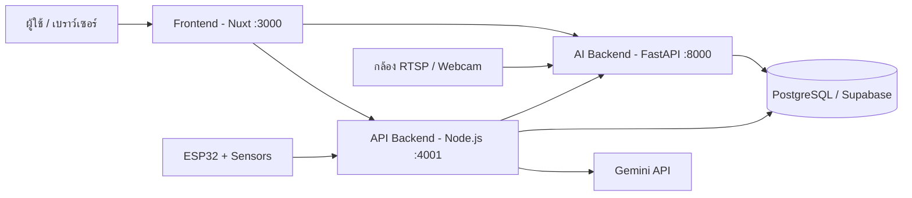

# PH Detection System — Heat Stress Intelligence for Dairy Farms

ระบบประเมินและแจ้งเตือนภาวะเครียดจากความร้อน (**Heat Stress**) ในโคนม ด้วยสถาปัตยกรรม **Multimodal AI** (Computer Vision + IoT + Predictive Model) เพื่อช่วยเกษตรกรรายย่อยในประเทศไทย เปลี่ยนรูปแบบการจัดการจาก **"ตั้งรับ (Reactive)" เป็น "เชิงรุก (Proactive)"** ลดความสูญเสียทางเศรษฐกิจ และลดการปล่อยก๊าซเรือนกระจก (ESG)

**อยู่ระหว่างพัฒนา**

---

## ภาพรวมโครงการ (Project Overview)

อิงจากงานวิจัยระดับโลกและในประเทศ (ปี 2019-2026) พบว่าโคนมตอบสนองต่อความร้อนด้วย **"ความหน่วง (Lag effect)"** ผลผลิตน้ำนมมักจะดิ่งลงสูงสุดใน **5 วัน** หลังจากสัมผัสความร้อน นอกจากนี้ความชื้นสัมพัทธ์ใน **"ฤดูฝน"** ของไทยยังเป็นตัวแปรหลักที่ทำให้โคนมเกิด Heat stress รุนแรงที่สุด

| หัวข้อ | รายละเอียด |
|---|---|
| **ปัญหา** | ในสภาพอากาศร้อนชื้นของไทย โคนมลูกผสมต้องเผชิญกับ **THI ≥ 76 สูงถึง 250 วันต่อปี (67% ของปี)** ซึ่งเป็นจุดวิกฤตที่ทำให้ผลผลิตน้ำนมลดลง อัตราผสมติด (Conception Rate) ดิ่งลง และเสี่ยงเกิดภาวะกรดในกระเพาะหมัก (Subclinical Rumen Acidosis จาก FPR < 1.2) อีกทั้งยังทำให้วัวปล่อยก๊าซมีเทนต่อกิโลกรัมนม (Methane Intensity) สูงขึ้น 17.5% นอกจากนี้ ฟาร์มรายย่อยกว่า 80% มีข้อจำกัดเรื่องโรงเรือนต่ำและใช้หลังคาสังกะสี |
| **กลุ่มเป้าหมาย** | เกษตรกรผู้เลี้ยงโคนมรายย่อยในไทย ซึ่งกว่า 70% เป็นผู้สูงวัยและมักไม่มีทุนซื้ออุปกรณ์สวมใส่ราคาแพง (Digital Divide) |
| **เป้าหมาย** | สร้างระบบตรวจจับแบบไม่สัมผัสตัวสัตว์ (Non-invasive) ด้วย Computer Vision + IoT (SHT40 ผ่าน RS485) ราคาประหยัด พร้อมโมเดล **LSTM** พยากรณ์ล่วงหน้า 3-7 วัน (Lookback 14 วัน) อิงเกณฑ์วิกฤตโคนมไทย (THI 76, 80, 84) เพื่อการจัดการเชิงรุก |

---

## สถาปัตยกรรมระบบ 3 ชั้น (3-Layer Architecture)

ออกแบบด้วยแนวคิด **Edge-to-Cloud** ตามหลัก Precision Livestock Farming (PLF)

### 1. Sense — การรับรู้ข้อมูลแบบพหุวิถี
- **Environmental IoT:** ESP32-S3 (N16R8) + **SHT40** (เซนเซอร์วัดอุณหภูมิ/ความชื้นความแม่นยำสูง) เชื่อมต่อส่งสัญญาณผ่าน **RS485** พร้อมระบบจ่ายไฟ **Adapter 12V 2A** ร่วมกับ **Step-down to 5V** เพื่อคำนวณค่า **THI** อย่างแม่นยำและเสถียรในสภาพแวดล้อมฟาร์ม
- **Edge Vision AI:** ใช้กล้องวงจรปิด / Webcam รันโมเดล **YOLOv8** บนอุปกรณ์ปลายทางเพื่อตรวจจับพฤติกรรม (ยืนนานผิดปกติ, นอนน้อยลง, หอบ) ซึ่งเป็นตัวชี้วัดความเครียดทางกายภาพ

### 2. Recommend — การวิเคราะห์เชิงทำนาย (Predictive Analytics)
- **Deep Learning (LSTM):** โมเดลจดจำข้อมูลอนุกรมเวลา (Time-series) เพื่อวิเคราะห์ความร้อนสะสมย้อนหลัง 14 วัน และพยากรณ์ค่า THI/ปริมาณน้ำนมล่วงหน้า 3-7 วัน
- **Context-aware GenAI (Gemini):** แปลงข้อมูลทางสถิติให้เป็น "คำแนะนำภาษาไทยที่ทำตามได้จริง" (Actionable insights) ตามบริบทของฟาร์ม
- **Proactive Alerts:** แจ้งเตือนเกษตรกรล่วงหน้าผ่าน LINE Messaging API

### 3. Capitalize — การสร้างสินทรัพย์จากข้อมูล
- **Digital Logbook:** จัดเก็บประวัติ THI และพฤติกรรม Time-series บน PostgreSQL (TimescaleDB)
- **ESG & Financial Inclusion:** ใช้ข้อมูลเป็นหลักฐานขอสินเชื่อฟาร์มยั่งยืน หรือเคลมประกันภัยอิงสภาพอากาศ

---

## 🧩 สถาปัตยกรรมซอฟต์แวร์ (Microservices)



| Service | Container | Port | หน้าที่ |
|---|---|---|---|
| `frontend` | `cow_detect_frontend` | `3000` | Landing page + Dashboard (Nuxt + Vuetify) |
| `backend` | `cow_detect_backend` | `8000` | YOLO inference, Camera stream (FastAPI) |
| `backend_node` | `cow_detect_node` | `4001` | Business API, Auth, GenAI, Sensor data (Express) |

> [!NOTE]
> ทุก service อยู่บน Docker network `app-network` จึงเรียกหากันด้วยชื่อ service ได้ เช่น `backend_node` เรียก FastAPI ผ่าน `http://backend:8000`

---

## 💻 เทคโนโลยีที่ใช้ (Tech Stack)

| ส่วน | เทคโนโลยี |
|---|---|
| **Frontend** | Nuxt 4, Vue 3, Vuetify 4 (`vuetify-nuxt-module`), ApexCharts, VueUse, `@nuxtjs/supabase` |
| **AI Backend** | FastAPI, Uvicorn, Ultralytics YOLO, OpenCV (headless), SQLAlchemy, Pydantic Settings |
| **API Backend** | Node.js, Express 5, Supabase JS, JWT, bcrypt, `@google/generative-ai`, nodemon |
| **Database** | PostgreSQL (Supabase) + PgBouncer, TimescaleDB (แผนสำหรับ Time-series) |
| **AI / ML** | YOLO (custom `best.pt`), LSTM (Time-series), Gemini (GenAI) |
| **Hardware** | ESP32-S3 N16R8, SHT40 Sensor, RS485 Module, Step-down to 5V, Adapter 12V 2A, IP Camera / USB Webcam |
| **Infrastructure** | Docker & Docker Compose |

---

## 📂 โครงสร้างโปรเจกต์ (Project Structure)

```text
Cow_detect/
├── docker-compose.yml        # รวมทุก service
├── .env                      # ตัวแปรกลาง (ไม่ถูก commit)
├── .gitignore
│
├── backend/                  # 🐍 AI Backend (FastAPI)
│   ├── app/
│   │   ├── api/
│   │   │   ├── detect.py     # POST /api/detect/image
│   │   │   └── test_cam.py   # GET  /api/cam/stream
│   │   ├── core/             # Config / Middleware
│   │   ├── db/               # Database connection & models
│   │   ├── services/
│   │   │   └── yolo_service.py   # โหลดโมเดล YOLO (Singleton)
│   │   ├── weights/          # ไฟล์โมเดล *.pt (ไม่ถูก commit)
│   │   └── main.py           # FastAPI entry point
│   ├── train.py              # สคริปต์เทรนโมเดล
│   ├── requirements.txt
│   └── Dockerfile
│
├── backend_node/             # 🟩 API Backend (Express)
│   ├── app/
│   │   ├── config/
│   │   ├── controllers/
│   │   ├── middleware/
│   │   └── routes/
│   ├── server.js             # Express entry point
│   ├── package.json
│   └── Dockerfile
│
└── frontend/                 # 🟢 Frontend (Nuxt)
    ├── app/
    │   ├── app.vue
    │   ├── layouts/default.vue   # Header / Navbar / Mobile drawer
    │   ├── pages/index.vue       # Landing page (Home)
    │   ├── components/
    │   └── plugins/apexcharts.client.ts
    ├── public/
    │   ├── images/               # bg, logo
    │   └── fonts/                # ฟอนต์ภาษาไทย / อังกฤษ
    ├── nuxt.config.ts
    └── Dockerfile
```

---

## การติดตั้งและการรันระบบ (Getting Started)

### สิ่งที่ต้องมี
- Docker Desktop
- ไฟล์โมเดล YOLO (`best.pt`) วางไว้ที่ `backend/app/weights/best.pt`

### 1. ตั้งค่า Environment Variables

สร้างไฟล์ `.env` ที่ root, `backend/.env` และ `backend_node/.env`

```env
# .env (root) — ใช้โดย docker-compose
SUPABASE_URL=https://<your-project>.supabase.co
SUPABASE_KEY=<your-anon-key>
GEMINI_API_KEY=<your-gemini-key>
DATABASE_URL=postgresql://<user>:<password>@<host>:6543/postgres
```

> [!CAUTION]
> ห้าม commit ไฟล์ `.env` ขึ้น Git เด็ดขาด (มีใน `.gitignore` แล้ว) หากเผลอ push ไปแล้วให้ใช้ `git rm --cached .env` และเปลี่ยนคีย์ใหม่

### 2. รันทุก service ด้วย Docker Compose

```bash
docker compose up --build
```

| URL | รายละเอียด |
|---|---|
| http://localhost:3000 | Frontend |
| http://localhost:8000/docs | Swagger UI ของ FastAPI |
| http://localhost:4001 | Node.js API |

คำสั่งที่ใช้บ่อย:

```bash
docker compose restart frontend      # รีสตาร์ทหลังแก้ .env
docker compose logs -f backend       # ดู log ของ service
docker compose down                  # หยุดทั้งหมด
```

> [!TIP]
> Frontend และ Node ใช้ anonymous volume `/app/node_modules` หากเพิ่ม package ใหม่แล้วไม่เจอ ให้รัน `docker compose up --build -V` เพื่อสร้าง volume ใหม่

### 3. (ทางเลือก) รัน Backend แบบไม่ใช้ Docker

```bash
cd backend
python -m venv venv
source venv/bin/activate          # Windows: venv\Scripts\activate
pip install -r requirements.txt
uvicorn app.main:app --reload --port 8000
```

---

## 🔗 API Endpoints

### AI Backend — FastAPI (`:8000`)

| Method | Path | รายละเอียด | สถานะ |
|---|---|---|---|
| `GET` | `/` | ตรวจสอบสถานะ Server | ✅ |
| `POST` | `/api/detect/image` | อัปโหลดภาพ → YOLO → คืน Bounding Box, Confidence, Class (JSON) | ✅ |
| `GET` | `/api/cam/stream` | MJPEG Stream จาก Webcam/RTSP พร้อมตีกรอบพฤติกรรมแบบ Real-time | ✅ |

### API Backend — Node.js (`:4001`)

| Method | Path | รายละเอียด | สถานะ |
|---|---|---|---|
| `GET` | `/` | ทดสอบการเชื่อมต่อ (`Connect node success!`) | ✅ |
| `POST` | `/api/sensors/data` | รับค่าอุณหภูมิและความชื้น (SHT40) จาก ESP32 ผ่าน RS485 | 🚧 |
| `POST` | `/api/auth/*` | สมัครสมาชิก / เข้าสู่ระบบ (JWT) | 🚧 |

---

## 🗺 Roadmap

- [x] Train custom YOLO model สำหรับพฤติกรรมโคนม
- [x] FastAPI รองรับ Image detection และ Video streaming
- [x] ตั้งค่า Microservices ด้วย Docker Compose (FastAPI + Node.js + Nuxt)
- [x] Landing page (Nuxt + Vuetify) พร้อม Smooth scroll และ Scroll reveal animation
- [ ] Endpoint รับข้อมูลจาก ESP32 (SHT40 Temperature & Humidity ผ่าน RS485)
- [ ] เชื่อมต่อ PostgreSQL / Supabase สำหรับ Digital Logbook
- [ ] ระบบ Auth (JWT) ฝั่ง Node.js
- [ ] โมเดล LSTM คาดการณ์แนวโน้มค่า THI ล่วงหน้า
- [ ] Dashboard แสดงผล Real-time สำหรับเกษตรกร
- [ ] GenAI (Gemini) สร้างคำแนะนำ + แจ้งเตือนผ่าน LINE Messaging API

**กำลังพัฒนา**

## 🌡️ เกณฑ์ประเมินความเครียดความร้อนโคนมไทย (Thai-Holstein Heat Stress Matrix)

อ้างอิงจากงานวิจัยประชากรโคนมไทยล่าสุด (Boonkum et al., 2024; Sungkhapreecha et al., 2022) โดยมหาวิทยาลัยขอนแก่นร่วมกับกรมปศุสัตว์ พบว่าโคนมลูกผสมไทยมีความทนทานต่อสภาพอากาศร้อนชื้นสูงกว่าโคนมเมืองหนาว โดยจุดวิกฤตที่เริ่มส่งผลกระทบต่อน้ำนมและสุขภาพคือ **THI = 76**:

| ช่วงค่า THI | ระดับความเสี่ยง | สถานะสรีรวิทยาและผลผลิต | มาตรการจัดการเชิงรุก (Action) |
|---|---|---|---|
| **< 76.0** | ปกติ (Comfort Zone) | โคนมลูกผสมไทยปรับตัวได้ดี สภาพแวดล้อมเหมาะสม | ตรวจสอบน้ำดื่มและความสะอาดโรงเรือนตามรอบปกติ |
| **76.0 – 79.9** | เริ่มมีผลกระทบ (Mild Stress) | **จุดวิกฤตเริ่มต้น (Onset)** น้ำนมเริ่มลด (-0.28 กก./THI) อัตราผสมติดเริ่มตก | เปิดพัดลมระบายอากาศ ตรวจสอบการไหลเวียนลมในคอก |
| **80.0 – 83.9** | เครียดปานกลาง (Moderate Stress) | อัตราสูญเสียน้ำนมสูงขึ้น 2 เท่า (BG3 ตก 0.22 กก./วัน) ค่า Somatic Cell Score พุ่ง เสี่ยงเต้านมอักเสบ | เปิดพัดลมร่วมกับระบบสเปรย์ละอองน้ำ เลี่ยงการผสมเทียมช่วงบ่าย |
| **≥ 84.0** | วิกฤตรุนแรง (Severe Heat Stress) | น้ำนมตกหนัก (-0.42 กก./THI) ตัวอ่อนฝ่อช่วง 16 วันแรก ค่า FPR < 1.2 เสี่ยงภาวะ Subclinical Rumen Acidosis | ลดความร้อนฉุกเฉิน เสริมสารบัฟเฟอร์ (Sodium Bicarbonate) ในอาหาร |

---

## 📚 อ้างอิง (References)

สถาปัตยกรรมและฟีเจอร์ของระบบ **CowCare AI / PH Detection System** ได้รับแรงบันดาลใจและพัฒนาต่อยอดจากงานวิจัยด้าน Precision Livestock Farming (PLF) และวิทยาศาสตร์โคนมระดับแนวหน้า (อัปเดตปี 2019-2026) ดังนี้:

1. Boonkum, W., Teawyoneyong, W., Chankitisakul, V., Duangjinda, M., & Buaban, S. (2024). **Impact of Heat Stress on Milk Yield, Milk Fat-to-Protein Ratio, and Conception Rate in Thai–Holstein Dairy Cattle: A Phenotypic and Genetic Perspective.** *Animals*, 14(20), 3026. *(งานวิจัยกำหนดจุดวิกฤต THI 76 สำหรับโคนมลูกผสมไทย และยืนยันผลกระทบต่ออัตราผสมติดและอัตราส่วนไขมันต่อโปรตีน)*
2. Sungkhapreecha, P., Chankitisakul, V., Duangjinda, M., Buaban, S., & Boonkum, W. (2022). **Determining Heat Stress Effects of Multiple Genetic Traits in Tropical Dairy Cattle Using Single-Step Genomic BLUP.** *Veterinary Sciences*, 9(2), 66. *(พบว่าโคนมไทยเผชิญ THI > 76 นานถึง 250 วัน/ปี และยืนยันการเพิ่มขึ้นของ Somatic Cell Score และความเสี่ยง Acidosis)*
3. วรรณลักษณ์ ถาวร, อิทธิพล สักลอ, และ วิวัฒน์ พัฒนาวงศ์. (2566). **ผลของอุณหภูมิ ความชื้น และฤดูกาลต่อระดับคอร์ติซอลในโคนมสายพันธุ์โฮลสไตน์ฟรีเชียน.** *วารสารเกษตรนเรศวร*. *(งานวิจัยยืนยันผลกระทบของความชื้นในฤดูฝนต่อภาวะเครียดในโคนมไทย)*
4. ณัชวิชญ์ ติกุล และ สุวิทย์ ประชุม. (2562). **ผลกระทบจากรูปแบบโรงเรือนและสภาพแวดล้อมต่อความสบายของโคในฟาร์มรายย่อยในจังหวัดเชียงใหม่.** *วารสารเกษตรพระวรุณ*. *(งานวิจัยวิเคราะห์ข้อจำกัดของโรงเรือนเกษตรกรรายย่อยไทย)*
5. Onan-Martinez, D., et al. (2026). **Heat stress increases enteric methane emissions yield and intensity while impairing rumen function and productivity in lactating dairy cattle.** *Journal of Dairy Science*. *(อ้างอิง Methane Intensity ที่เพิ่มขึ้น 17.5% เมื่อเกิด Heat Stress)*
6. Papo, M. L., et al. (2026). **Integrating Precision Livestock Farming and Genomic Tools for Heat Stress Mitigation in South African Dairy Cattle.** *Animals*. *(แนวทางลด Digital Divide ด้วย PLF ราคาประหยัดและ Computer Vision สำหรับฟาร์มรายย่อย)*
7. Mylostyvyi, R. (2026). **Heat Stress in Dairy Cattle Production: A View from the Perspective of Sustainable Development.** *Sustainability*. *(อ้างอิง Biological Memory การส่งต่อความเครียดจากแม่สู่ลูกโค 35%)*
8. Hasan, F.M., et al. (2026). **Impact of heat stress on cattle systems: Responses of production metrics to thermal stress.** *Computers and Electronics in Agriculture*. *(การค้นพบ "Lag Effect" 5 วันที่ผลผลิตน้ำนมจะตกลงต่ำสุด)*
9. Mulajkar, R. M., et al. (2026). **Artificial Intelligence for Early Detection of Heat Stress and Environmental Hazards in Dairy Animals.** *Journal of Animal Environment*. *(การใช้ Edge AI และการรับรองความแม่นยำของโมเดล LSTM ในโคนม)*
10. Abdourhamane, I. M. (2026). **Deep Learning-Based Forecasting of Heat Stress Events and Daily Milk Yield Depreciation in Dairy Cattle Using Meteorological Data: An In-Silico Study.** *Acta Veterinaria-Beograd*. *(กรอบแนวคิด LSTM 14-day lookback และการเปลี่ยนการจัดการจาก Reactive สู่ Proactive)*

