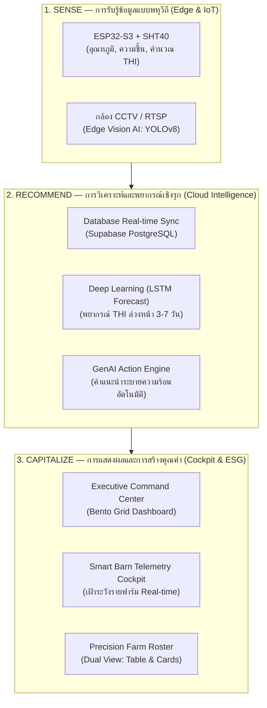
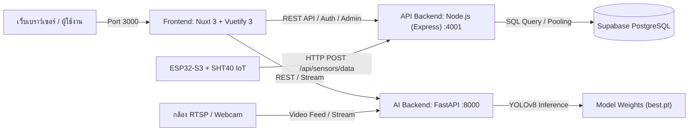

# CowCare AI — Heat Stress Intelligence for Dairy Farms

ระบบประเมินและแจ้งเตือนภาวะเครียดจากความร้อน (**Heat Stress**) ในโคนม ด้วยสถาปัตยกรรม **Multimodal AI** (Computer Vision + IoT Telemetry + Predictive Analytics) เพื่อช่วยเกษตรกรรายย่อยในประเทศไทย เปลี่ยนรูปแบบการจัดการฟาร์มจาก **"ตั้งรับ (Reactive)" เป็น "เชิงรุก (Proactive)"** ป้องกันผลผลิตน้ำนมตก ปัญหาระบบสืบพันธุ์ และลดการปล่อยก๊าซเรือนกระจก (ESG)

[](https://nuxt.com/)
[](https://fastapi.tiangolo.com/)
[](https://expressjs.com/)
[](https://supabase.com/)
[](https://ultralytics.com/)
[](https://www.docker.com/)

---

## 📌 สารบัญ (Table of Contents)

1. [ภาพรวมโครงการ (Project Overview)](#-ภาพรวมโครงการ-project-overview)
2. [สถาปัตยกรรมระบบ 3 ชั้น (3-Layer Architecture)](#-สถาปัตยกรรมระบบ-3-ชั้น-3-layer-architecture)
3. [สถาปัตยกรรมซอฟต์แวร์ (Microservices Ecosystem)](#-สถาปัตยกรรมซอฟต์แวร์-microservices-ecosystem)
4. [ฟีเจอร์เด่นของระบบ (Core Features & UI Modules)](#-ฟีเจอร์เด่นของระบบ-core-features--ui-modules)
5. [เทคโนโลยีที่ใช้ (Tech Stack)](#-เทคโนโลยีที่ใช้-tech-stack)
6. [โครงสร้างโปรเจกต์ (Project Structure)](#-โครงสร้างโปรเจกต์-project-structure)
7. [การติดตั้งและการรันระบบ (Getting Started)](#-การติดตั้งและการรันระบบ-getting-started)
8. [คู่มือ API Endpoints](#-คู่มือ-api-endpoints)
9. [เกณฑ์ประเมินความเครียดความร้อนโคนมไทย (Thai-Holstein Heat Stress Matrix)](#-เกณฑ์ประเมินความเครียดความร้อนโคนมไทย-thai-holstein-heat-stress-matrix)
10. [แผนการพัฒนาระบบ (Roadmap)](#-แผนการพัฒนาระบบ-roadmap)
11. [งานวิจัยอ้างอิง (Academic References)](#-งานวิจัยอ้างอิง-academic-references)

---

## 🎯 ภาพรวมโครงการ (Project Overview)

อิงจากงานวิจัยโคนมเขตร้อนชื้นล่าสุด (ปี 2019–2026) พบว่าโคนมตอบสนองต่อความร้อนสะสมด้วย **"ความหน่วง (Lag effect)"** โดยผลผลิตน้ำนมมักจะดิ่งลงต่ำสุดใน **5 วัน** หลังจากสัมผัสความร้อนจัด และความชื้นสัมพัทธ์ใน **"ฤดูฝน"** ของไทยยังเป็นตัวเร่งให้โคนมเกิด Heat Stress รุนแรงที่สุด

| หัวข้อ | รายละเอียดเชิงวิชาการและบริบทจริง |
|---|---|
| **ปัญหาหลัก** | โคนมลูกผสมไทยต้องเผชิญกับ **THI ≥ 76 สูงถึง 250 วันต่อปี (67% ของปี)** ซึ่งเป็นจุดวิกฤตที่ทำให้ผลผลิตน้ำนมลดลงเฉลี่ย **0.28–0.42 กก./THI unit**, อัตราผสมติดดิ่งลง, เสี่ยงเกิดภาวะ Subclinical Rumen Acidosis (FPR < 1.2) และทำให้วัวปล่อยก๊าซมีเทนต่อกิโลกรัมนม (**Methane Intensity**) สูงขึ้นถึง **17.5%** นอกจากนี้ ฟาร์มรายย่อยกว่า 80% มีข้อจำกัดเรื่องโรงเรือนเตี้ย (เฉลี่ย 2.7 ม.) และใช้หลังคาสังกะสีสะสมความร้อน |
| **กลุ่มเป้าหมาย** | เกษตรกรผู้เลี้ยงโคนมรายย่อยในไทย ซึ่งกว่า 70% เป็นผู้สูงวัยและไม่มีทุนติดตั้งอุปกรณ์สวมใส่ราคาแพง (Wearable Sensors / Ruminal Bolus) ก่อให้เกิดภาวะ **Digital Divide** |
| **แนวทางแก้ไข** | พัฒนาระบบเฝ้าระวังแบบไม่สัมผัสตัวสัตว์ (**Non-invasive Multimodal Sensing**) ด้วยกล้องวงจรปิด Computer Vision + IoT (SHT40 ผ่าน RS485/HTTP) ต้นทุนประหยัด เชื่อมต่อกับแดชบอร์ด **Executive Command Center** และโมเดลพยากรณ์ล่วงหน้า 3–7 วัน เพื่อการจัดการเชิงรุกก่อนที่ผลผลิตจะเสียหาย |

---

## 🏗️ สถาปัตยกรรมระบบ 3 ชั้น (3-Layer Architecture)

ออกแบบด้วยแนวคิด **Edge-to-Cloud Precision Livestock Farming (PLF)**:



1. **Sense (การรับรู้ข้อมูล):**
   - **Environmental IoT:** โมดูล ESP32-S3 + เซนเซอร์ **SHT40** ส่งสัญญาณผ่าน RS485 หรือ HTTP POST อัปเดตข้อมูลจุลภูมิอากาศ (Microclimate) คำนวณค่า **THI (Temperature-Humidity Index)** อัตโนมัติทุกรอบการอ่าน
   - **Edge Vision AI:** กล้องวงจรปิดตรวจจับพฤติกรรมโคนมด้วยโมเดล **YOLOv8** (ยืน, นอน, กินน้ำ, กินอาหาร, อาการหอบ) แบบ Non-invasive
2. **Recommend (การวิเคราะห์และแนะนำ):**
   - จัดเก็บข้อมูล Telemetry อนุกรมเวลาบน Supabase PostgreSQL
   - คำนวณระดับความเสี่ยง THI แบบเรียลไทม์ (Normal < 76, Mild 76–79.9, Moderate 80–83.9, Severe ≥ 84)
   - แนะนำการปฏิบัติการเชิงรุก (Actionable Advisory) ทันที เช่น การเปิดพัดลม พ่นละอองหมอก หรือเสริมสารบัฟเฟอร์ในอาหาร
3. **Capitalize (การสร้างคุณค่าและบริหารจัดการ):**
   - แดชบอร์ดระดับผู้บริหารและเกษตรกร พร้อมกราฟ Interactive ApexCharts
   - บันทึก Digital Audit Log สำหรับการขอมาตรฐานฟาร์มคาร์บอนต่ำ หรือการประเมินสินเชื่อ ESG

---

## 🧩 สถาปัตยกรรมซอฟต์แวร์ (Microservices Ecosystem)



| Service | Container Name | Port | เทคโนโลยีหลัก | หน้าที่สำคัญ |
|---|---|---|---|---|
| **Frontend** | `cow_detect_frontend` | `3000` | Nuxt 3, Vue 3, Tailwind CSS, Vuetify 3, ApexCharts | เว็บแอปพลิเคชันระบบ Admin Command Center, Cockpit เฝ้าระวังฟาร์ม, และ Farm Roster |
| **API Backend** | `cow_detect_node` | `4001` | Node.js, Express 5, JWT, bcrypt, pg (PostgreSQL) | Business Logic, ระบบ Authentication & Role-based Access, REST API สำหรับฟาร์มและเซนเซอร์ IoT |
| **AI Backend** | `cow_detect_backend` | `8000` | FastAPI, Uvicorn, Ultralytics YOLOv8, OpenCV | AI Inference สำหรับวิเคราะห์พฤติกรรมโคนมจากภาพนิ่ง และ Live Video MJPEG Stream |
| **Database** | *Cloud Managed* | `5432/6543` | PostgreSQL (Supabase) + PgBouncer | จัดเก็บตารางผู้ใช้ (`tb_users`), ฟาร์ม (`tb_farms`), อุปกรณ์ (`tb_devices`), และข้อมูลเซนเซอร์ (`tb_sensor_readings`) |

---

## 🌟 ฟีเจอร์เด่นของระบบ (Core Features & UI Modules)

### 1. 🎛️ Executive Agritech Command Center (`/Admin`)
- **Bento Grid Dashboard:** รวมศูนย์ข้อมูลการดำเนินงานระดับเครือข่าย คำนวณค่าจริงจากฐานข้อมูล Supabase แบบ Real-time
- **4 Bento KPI Cards:**
  - จำนวนฟาร์มทั้งหมดในเครือข่าย พร้อมอัตราการเติบโต
  - อัตราการออนไลน์ของกล่อง IoT (Hardware Online Rate %)
  - ค่า THI เฉลี่ยของเครือข่าย พร้อมไฟสถานะความเสี่ยง
  - รายการแจ้งเตือนความร้อนที่ต้องติดตาม (Active Thermal Alerts)
- **Analytics & AI Forecast Row:**
  - กราฟเปรียบเทียบค่า THI จริงกับค่าพยากรณ์ AI ล่วงหน้า 3 วัน
  - Donut Chart สัดส่วนฟาร์มแยกตาม 4 ระดับความเสี่ยง
- **Operations & Diagnostics:** ตาราง Thermal Alerts ด่วน และกล่องตรวจสอบความสมบูรณ์ของระบบ (API Gateway, IoT Pipeline, AI Model Node)

### 2. 📊 Smart Barn Telemetry Cockpit (`/Admin/farm_detail-[id]`)
- **Hero Telemetry Bento (12 คอลัมน์):**
  - **Left (5 Cols):** ตัวเลข THI ขนาดใหญ่ เปลี่ยนสีการ์ดและขอบตามความเสี่ยง พร้อม **Actionable Recommendation** แนะนำการจัดการสภาพแวดล้อมฉุกเฉินทันที
  - **Center (4 Cols):** ค่าวัดอุณหภูมิ (°C) และความชื้นสัมพัทธ์ (%RH) พร้อมแถบ Progress Bar
  - **Right (3 Cols):** ข้อมูลจำเพาะของโรงเรือน (ความสูง, ชนิดหลังคา, ระบบระบายความร้อน, หมายเลขกล่อง IoT)
- **24-Hour Summary Ribbon:** สรุปค่า THI สูงสุด/ต่ำสุด/เฉลี่ย และชั่วโมงวิกฤตสะสมในรอบวัน
- **Interactive Telemetry ApexCharts:** กราฟเส้นความละเอียดสูง แสดงแนวโน้มอุณหภูมิ ความชื้น และค่าพยากรณ์ AI
- **50-Point Audit Log Table:** ตารางประวัติการอ่านค่าย้อนหลัง 50 รายการ พร้อมแถบสีความเสี่ยงกำกับแต่ละแถว

### 3. 📋 Precision Agritech Bento Farm Roster (`/Admin/farms`)
- **Header & Live Control:** หัวข้อ Network Farm Roster, ตัวเลขออนไลน์สด, และปุ่มสลับ **Live Telemetry (8s)** พร้อมไฟกระพริบ
- **Interactive THI Filter Strip:** การ์ดกรองข้อมูลด่วน 4 ใบ (`ทั้งหมด`, `ปกติ <76`, `เฝ้าระวัง 76-83.9`, `วิกฤต ≥84`) ไฮไลต์ขอบตามสถานะ
- **View Switcher:** สลับมุมมองการแสดงผลได้ทันที:
  - **Table View:** ตารางกระจกใสไร้เส้นขอบแนวตั้ง (Borderless Glass Table) สะอาดตา
  - **Bento Grid View:** การ์ดแสดงผลแบบ 3 คอลัมน์ Responsive พร้อมแถบสีความเสี่ยงด้านบน, ตัวเลข THI เด่นชัดตรงกลาง, และกล่อง Microclimate
- **Zero Native Alerts:** แทนที่ `alert()` / `confirm()` ด้วย Custom `<v-dialog>` ยืนยันการลบฟาร์ม และ `<v-snackbar>` แจ้งผลลัพธ์การทำงาน

### 4. 👥 Glassmorphic User Management (`/Admin/users`)
- ระบบจัดการสิทธิ์ผู้ใช้งานแยกตามบทบาท (`admin`, `expert`, `farmer`)
- แท็บตัวกรองทรงแคปซูล (Pills) พร้อมตัวเลขนับจำนวนสมาชิก
- ค้นหาข้อมูลสมาชิก (ชื่อ, เบอร์โทร, สังกัด) แบบเรียลไทม์
- โมดอลเพิ่ม/แก้ไข และ Dialog ยืนยันการลบสมาชิกพร้อมระบบ Audit

---

## 💻 เทคโนโลยีที่ใช้ (Tech Stack)

```text
Frontend Framework:     Nuxt 3 / Vue 3 (Composition API, <script setup>)
Styling & UI Kit:       Tailwind CSS + Vuetify 3 (vuetify-nuxt-module)
Data Visualization:     ApexCharts (vue3-apexcharts)
State & Utilities:      VueUse, Axios
AI Inference Engine:    Ultralytics YOLOv8, OpenCV Headless
AI Backend:             FastAPI, Uvicorn, Pydantic
API Backend:            Node.js (LTS), Express 5, JWT, bcrypt
Database Engine:        Supabase PostgreSQL, Connection Pooling (PgBouncer)
Hardware Microcontroller: ESP32-S3 (N16R8), SHT40 Temperature & Humidity Sensor
DevOps & Container:     Docker, Docker Compose
```

---

## 📂 โครงสร้างโปรเจกต์ (Project Structure)

```text
testYOLO26/
├── docker-compose.yml              # นิยาม Service: Frontend, Node Backend, FastAPI Backend
├── .env.example                    # ตัวแปรสภาพแวดล้อมตัวอย่าง
├── README.md                       # เอกสารประกอบโครงการฉบับสมบูรณ์
│
├── backend/                        # 🐍 AI Backend (FastAPI + YOLOv8)
│   ├── app/
│   │   ├── api/
│   │   │   ├── detect.py           # POST /api/detect/image (Image Inference)
│   │   │   └── test_cam.py         # GET  /api/cam/stream (Live MJPEG Stream)
│   │   ├── core/                   # การตั้งค่า CORS และ Config
│   │   ├── services/
│   │   │   └── yolo_service.py     # โหลดและจัดการโมเดล YOLO (Singleton)
│   │   ├── weights/                # ไฟล์น้ำหนักโมเดล (best.pt)
│   │   └── main.py                 # FastAPI Application Entrypoint
│   ├── requirements.txt
│   └── Dockerfile
│
├── backend_node/                   # 🟩 API Backend (Node.js + Express + Supabase)
│   ├── app/
│   │   ├── config/
│   │   │   └── db.js               # PostgreSQL Pool Connection (Supabase)
│   │   ├── middleware/
│   │   │   └── authMiddleware.js   # ตรวจสอบสิทธิ์ JWT & Role Protection
│   │   └── routes/
│   │       ├── authRouter.js       # /api/auth (Login, Register)
│   │       └── Admin/
│   │           ├── farms.js        # /api/Admin/farms (CRUD, Dashboard Stats, Telemetry)
│   │           ├── sensors.js      # /api/sensors (IoT Data Ingestion & History)
│   │           └── users.js        # /api/Admin/users (User Management)
│   ├── server.js                   # Express Server Entrypoint (:4001)
│   ├── package.json
│   └── Dockerfile
│
└── frontend/                       # 🟢 Frontend (Nuxt 3 + Vuetify + Tailwind)
    ├── app/
    │   ├── layouts/
    │   │   ├── default.vue         # เลย์เอาต์หน้าหลัก (Navbar, Footer)
    │   │   └── admin.vue           # เลย์เอาต์ Admin Command Center (Sidebar, Header)
    │   ├── pages/
    │   │   ├── index.vue           # Landing Page
    │   │   ├── login.vue           # หน้าระบบเข้าสู่ระบบ
    │   │   └── Admin/
    │   │       ├── index.vue       # Executive Agritech Command Center
    │   │       ├── farms.vue       # Network Farm Roster (Bento & Table)
    │   │       ├── farm_detail-[id].vue # Smart Barn Telemetry Cockpit
    │   │       └── users.vue       # User Management
    │   ├── components/
    │   │   └── Admin/
    │   │       ├── farm/           # AddFarmModal.vue, EditFarmModal.vue
    │   │       ├── user/           # AddUserModal.vue, EditUserModal.vue
    │   │       └── dashboard/      # MetricsCards, DashboardCharts, AlertsTable ฯลฯ
    │   ├── plugins/
    │   │   └── apexcharts.client.ts # ApexCharts Client-side Registration
    │   └── API/
    │       └── baseAPI.js          # API Endpoint Constants
    ├── nuxt.config.ts
    ├── tailwind.config.js
    ├── package.json
    └── Dockerfile
```

---

## 🚀 การติดตั้งและการรันระบบ (Getting Started)

### ข้อกำหนดเบื้องต้น
- [Docker Desktop](https://www.docker.com/products/docker-desktop/) ติดตั้งและเปิดใช้งานเรียบร้อยแล้ว
- โมเดล YOLOv8 weights วางไว้ที่ `backend/app/weights/best.pt`

### 1. ตั้งค่าไฟล์ Environment Variables

สร้างไฟล์ `.env` ที่ root directory ของโครงการ:

```env
# Database & Supabase (PostgreSQL)
SUPABASE_URL=https://<your-project>.supabase.co
SUPABASE_KEY=<your-supabase-anon-or-service-key>
DATABASE_URL=postgresql://postgres:<password>@<host>:6543/postgres?pgbouncer=true

# Security
SECRET_KEY=YourSuperSecretKeyCowCareAI2026

# Ports (Optional defaults)
PORT_NODE=4001
PORT_AI=8000
PORT_FRONTEND=3000
```

### 2. รันระบบผ่าน Docker Compose

```bash
# บิลด์และสั่งรันทุกคอนเทนเนอร์พร้อมกัน
docker compose up --build -d

# ตรวจสอบสถานะการทำงาน
docker compose ps
```

| หน้าจอ / บริการ | URL สำหรับเข้าใช้งาน |
|---|---|
| **Frontend Web Portal** | [http://localhost:3000](http://localhost:3000) |
| **Admin Command Center** | [http://localhost:3000/Admin](http://localhost:3000/Admin) |
| **FastAPI Swagger Docs** | [http://localhost:8000/docs](http://localhost:8000/docs) |
| **Node.js API Health** | [http://localhost:4001](http://localhost:4001) |

---

## 📡 คู่มือ API Endpoints

### 1. Node.js API Backend (`:4001`)

#### Authentication (`/api/auth`)
- `POST /api/auth/login` — เข้าสู่ระบบ (รับอีเมล/รหัสผ่าน คืนค่า JWT Token และสิทธิ์ Role)
- `POST /api/auth/register` — ลงทะเบียนผู้ใช้งานใหม่

#### IoT & Sensor Ingestion (`/api/sensors` หรือ `/api/Admin/sensors`)
- `POST /api/sensors/data` — รับข้อมูลโทรมาตรจาก ESP32-S3 (คำนวณ THI และอัปเดตสถานะอุปกรณ์เป็น Online อัตโนมัติ)
  ```json
  {
    "serial_no": "ESP32-S3-01",
    "temperature_c": 31.5,
    "humidity_pct": 78.2,
    "pressure_hpa": 1008.4
  }
  ```
- `GET /api/sensors/latest?farm_id=<id>` — ดึงข้อมูลการอ่านค่าล่าสุดของฟาร์ม
- `GET /api/sensors/history?farm_id=<id>&limit=50` — ดึงประวัติย้อนหลังสำหรับการสร้างกราฟ

#### Farm Management (`/api/Admin/farms`)
- `GET /api/Admin/farms/all` — รายการฟาร์มทั้งหมด พร้อมข้อมูลอุปกรณ์และค่าเซนเซอร์ล่าสุด
- `GET /api/Admin/farms/dashboard-stats` — สรุปสถิติภาพรวมเครือข่ายสำหรับ Command Center Dashboard
- `GET /api/Admin/farms/:id` — รายละเอียดเชิงลึกของฟาร์ม พร้อมประวัติย้อนหลัง 30 รายการ
- `POST /api/Admin/farms/add` — เพิ่มฟาร์มใหม่เข้าสู่เครือข่าย
- `PUT /api/Admin/farms/:id` — แก้ไขข้อมูลฟาร์ม และสลับอุปกรณ์ IoT ประจำฟาร์ม
- `DELETE /api/Admin/farms/:id` — ลบฟาร์มและปลดการผูกอุปกรณ์

#### User Management (`/api/Admin/users`)
- `GET /api/Admin/users/users` — รายชื่อผู้ใช้งานทั้งหมดในระบบ
- `POST /api/Admin/users/create` — สร้างบัญชีผู้ใช้งานใหม่โดย Admin
- `PUT /api/Admin/users/:id` — ปรับปรุงข้อมูลสมาชิกหรือสถานะบัญชี
- `DELETE /api/Admin/users/:id` — ลบบัญชีผู้ใช้งาน

### 2. FastAPI AI Backend (`:8000`)
- `POST /api/detect/image` — อัปโหลดไฟล์ภาพเพื่อตรวจจับพฤติกรรมโคนมผ่าน YOLOv8
- `GET /api/cam/stream` — สตรีมภาพวิดีโอแบบสด (MJPEG) พร้อม Bounding Boxes แสดงพฤติกรรมโคนมแบบ Real-time

---

## 🌡️ เกณฑ์ประเมินความเครียดความร้อนโคนมไทย (Thai-Holstein Heat Stress Matrix)

คำนวณค่า **ดัชนีอุณหภูมิและความชื้น (THI)** ตามสูตรมาตรฐานสากลของ **NRC (1971)**:

$$\text{THI} = (1.8 \times T + 32) - (0.55 - 0.0055 \times \text{RH}) \times (1.8 \times T - 26)$$

*เมื่อ $T$ คือ อุณหภูมิสิ่งแวดล้อม (°C) และ $\text{RH}$ คือ ความชื้นสัมพัทธ์ (%)*

| ช่วงค่า THI | ระดับความเสี่ยง | ผลกระทบต่อสรีรวิทยาและผลผลิตโคนมไทย | มาตรการปฏิบัติการเชิงรุก (Actionable Advisory) |
|---|---|---|---|
| **< 76.0** | **สภาวะปกติ (Comfort Zone)** | โคนมลูกผสมไทยอยู่ในสภาวะสบาย การเผาผลาญและการกินอาหารปกติ | ตรวจสอบน้ำดื่มและดูแลความสะอาดโรงเรือนตามวงรอบปกติ |
| **76.0 – 79.9** | **เริ่มมีผลกระทบ (Mild Stress)** | **จุดวิกฤตเริ่มต้น (Threshold Onset):** ผลผลิตน้ำนมเริ่มลดลง (-0.28 กก./THI), อัตราผสมติดเริ่มลดลง | เปิดพัดลมระบายอากาศเพื่อเพิ่มอัตราการไหลเวียนของลมในโรงเรือน |
| **80.0 – 83.9** | **เครียดปานกลาง (Moderate Stress)** | อัตราสูญเสียน้ำนมสูงขึ้น 2 เท่า, ค่า Somatic Cell Score (SCS) สูงขึ้น เสี่ยงต่อการเกิดเต้านมอักเสบ | เปิดพัดลมร่วมกับระบบพ่นละอองหมอก (Mist Sprayer) หลีกเลี่ยงการผสมเทียมช่วงบ่าย |
| **≥ 84.0** | **วิกฤตรุนแรง (Severe Heat Stress)** | น้ำนมตกหนัก (-0.42 กก./THI), ตัวอ่อนฝ่อระยะแรก, ค่า FPR < 1.2 เสี่ยงต่อภาวะ Subclinical Acidosis | ดำเนินการลดความร้อนฉุกเฉิน เสริมสารบัฟเฟอร์ (Sodium Bicarbonate) ในอาหาร |

---

## 🗺️ แผนการพัฒนาระบบ (Roadmap)

- [x] **YOLOv8 Edge Vision:** โมเดลตรวจจับพฤติกรรมโคนม (ยืน, นอน, หอบ, กินอาหาร, กินน้ำ)
- [x] **FastAPI Streaming Engine:** รองรับการประมวลผลรูปภาพและ MJPEG Video Stream
- [x] **Microservices Architecture:** จัดการโครงสร้างหลายบริการด้วย Docker Compose
- [x] **Landing Page:** ดีไซน์ Responsive สไตล์ Modern Agritech
- [x] **Telemetry Ingestion Pipeline:** พัฒนา Endpoint `/api/sensors/data` รับข้อมูลจาก ESP32-S3 พร้อมคำนวณ THI อัตโนมัติ
- [x] **Database & Cloud Storage:** เชื่อมต่อ Supabase PostgreSQL สำหรับบันทึก Digital Audit Logs
- [x] **Authentication & Role-Based Access:** ระบบ JWT Authentication พร้อมสิทธิ์ Admin, Expert, Farmer
- [x] **Executive Agritech Command Center (`/Admin`):** แดชบอร์ด Bento Grid เชื่อมโยงข้อมูลรวมจริงจากฐานข้อมูล
- [x] **Smart Barn Telemetry Cockpit (`/Admin/farm_detail-[id]`):** หน้าควบคุมและมอนิเตอร์ระดับฟาร์ม พร้อม ApexCharts
- [x] **Precision Agritech Bento Farm Roster (`/Admin/farms`):** แสดงผลแบบ Dual View (ตารางข้อมูลไร้เส้นขอบ & การ์ดสมาร์ทฟาร์ม) พร้อมตัวกรอง THI แบบ Interactive
- [x] **Glassmorphic User Management (`/Admin/users`):** ระบบบริหารจัดการบัญชีผู้ใช้งานในเครือข่าย
- [ ] **AI Forecast Model (LSTM Pipeline):** โมเดล LSTM พยากรณ์แนวโน้มค่า THI และปริมาณน้ำนมล่วงหน้า 3–7 วัน (Lookback 14 วัน)
- [ ] **Proactive LINE Alert Bot:** แจ้งเตือนเกษตรกรล่วงหน้าผ่าน LINE Messaging API และแนะนำการปฏิบัติงานอัตโนมัติ

---

## 📚 งานวิจัยอ้างอิง (Academic References)

1. Boonkum, W., Teawyoneyong, W., Chankitisakul, V., Duangjinda, M., & Buaban, S. (2024). **Impact of Heat Stress on Milk Yield, Milk Fat-to-Protein Ratio, and Conception Rate in Thai–Holstein Dairy Cattle: A Phenotypic and Genetic Perspective.** *Animals*, 14(20), 3026.
2. Sungkhapreecha, P., Chankitisakul, V., Duangjinda, M., Buaban, S., & Boonkum, W. (2022). **Determining Heat Stress Effects of Multiple Genetic Traits in Tropical Dairy Cattle Using Single-Step Genomic BLUP.** *Veterinary Sciences*, 9(2), 66.
3. วรรณลักษณ์ ถาวร, อิทธิพล สักลอ, และ วิวัฒน์ พัฒนาวงศ์. (2566). **ผลของอุณหภูมิ ความชื้น และฤดูกาลต่อระดับคอร์ติซอลในโคนมสายพันธุ์โฮลสไตน์ฟรีเชียน.** *วารสารเกษตรนเรศวร*.
4. ณัชวิชญ์ ติกุล และ สุวิทย์ ประชุม. (2562). **ผลกระทบจากรูปแบบโรงเรือนและสภาพแวดล้อมต่อความสบายของโคในฟาร์มรายย่อยในจังหวัดเชียงใหม่.** *วารสารเกษตรพระวรุณ*.
5. Onan-Martinez, D., et al. (2026). **Heat stress increases enteric methane emissions yield and intensity while impairing rumen function and productivity in lactating dairy cattle.** *Journal of Dairy Science*.
6. Papo, M. L., et al. (2026). **Integrating Precision Livestock Farming and Genomic Tools for Heat Stress Mitigation in South African Dairy Cattle.** *Animals*.
7. Mylostyvyi, R. (2026). **Heat Stress in Dairy Cattle Production: A View from the Perspective of Sustainable Development.** *Sustainability*.
8. Hasan, F.M., et al. (2026). **Impact of heat stress on cattle systems: Responses of production metrics to thermal stress.** *Computers and Electronics in Agriculture*.
9. Mulajkar, R. M., et al. (2026). **Artificial Intelligence for Early Detection of Heat Stress and Environmental Hazards in Dairy Animals.** *Journal of Animal Environment*.
10. Abdourhamane, I. M. (2026). **Deep Learning-Based Forecasting of Heat Stress Events and Daily Milk Yield Depreciation in Dairy Cattle Using Meteorological Data: An In-Silico Study.** *Acta Veterinaria-Beograd*.

---

*พัฒนาและดูแลโดยทีมวิจัยและพัฒนา CowCare AI (PH Detection System)*
