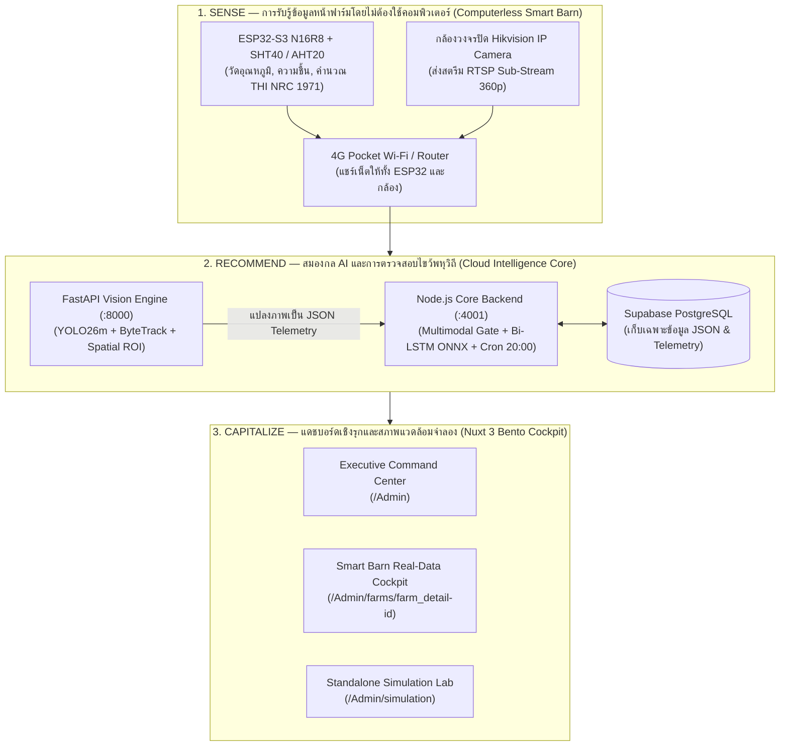

# PH Detection System — Precision Herd Heat Stress & Cow Behavior Intelligence
### (CowCare AI Initiative for Tropical Dairy Farms)

ระบบประเมิน ตรวจจับ และพยากรณ์ภาวะความเครียดจากความร้อน (**Heat Stress**) และพฤติกรรมโคนม ด้วยสถาปัตยกรรม **Multimodal Deep Learning, Computer Vision (YOLO + ByteTrack) & IoT Telemetry** ออกแบบมาเพื่อยกระดับฟาร์มโคนมไทย (โดยเฉพาะเกษตรกรรายย่อย) เปลี่ยนรูปแบบการจัดการฟาร์มจาก **"ตั้งรับ (Reactive)" เป็น "เชิงรุก (Proactive Management)"** ป้องกันผลผลิตน้ำนมลดฮวบจากภาวะหน่วงทางชีวภาพ (Biological Lag Effect 5 วัน) และส่งเสริมมาตรฐานฟาร์มคาร์บอนต่ำ (ESG)

[](https://github.com/)
[](https://nuxt.com/)
[](https://fastapi.tiangolo.com/)
[](https://expressjs.com/)
[](https://onnxruntime.ai/)
[](https://supabase.com/)
[](https://ultralytics.com/)
[](https://www.docker.com/)

---

## 📌 สารบัญ (Table of Contents)

1. [ภาพรวมโครงการ (Project Overview)](#-ภาพรวมโครงการ-project-overview)
2. [สถาปัตยกรรมระบบ 3 ชั้น (3-Layer Architecture)](#-สถาปัตยกรรมระบบ-3-ชั้น-3-layer-architecture)
3. [การไหลของข้อมูลจากหน้าฟาร์มสู่ Cloud (Field-to-Cloud Data Flow)](#-การไหลของข้อมูลจากหน้าฟาร์มสู่-cloud-field-to-cloud-data-flow)
4. [ระบบ AI, Multimodal Cross-Validation & Uncertainty Bands](#-ระบบ-ai-multimodal-cross-validation--uncertainty-bands)
5. [ฟีเจอร์เด่นของระบบ (Core Features & Cockpit Modules)](#-ฟีเจอร์เด่นของระบบ-core-features--cockpit-modules)
6. [เทคโนโลยีที่ใช้ (Tech Stack)](#-เทคโนโลยีที่ใช้-tech-stack)
7. [โครงสร้างโปรเจกต์ (Project Structure)](#-โครงสร้างโปรเจกต์-project-structure)
8. [การติดตั้งและการรันระบบ (Getting Started)](#-การติดตั้งและการรันระบบ-getting-started)
9. [คู่มือ API Endpoints](#-คู่มือ-api-endpoints)
10. [เกณฑ์ประเมินความเครียดความร้อนโคนมไทย (Thai Tropical Calibration Matrix)](#-เกณฑ์ประเมินความเครียดความร้อนโคนมไทย-thai-tropical-calibration-matrix)
11. [แผนการพัฒนาระบบ (Roadmap)](#-แผนการพัฒนาระบบ-roadmap)
12. [งานวิจัยอ้างอิง (Academic References)](#-งานวิจัยอ้างอิง-academic-references)

---

## 🎯 ภาพรวมโครงการ (Project Overview)

อิงจากงานวิจัยชีววิทยาโคนมเขตร้อนชื้นระดับสากลและในประเทศไทย (Boonkum et al., 2024; Hasan et al., 2026; Abdourhamane, 2026) โคนมตอบสนองต่อความร้อนสะสมด้วย **"ความหน่วงทางชีวภาพ (Biological Lag Effect)"** โดยผลผลิตน้ำนมจะดิ่งลงต่ำสุดใน **5 วัน** หลังจากสัมผัสความร้อนจัด และหากค่า THI ในช่วงเวลากลางคืน (00:00–06:00 น.) ไม่ลดลงต่ำกว่าเกณฑ์ แม่โคจะไม่สามารถคายความร้อนสะสมได้ (Night Recovery Failure - Mylostyvyi, 2026)

| หัวข้อ | รายละเอียดเชิงวิชาการและบริบทจริง |
|---|---|
| **ปัญหาหลัก** | โคนมลูกผสมไทย (Thai-Friesian) ต้องเผชิญกับ **THI ≥ 76 สูงถึง 250 วันต่อปี** ทำให้ผลผลิตน้ำนมลดลงเฉลี่ย **0.45 กก./THI unit**, อัตราผสมติดดิ่งลง และปล่อยก๊าซมีเทนต่อกิโลกรัมนม (**Methane Intensity**) สูงขึ้นถึง **17.5%** ขณะที่ฟาร์มรายย่อยกว่า 80% มีโรงเรือนเตี้ย (เฉลี่ย 2.7 ม.) และใช้หลังคาสังกะสีสะสมความร้อน (Tikul & Prachum, 2019) |
| **กลุ่มเป้าหมาย** | เกษตรกรผู้เลี้ยงโคนมรายย่อยในไทย ซึ่งไม่มีทุนทรัพย์ติดตั้งอุปกรณ์สวมใส่ราคาแพง (Wearable Collars / Ruminal Bolus) และไม่สะดวกลงบันทึกปริมาณน้ำนมดิบรายวันด้วยตนเอง |
| **แนวทางแก้ไข** | พัฒนาระบบเฝ้าระวังแบบไม่สัมผัสตัวสัตว์ (**Non-invasive Multimodal Sensing**) ด้วยกล้องวงจรปิด IP Camera + YOLO ByteTrack + เซ็นเซอร์อุตสาหกรรม ESP32-S3 เชื่อมต่อกับ **Multimodal Bi-LSTM ONNX Engine** พร้อมระบบ **Cross-Validation Gate & Fail-Safe Engine** และคำนวณ **Zero-Input Milk Loss Proxy** อัตโนมัติ 100% |

---

## 🏗️ สถาปัตยกรรมระบบ 3 ชั้น (3-Layer Architecture)



---

## 🌐 การไหลของข้อมูลจากหน้าฟาร์มสู่ Cloud (Field-to-Cloud Data Flow)

ในฟาร์มจริง **ไม่ต้องมีคอมพิวเตอร์ตั้งอยู่ที่คอกวัว** อุปกรณ์หน้าฟาร์มใช้เพียง **ปลั๊กไฟ + Pocket Wi-Fi ใส่ซิม 4G 1 ตัว** เพื่อส่งข้อมูลเข้าสู่ระบบ:

### 1. ฝั่งเซ็นเซอร์ IoT (ESP32-S3 N16R8)
1. บอร์ด **ESP32-S3** เชื่อมต่อ Wi-Fi จาก Pocket Wi-Fi
2. อ่านค่าอุณหภูมิและความชื้น แล้วส่งข้อมูลเป็น **`JSON`** ผ่าน HTTP POST ไปยัง Node.js Backend (`/api/Admin/sensors/data`) เพื่อบันทึกลง **Supabase**
3. **Dynamic Heartbeat:** หากไฟดับหรือถอดปลั๊ก ESP32 เกิน **2 นาที** ระบบจะเปลี่ยนสถานะอุปกรณ์เป็น **`Offline` (ออฟไลน์)** บนหน้าเว็บโดยอัตโนมัติทันที

### 2. ฝั่งกล้องวงจรปิด (IP Camera ➔ Python YOLO ➔ JSON ➔ Supabase)
1. **กล้องถ่ายภาพดิบ:** กล้องวงจรปิด (Hikvision IP Camera) ที่ผูกไว้กับฟาร์ม ส่งสัญญาณภาพวิดีโอ **RTSP Stream** ผ่าน Pocket Wi-Fi
2. **Python (FastAPI :8000) รับภาพมาประมวลผล AI:**
   - โมเดล **YOLO26m + ByteTrack** ตรวจจับและนับจำนวนแม่โค (`standing`, `lying down`, `feeding`, `drinking`)
   - คำนวณดัชนีความสบายของฝูงโค (**Cow Comfort Index - CCI**)
3. **แปลงภาพเป็นก้อน `JSON`:**
   - เมื่อประมวลผลเสร็จ Python จะสร้างผลลัพธ์เป็น **`JSON`** ส่งต่อไปยัง Node.js เพื่อบันทึกลงตาราง `cctv_behavior_telemetry` ใน **Supabase** พร้อมส่งสตรีมภาพที่ตีกรอบแล้ว (Detection Stream) ไปแสดงบนหน้าเว็บ

```json
{
  "farm_id": "63e1196a-0a67-479f-8743-2d2e2cafd767",
  "total_cows_detected": 6,
  "standing_count": 2,
  "lying_count": 3,
  "feeding_count": 1,
  "drinking_count": 0,
  "cow_comfort_index": 75.0,
  "ai_confidence_avg": 0.88
}
```

---

## 🧠 ระบบ AI, Multimodal Cross-Validation & Uncertainty Bands

### 1. Vision Accuracy Recovery & Active Learning (`Port 8000`)
- **Spatial ROI-Assisted Classification:** แก้ปัญหาเหล็กกั้นคอก (Stanchion Bars) บังตัววัวขณะก้มกินอาหารหรือดื่มน้ำ หากรหัสติดตามตัววัว (`track_id` จาก ByteTrack `MOTA: 81.2%`) มีจุดศูนย์กลางอยู่ในเขต `feed_bunk_roi` หรือ `water_trough_roi` ต่อเนื่อง $\ge 60$ วินาที ระบบจะช่วยเพิ่มค่าความมั่นใจ `+0.15` (สูงสุด `0.99`) และระบุพฤติกรรมเป็น `feeding` หรือ `drinking` อย่างแม่นยำ
- **Active Learning Auto-Sampler:** เมื่อพบเฟรมที่มีความมั่นใจต่ำ (`0.20 <= ai_confidence_avg < 0.40`) จากแสงสะท้อนหรือฝุ่น ระบบจะเซฟภาพพร้อมไฟล์ JSON Annotation ลง `backend/app/active_learning_samples/` อัตโนมัติ (จำกัดไม่เกิน 50 ภาพ/วัน/กล้อง) เพื่อนำไปเทรนโมเดลต่อยอด

### 2. Multimodal Cross-Validation Gate & Fail-Safe Engine (`Port 4001`)
ระบบตรวจสอบไขว้ระหว่าง **ค่าเซ็นเซอร์ IoT** และ **ผลตรวจจับจากกล้อง AI** ([`multimodalValidationService.js`](file:///Users/phattaradanai/Desktop/testYOLO26/backend_node/app/services/multimodalValidationService.js)):
- 🟢 **Case A — `MULTIMODAL_VERIFIED`:** เซ็นเซอร์และกล้องเห็นตรงกันว่าเกิดความเครียดความร้อน (`THI >= 76.0` และ `CCI < 70%`) คำนวณความเชื่อมั่นรวมด้วยสมการ $P_{\text{final}} = 1 - (1 - P_{\text{sensor}})(1 - P_{\text{vision}})$
- 🟡 **Case B — `SENSOR_DRIFT_SUSPECTED` (ป้องกันแจ้งเตือนหลอก):** เซ็นเซอร์รายงานค่าความร้อนสูง (`THI >= 80.0`) แต่กล้อง AI มองเห็นชัดเจน (`conf >= 0.50`) และพบว่าแม่โคนอนพักผ่อนสบาย (`CCI >= 75%`, ไม่หอบ) ระบบจะระงับการแจ้งเตือนฉุกเฉิน และเตือนให้เกษตรกรตรวจสอบว่าแดดส่องโดนกล่องเซ็นเซอร์โดยตรงหรือไม่
- 🟠 **Case C — `FAILSAFE_THAI_HEURISTIC` (โหมดสำรองเมื่อกล้องมัว/ไม่ได้ติดกล้อง):** หากฟาร์มยังไม่ได้ติดตั้งกล้อง กล้องออฟไลน์ หรือเลนส์สกปรก (`conf < 0.40`) ในขณะที่ `THI >= 80.0` ระบบจะสลับไปใช้สมการฟิสิกส์โรงเรือนไทยจากเซ็นเซอร์ทันที เพื่อให้การแจ้งเตือนทำงานได้ 100% ไม่มีสะดุด

### 3. Bi-LSTM 72-Hour Forecast & Empirical Uncertainty Bands
พยากรณ์ล่วงหน้า 3 วันด้วยโมเดล `farm_lstm.onnx` พร้อมแถบความคลาดเคลื่อนมาตรฐาน (MAE Uncertainty Bands):
- **Day +1 (+24h):** `Predicted THI ±0.58` | `Milk Risk ±0.19 kg` (`Confidence: 95.8%`)
- **Day +2 (+48h):** `Predicted THI ±0.84` | `Milk Risk ±0.28 kg` (`Confidence: 91.2%`)
- **Day +3 (+72h):** `Predicted THI ±1.18` | `Milk Risk ±0.39 kg` (`Confidence: 86.4%`)

---

## 🌟 ฟีเจอร์เด่นของระบบ (Core Features & Cockpit Modules)

### 1. 🎛️ Executive Agritech Command Center (`/Admin`)
- แดชบอร์ดภาพรวมระดับเครือข่ายแบบ Bento Grid แสดง KPI ฟาร์มทั้งหมด, อัตราออนไลน์ของอุปกรณ์ IoT ตามเวลาจริง, THI เฉลี่ยเครือข่าย และรายการแจ้งเตือนความร้อน

### 2. 📋 Precision Farm Roster & Direct Camera Binding (`/Admin/farms`)
- **ผูกกล้องวงจรปิดตั้งแต่สร้าง/แก้ไขฟาร์ม:** ใน Modal เพิ่มฟาร์ม ([`AddFarmModal.vue`](file:///Users/phattaradanai/Desktop/testYOLO26/frontend/app/components/Admin/farm/AddFarmModal.vue)) และแก้ไขฟาร์ม ([`EditFarmModal.vue`](file:///Users/phattaradanai/Desktop/testYOLO26/frontend/app/components/Admin/farm/EditFarmModal.vue)) สามารถเปิดสวิตช์ผูกกล้อง Hikvision IP Camera (ชื่อกล้อง, IP Address, RTSP Port, Username, Password) พร้อมบันทึกใน ACID Transaction เดียวกันทันที
- **3-Tab Quick Filter:** แยกฟาร์มทั้งหมด (All), ฟาร์มที่ออนไลน์ปกติ (Active), และฟาร์มที่อุปกรณ์ออฟไลน์/รอเชื่อมต่อ (Pending)

### 3. 📊 Smart Barn Real-Data Cockpit (`/Admin/farms/farm_detail-[id]`)
- **แสดงเฉพาะข้อมูลจริง 100% (`is_simulation = FALSE`):** แยกข้อมูลจริงออกจากโหมดจำลองอย่างเด็ดขาด
- **Direct Bound Camera Stream:** ตัด Dropdown เลือกกล้องออกทั้งหมด โดยดึงภาพสตรีมตรงจากกล้องประจำฟาร์มที่ผูกไว้ทันที หากฟาร์มใดยังไม่ได้ผูกกล้อง ระบบจะแสดงการ์ดแจ้งเตือน **"ยังไม่ได้ติดตั้งกล้องวงจรปิดในฟาร์มนี้"** พร้อมปุ่มลัดให้กดติดตั้งกล้องได้ทันที
- **ApexCharts Uncertainty Bands:** กราฟพยากรณ์ 72 ชั่วโมงพร้อมพื้นที่แรเงาขอบเขตความคลาดเคลื่อน (`predicted_thi ± thi_mae`)
- **Human-in-the-Loop Feedback:** ปุ่ม 👍 `แม่นยำ` / 👎 `คลาดเคลื่อน` บนการ์ดแจ้งเตือน เพื่อเก็บสถิติ False Positive Rate (FPR) ในการใช้งานจริง

### 4. 🧪 Standalone Simulation Environment (`/Admin/simulation`)
- เมนู **"สภาพแวดล้อมจำลอง"** แยกอิสระสำหรับทดสอบจำลองค่าความร้อน (THI Slider), ทดสอบกล้อง AI ด้วยวิดีโอโรงเรือนจำลอง (`sample_barn.mp4`), และจำลองการเกิดพฤติกรรมผิดปกติโดยไม่ปะปนกับฐานข้อมูลฟาร์มจริง

---

## 💻 เทคโนโลยีที่ใช้ (Tech Stack)

| หมวดหมู่ | เทคโนโลยี |
|---|---|
| **Frontend** | Nuxt 3, Vue 3 (Composition API), Tailwind CSS, Vuetify 3, ApexCharts |
| **Vision AI Backend (`:8000`)** | Python, FastAPI, Uvicorn, Ultralytics YOLO26m (`best1.pt`), ByteTrack, OpenCV |
| **Core API Backend (`:4001`)** | Node.js, Express 5, `onnxruntime-node` (`farm_lstm.onnx`), `node-cron`, `pg` |
| **Database** | Supabase PostgreSQL (Transaction Pooler + Idle Connection Error Guard) |
| **IoT & Barn Hardware** | ESP32-S3 N16R8, SHT40 / AHT20, Hikvision IP Camera (RTSP), 4G Pocket Wi-Fi |
| **DevOps & Deployment** | Docker, Docker Compose |

---

## 📂 โครงสร้างโปรเจกต์ (Project Structure)

```text
testYOLO26/
├── docker-compose.yml                          # นิยาม Service: Frontend (:3000), Node (:4001), FastAPI (:8000)
├── README.md                                   # เอกสารคู่มือและสถาปัตยกรรมระบบฉบับสมบูรณ์ (v3.0.0)
├── PROJECT_OVERVIEW.md                         # เอกสารสรุปภาพรวมเชิงวิชาการและสถาปัตยกรรม
│
├── backend/                                    # AI Vision Backend (FastAPI + YOLO26m + ByteTrack)
│   ├── app/
│   │   ├── api/
│   │   │   ├── detect.py                       # Endpoint ตรวจจับภาพนิ่ง
│   │   │   └── test_cam.py                     # RTSP / Simulation Streaming + Active Learning Sampler
│   │   ├── services/
│   │   │   ├── behavior_engine.py              # ByteTrack State Tracker + Spatial ROI Confidence Boost
│   │   │   └── yolo_service.py                 # YOLO Inference Service
│   │   ├── active_learning_samples/            # โฟลเดอร์เก็บภาพความมั่นใจต่ำอัตโนมัติ (0.20 <= conf < 0.40)
│   │   ├── weights/                            # โมเดล best1.pt, yolo26m.pt, farm_lstm.onnx, sample_barn.mp4
│   │   └── main.py                             # FastAPI Entrypoint (:8000)
│   ├── ml_lstm/                                # โครงสร้างโมเดลและสคริปต์เทรน Bi-LSTM
│   └── training_archive/                       # โฟลเดอร์จัดเก็บชุดข้อมูล Roboflow และสคริปต์เทรน YOLO
│       ├── cow-behavior-analysiws--2/          # ชุดข้อมูลภาพและ Annotations สำหรับพฤติกรรมโคนม
│       └── train.py                            # สคริปต์ Fine-tune YOLO26m บน Apple MPS / CUDA
│
├── backend_node/                               # 🟩 Core API Backend (Node.js + Express + ONNX)
│   ├── app/
│   │   ├── config/db.js                        # Supabase PostgreSQL Pool (พร้อม Idle Error Handler)
│   │   ├── services/
│   │   │   ├── lstmOnnxService.js              # Bi-LSTM ONNX Inference + 72h Lookback
│   │   │   ├── dailyLstmScheduler.js           # Batch Job 20:00 น. พร้อม Uncertainty Bands (MAE)
│   │   │   └── multimodalValidationService.js  # Multimodal Cross-Validation Gate & Fail-Safe Engine
│   │   └── routes/Admin/
│   │       ├── farms.js                        # CRUD ฟาร์ม + ผูกกล้อง CCTV ใน ACID Transaction + เช็คสถานะ Online
│   │       ├── cctvCameras.js                  # จัดการกล้อง RTSP, Telemetry Rollup และ Alert Feedback
│   │       ├── system.js                       # Argon Accuracy Benchmarks & Multimodal Status API
│   │       └── sensors.js                      # รับค่าเซ็นเซอร์จาก ESP32-S3 (NRC 1971)
│   └── server.js                               # Express Server Entrypoint (:4001)
│
└── frontend/                                   # 🟢 Frontend Web Application (Nuxt 3)
    └── app/
        ├── pages/Admin/
        │   ├── index.vue                       # Executive Command Center
        │   ├── farms.vue                       # Precision Farm Roster
        │   ├── simulation.vue                  # เมนูสภาพแวดล้อมจำลองแยกอิสระ (Simulation Sandbox)
        │   └── farms/farm_detail-[id].vue      # Smart Barn Real-Data Cockpit
        └── components/Admin/farm/
            ├── AddFarmModal.vue                # Modal เพิ่มฟาร์มพร้อมผูกอุปกรณ์ IoT และกล้อง CCTV
            ├── EditFarmModal.vue               # Modal แก้ไขฟาร์มและตั้งค่ากล้อง CCTV
            ├── AddCameraModal.vue              # Modal ผูกกล้อง Hikvision ด่วน
            └── SystemAccuracyModal.vue         # Modal แสดงผล Argon Benchmarks & System Accuracy
```

---

## 🚀 การติดตั้งและการรันระบบ (Getting Started)

### 1. รันผ่าน Docker Compose (แนะนำ)
```bash
docker compose up --build -d
```

### 2. รันแยกแต่ละบริการ (Local Development)
```bash
# 1. รัน Node.js Core Backend (:4001)
cd backend_node
npm install
npm run dev

# 2. รัน FastAPI Vision Backend (:8000)
cd backend
source venv/bin/activate
uvicorn app.main:app --host 0.0.0.0 --port 8000 --reload

# 3. รัน Nuxt 3 Frontend (:3000)
cd frontend
npm install
npm run dev
```

| บริการ / หน้าจอ | URL สำหรับเข้าใช้งาน |
|---|---|
| **Executive Command Center** | [http://localhost:3000/Admin](http://localhost:3000/Admin) |
| **หน้าจัดการฟาร์ม (Farm Roster)** | [http://localhost:3000/Admin/farms](http://localhost:3000/Admin/farms) |
| **หน้าสภาพแวดล้อมจำลอง (Simulation Lab)** | [http://localhost:3000/Admin/simulation](http://localhost:3000/Admin/simulation) |
| **FastAPI Swagger Docs** | [http://localhost:8000/docs](http://localhost:8000/docs) |
| **Node.js API Health** | [http://localhost:4001](http://localhost:4001) |

---

## 📡 คู่มือ API Endpoints ที่สำคัญ

| Method | Endpoint | รายละเอียด |
|---|---|---|
| `POST` | `/api/Admin/sensors/data` | รับข้อมูลอุณหภูมิและความชื้นจาก ESP32-S3 คำนวณ THI และอัปเดต `last_seen_at` |
| `GET` | `/api/Admin/farms/:id/latest` | ดึงค่าเซ็นเซอร์ล่าสุดและตรวจสอบสถานะ Online/Offline แบบไดนามิก (Timeout 2 นาที) |
| `POST` | `/api/Admin/farms` | สร้างฟาร์มใหม่ พร้อมผูกอุปกรณ์ IoT และกล้องวงจรปิดใน ACID Transaction |
| `PUT` | `/api/Admin/farms/:id` | แก้ไขข้อมูลฟาร์ม อุปกรณ์ IoT และการตั้งค่ากล้องวงจรปิด |
| `GET` | `/api/Admin/system/accuracy-benchmarks` | ดึงค่าพารามิเตอร์ความแม่นยำเชิงประจักษ์และ Argon Benchmarks (In-Silico F1 `0.915`, Field F1 `0.862`) |
| `GET` | `/api/Admin/system/farms/:farmId/multimodal-status` | ตรวจสอบสถานะ Cross-Validation ระหว่างเซ็นเซอร์ IoT และกล้อง AI |
| `POST` | `/api/alerts/:alertId/feedback` | บันทึกผลประเมินความแม่นยำของการแจ้งเตือนโดยเกษตรกร (`is_accurate: true/false`) |
| `GET` | `/api/cam/stream` | สตรีมวิดีโอ MJPEG ที่ผ่านการตรวจจับด้วย YOLO26m + ByteTrack (`Port 8000`) |

---

## 🌡️ เกณฑ์ประเมินความเครียดความร้อนโคนมไทย (Thai Tropical Calibration Matrix)

คำนวณค่า **THI** ตามสมการ **NRC (1971)** โดยปรับเกณฑ์ให้สอดคล้องกับพันธุกรรมโคนมลูกผสมไทย (Boonkum et al., 2024):
$$\text{THI} = (1.8 \times T + 32) - (0.55 - 0.0055 \times \text{RH}) \times (1.8 \times T - 26)$$

| ช่วงค่า THI | ระดับความเสี่ยง | ผลกระทบต่อโคนมลูกผสมไทย | มาตรการปฏิบัติการเชิงรุก (Actionable Advisory) |
|---|---|---|---|
| **< 76.0** | **ปกติ (Comfort Zone)** | แม่โคสบายตัว กินอาหารและนอนเคี้ยวเอื้องตามปกติ ($\text{CCI} \ge 75\%$) | ดูแลการระบายอากาศและน้ำดื่มสะอาดตามปกติ |
| **76.0 – 79.9** | **เริ่มเฝ้าระวัง (Mild)** | เริ่มสะสมความร้อน แม่โคยืนนานขึ้น เสี่ยงน้ำนมเริ่มลดลง | เปิดพัดลมระบายอากาศเร่งการถ่ายเทความร้อน |
| **80.0 – 83.9** | **ปานกลาง (Moderate)** | การเคี้ยวเอื้องลดลง หายใจเร็วขึ้น น้ำนมลดลงชัดเจน | **ฤดูร้อน:** เปิดพัดลม + พ่นหมอก<br>**ฤดูฝน ($RH \ge 75\%$):** เปิดพัดลมเต็มกำลัง **งดพ่นหมอก** ป้องกันคอกแฉะและเต้านมอักเสบ |
| **≥ 84.0** | **วิกฤต (Severe)** | แม่โคหอบรุนแรง น้ำนมดิ่งฮวบ เสี่ยงภาวะเลือดเป็นกรดและผสมไม่ติด | ลดความร้อนฉุกเฉินทันที เสริมแร่ธาตุบัฟเฟอร์ และเลื่อนการผสมเทียม |

---

## 🗺️ แผนการพัฒนาระบบ (Roadmap)

- [x] **YOLO26m + ByteTrack Vision Engine:** ตรวจจับและติดตามพฤติกรรมโคนม (ยืน, นอน, กินอาหาร, ดื่มน้ำ)
- [x] **Spatial ROI-Assisted Recovery & Active Learning:** บูสต์ความแม่นยำในจุดอับสายตาและเก็บภาพความมั่นใจต่ำอัตโนมัติ
- [x] **Multimodal Cross-Validation Gate & Fail-Safe Engine:** ตรวจสอบไขว้ IoT + Vision ป้องกันแดดส่องเซ็นเซอร์และสลับโหมดอัตโนมัติเมื่อกล้องออฟไลน์
- [x] **Bi-LSTM 72h Forecast with Empirical Uncertainty Bands:** พยากรณ์ล่วงหน้า 3 วันพร้อมค่าความคลาดเคลื่อน `±MAE`
- [x] **Direct CCTV Camera Binding in Farm Modals:** ผูกกล้องวงจรปิดตั้งแต่ขั้นตอนเพิ่ม/แก้ไขฟาร์ม พร้อมระบบแจ้งเตือนหากยังไม่ได้ติดตั้งกล้อง
- [x] **Standalone Simulation Sandbox (`/Admin/simulation`):** แยกหน้าจำลองสภาพแวดล้อมและกล้องออกจากหน้าฟาร์มจริง 100%
- [x] **Dynamic ESP32 Offline Detection:** ตรวจจับการถอดปลั๊กหรือเน็ตหลุดภายใน 2 นาทีพร้อมอัปเดตฐานข้อมูลอัตโนมัติ
- [ ] **Context-Aware LINE Messaging Bot:** แจ้งเตือนเกษตรกรผ่าน LINE Official Account พร้อมปุ่มกดยืนยันผล

---

## 📚 งานวิจัยอ้างอิง (Academic References)

1. Boonkum, W., et al. (2024). **Impact of Heat Stress on Milk Yield, Milk Fat-to-Protein Ratio, and Conception Rate in Thai–Holstein Dairy Cattle: A Phenotypic and Genetic Perspective.** *Animals*, 14(20), 3026.
2. Sungkhapreecha, P., et al. (2022). **Determining Heat Stress Effects of Multiple Genetic Traits in Tropical Dairy Cattle Using Single-Step Genomic BLUP.** *Veterinary Sciences*, 9(2), 66.
3. วรรณลักษณ์ ถาวร, อิทธิพล สักลอ, และ วิวัฒน์ พัฒนาวงศ์. (2566). **ผลของอุณหภูมิ ความชื้น และฤดูกาลต่อระดับคอร์ติซอลในโคนมสายพันธุ์โฮลสไตน์ฟรีเชียน.** *วารสารเกษตรนเรศวร*.
4. ณัชวิชญ์ ติกุล และ สุวิทย์ ประชุม. (2562). **ผลกระทบจากรูปแบบโรงเรือนและสภาพแวดล้อมต่อความสบายของโคในฟาร์มรายย่อยในจังหวัดเชียงใหม่.** *วารสารเกษตรพระวรุณ*.
5. Hasan, F. M., et al. (2026). **Impact of heat stress on cattle systems: Responses of production metrics to thermal stress.** *Computers and Electronics in Agriculture*.
6. Abdourhamane, I. M. (2026). **Deep Learning-Based Forecasting of Heat Stress Events and Daily Milk Yield Depreciation in Dairy Cattle Using Meteorological Data: An In-Silico Study.** *Acta Veterinaria-Beograd*, 76(2), 242-254.
7. Mylostyvyi, R. (2026). **Heat Stress in Dairy Cattle Production: A View from the Perspective of Sustainable Development.** *Sustainability*.
8. Mulajkar, R. M., et al. (2026). **Artificial Intelligence for Early Detection of Heat Stress and Environmental Hazards in Dairy Animals.** *Journal of Animal Environment*, 18(2s).
9. Onan-Martinez, D., et al. (2026). **Heat stress increases enteric methane emissions yield and intensity while impairing rumen function and productivity in lactating dairy cattle.** *Journal of Dairy Science*.
10. Papo, M. L., et al. (2026). **Integrating Precision Livestock Farming and Genomic Tools for Heat Stress Mitigation in South African Dairy Cattle.** *Animals*.

---

*พัฒนาและดูแลโดยทีมวิจัยและพัฒนา PH Detection System (CowCare AI)*
