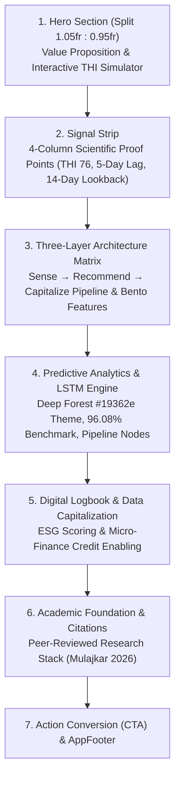

# Comprehensive Architectural & UI/UX Design Analysis of `index.vue`
**System:** CowCare AI (Heat Stress Intelligence for Dairy Farms)  
**Author:** Senior Frontend & System Design Engineer  
**Document Status:** Approved Architecture Document  
**Date:** October 14, 2026  

---

## 1. Executive Summary & Design Philosophy

The primary `pages/index.vue` serves as the public-facing gateway for **CowCare AI**. It is built upon the **"Biophilic Agritech Design System"**, which strategically combines:
- **Biophilic Aesthetic:** Natural, earthy tones (Deep Forest Green, Warm Terracotta, Sage, and Ivory Canvas) that resonate with sustainable agriculture and precision dairy farming.
- **Micro-SaaS & Glassmorphism:** Semi-transparent cards (`backdrop-blur`, subtle borders, soft ambient elevation) creating an enterprise-grade, modern web feel.
- **Evidence-Based Storytelling:** Seamlessly transitioning the user from agricultural challenges to scientific evidence (Thai-Holstein THI thresholds, 5-day lag effect), architectural solutions, and interactive verification.

---

## 2. Design System & Visual Hierarchy

### 2.1 Color Palette & Token Architecture

| Design Token | Hex Code | Semantic Role | Psychological / Functional Impact |
|---|---|---|---|
| **Deep Forest Green** | `#24433a` / `#163026` | Primary Brand Color | Conveys stability, vitality, deep agricultural roots, and trust. |
| **Terracotta Amber** | `#d87939` / `#ea580c` | Primary Accent / Warning | Represents thermal energy, high-priority notifications, and callouts. |
| **Sage & Comfort Green** | `#3e7d4f` / `#e6f2e7` | Normal / Optimal Status | Represents the Comfort Zone ($\text{THI} < 76$), safety, and optimal milk yield. |
| **Warm Ivory Canvas** | `#fffdf7` | Global Background | Eliminates sterile pure-white `#ffffff` fatigue, giving a warm, tactile feel. |
| **Deep Night Forest** | `#19362e` | Section Accent (AI / LSTM) | Creates an intentional visual contrast for deep tech and AI intelligence. |

### 2.2 Typography & Spacing Rhythm
- **Primary Typeface:** `"Noto Sans Thai"` paired with `Inter` / system sans-serif.
- **Tabular Figures:** Numbers in badges and telemetry cards utilize tabular numerals (`tabular-nums`) to prevent layout shifts during reactive updates.
- **Modular Fluid Typography:** Leverages CSS `clamp()` (e.g., `clamp(1.7rem, 3vw, 2.4rem)`) to maintain perfect typographic scale across smartphones, tablets, and ultra-wide displays without abrupt breakpoint jumps.

---

## 3. Structural Decomposition of `pages/index.vue`

---

## 4. Deep-Dive: Section-by-Section Engineering & UI Details

### 4.1 Hero Section with Embedded Interactive Telemetry Sandbox
- **Ambient Lighting:** Dual animated blurred circles (`.ambient-one`, `.ambient-two`) with subtle drift animations provide depth without GPU overhead.
- **Interactive THI Calculator:** Rather than static mockups, the hero embeds a functional sandbox:
  - Implements the official **NRC (1971)** mathematical formula in a Vue `computed` property:
    $$\text{THI} = (1.8 \times T + 32) - (0.55 - 0.0055 \times \text{RH}) \times (1.8 \times T - 26)$$
  - **Dynamic State Machine:** Reactively updates background colors, risk ring borders, risk badges, and recommendations across four research-defined stages (`Comfort Zone < 76`, `Mild 76–79`, `Moderate 80–83`, `Severe ≥ 84`).
  - **Continuous Gauge Bar:** An analog three-segment scale with a smoothly transitioning pointer (`transition: left 0.25s`) demonstrates the exact threshold position.
  - **Educational Trust Marker:** A dedicated callout clarifies the scientific rationale of choosing **THI 76** over Western standards (THI 72) for Thai crossbred Holstein cattle.

### 4.2 Signal Strip (Scientific Proof Points)
- **Visual Rhythm:** Full-width deep green bar (`#24433a`) providing an immediate grounding break between the hero and product explanation.
- **Cognitive Clarity:** Distills complex research parameters into four easily digestible numbers:
  1. **THI 76:** Physiological onset threshold.
  2. **5 Days:** Peak milk drop lag effect.
  3. **14 Days:** LSTM historical lookback window.
  4. **3–7 Days:** Proactive alert forecast lead time.

### 4.3 Three-Layer Architecture & Bento Feature Matrix
- **Conceptual Pipeline:** Visualizes the progression from raw IoT telemetry to structured business value:
  - **Layer 1 (Sense):** ESP32-S3 + SHT40 + RS485 Modbus and non-invasive CCTV vision.
  - **Layer 2 (Recommend):** LSTM predictive analytics and Gemini actionable advisory.
  - **Layer 3 (Capitalize):** Digital logbook, ESG scoring, and index-based climate insurance.
- **Bento Feature Grid:** Features an intentional asymmetrical visual hierarchy where Card 01 (`feature-primary`) is tinted in solid Forest Green with tag chips, while Cards 02 and 03 utilize elevated off-white glass with miniature visualizers (behavior frequency bars and status pill badges).

### 4.4 Predictive AI Section (The Inversion Section)
- **Intentional Contrast Inversion:** Shifts the palette to `#19362e` with golden accents (`#f2bd7c` and `#d87939`) to denote computational intelligence and technical depth.
- **Node-Based Model Flow (`.lstm-flow`):** Custom SVG-connected pipeline diagram visually detailing how raw temperature and humidity are fed into the central **LSTM Time-Series Brain Node** before outputting proactive warnings.

### 4.5 Digital Logbook & Scientific Citation Cards
- **Mockup Digital Logbook:** Displays sample audit metrics (weekly average THI, cumulative heat load hours, behavioral anomalies, recording completeness).
- **Academic Foundation:** Directly quotes recent peer-reviewed literature (Mulajkar et al., 2026), reinforcing that CowCare AI is not a generic hackathon concept, but an evidence-based precision livestock platform.

---

## 5. Technical Implementation & Performance Engineering

### 5.1 Scroll Performance & Micro-Interactions
- **`IntersectionObserver` Implementation:** Replaces heavyweight third-party animation libraries with a lightweight native browser observer that toggles `.is-visible` on `.reveal` elements at a `0.14` visibility threshold.
- **Scroll Restoration Control:** Enforces `history.scrollRestoration = 'manual'` and auto-scrolls to top on mount, preventing broken scroll states on refresh.
- **CSS GPU Acceleration:** Transitions leverage 3D transforms (`translate3d(0, 24px, 0)` to `translate3d(0, 0, 0)`) paired with `will-change: opacity, transform`, guaranteeing constant 60fps animations on mobile devices.

### 5.2 Accessibility & Responsive Design
- **`prefers-reduced-motion` Media Query:** Fully honors accessibility preferences by neutralizing animation durations (`0.01ms`) and transitions.
- **Multi-Tier Breakpoint Architecture:**
  - **Desktop ($\ge 961\text{px}$):** Multi-column balanced grids.
  - **Tablet ($601\text{px} - 960\text{px}$):** Stacks visualizers below text blocks while preserving grid spacing.
  - **Mobile ($\le 600\text{px}$):** Converts multi-column stats into 2-column grids, stacks button CTAs to full width, and tightens card padding to prevent overflow.

---

## 6. Architectural Contrast: `pages/index.vue` vs. `pages/Admin/index.vue`

| Architectural Dimension | Public Landing (`pages/index.vue`) | Admin Command Center (`pages/Admin/index.vue`) |
|---|---|---|
| **Primary Audience** | Public, Farmers, Investors, Grant Judges | Farm Managers, Veterinarians, System Administrators |
| **UX Objective** | Educate, demonstrate scientific validity, convert users | Operational monitoring, rapid incident response, system health |
| **Data Binding** | Client-side reactive math simulation (`computed`) | Live server state via REST API (`/api/Admin/farms/dashboard-stats`) |
| **Update Cycle** | User-triggered range inputs | Background polling every 12 seconds with unmount cleanup |
| **Layout Pattern** | Long-scroll thematic narrative sections | High-density 12-column Bento Grid (KPIs, Donut, Charts, Diagnostics) |
| **Component Structure** | Monolithic single-file component for zero-latency presentation | Modular architecture (`AdminHeaderArea`, `AdminMetricsCards`, `AdminDashboardCharts`, `AdminAlertsTable`, `AdminSystemDiagnostics`) |

---

## 7. Strategic Recommendations & Optimization Opportunities

1. **Preset Quick-Selector in Sandbox:**
   - *Enhancement:* Add one-click quick buttons to the hero sandbox (e.g., `"เชียงใหม่ ฤดูร้อน"`, `"สระบุรี ฤดูฝน"`) so first-time visitors can instantly jump to extreme conditions without adjusting sliders manually.
2. **Dynamic Chart Sparkline in Logbook Card:**
   - *Enhancement:* Replace the static log rows with a mini 7-day sparkline SVG to visually demonstrate the cumulative heat load trajectory.
3. **PWA / Standalone Read-Mode Support:**
   - *Enhancement:* Add lightweight web manifest configurations for farmers browsing via mobile browsers under intermittent 3G connectivity in rural areas.
