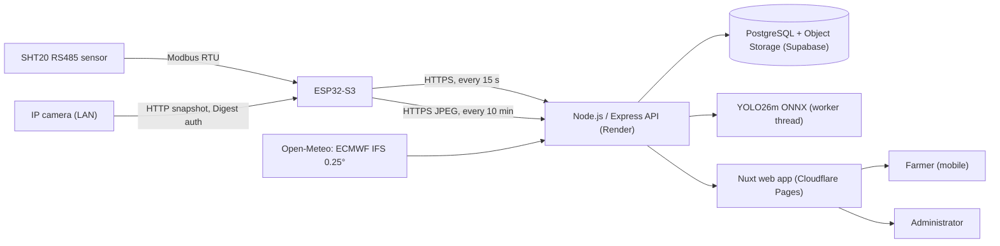

# CowCare AI — ขอบเขตงานและเทคโนโลยีที่ใช้ (Hardware & Software)

*CowCare AI · ร่างสำหรับ paper · 6 พ.ย. 2569*

ร่างนี้เขียนจากโค้ดและเฟิร์มแวร์จริงใน repository (commit `5753503`) ทุกตัวเลขตรวจกับซอร์สโค้ดแล้ว ข้อมูลที่ยังไม่มี เช่น รุ่นกล้อง และผลทดสอบความแม่นยำของเซ็นเซอร์ ทำเครื่องหมาย **\[ต้องเติม\]** ไว้ หัวข้อ 7 เป็นร่างภาษาอังกฤษสำหรับใช้ใน paper

> **สถานะสำคัญ:** ทุกส่วนในขอบเขตพัฒนาเสร็จและทดสอบในบ้านแล้ว (ยกเว้นการเก็บตำแหน่งกรอบของทุกภาพ ซึ่งรอรัน migration ฐานข้อมูล) แต่**ยังไม่ได้ติดตั้งที่ฟาร์มโคนม** ผลภาคสนามจึงยังไม่มี

## 1. ขอบเขตงาน (Scope of work)

**วัตถุประสงค์:** พัฒนาระบบต้นทุนต่ำสำหรับฟาร์มโคนมรายย่อย ที่วัดสภาพอากาศ*ในคอก*อย่างต่อเนื่อง ประเมินระดับความเสี่ยงความเครียดจากความร้อนด้วยดัชนี THI ตามเกณฑ์งานวิจัยโคนมไทย พยากรณ์ THI ล่วงหน้า 3 วันที่ปรับให้เข้ากับคอกนั้น และใช้ภาพจากกล้องประเมินท่าทางของฝูงเป็นข้อมูลประกอบ โดยเกษตรกรไม่ต้องกรอกข้อมูลรายวัน

### ในขอบเขต

1.  วัดอุณหภูมิและความชื้นสัมพัทธ์ในคอก 1 จุดต่อคอก ส่งข้อมูลทุก 15 วินาที พร้อมเก็บข้อมูลค้างส่งเมื่อเครือข่ายขัดข้อง
2.  คำนวณ THI และจัดระดับ 4 ระดับตามเกณฑ์งานวิจัยโคนมไทย เลือกเกณฑ์ได้ 2 แบบตามสายพันธุ์ของฝูง
3.  สรุปตัวชี้วัดความร้อนสะสม: ชั่วโมงร้อน ชั่วโมงกลางคืนที่ THI ต่ำกว่าเกณฑ์ วันร้อนติดกัน เหตุการณ์ความร้อน และความครบถ้วนของข้อมูล พร้อมบันทึกสรุปประจำวันอัตโนมัติ
4.  ติดตามสถานะกล่องเซ็นเซอร์ (สัญญาณ Wi-Fi หน่วยความจำ คิวค้างส่ง สถานะเซ็นเซอร์) ทุก 5 นาที เพื่อรู้ปัญหาก่อนข้อมูลหาย
5.  พยากรณ์ THI เฉลี่ยรายวันล่วงหน้า 1–3 วัน โดยปรับพยากรณ์ ECMWF ด้วยค่าเพี้ยนที่เรียนจากเซ็นเซอร์ในคอก
6.  ตรวจจับท่าทางระดับฝูงจากภาพนิ่งทุก 10 นาที 4 คลาส (ยืน นอน กิน ดื่ม) ด้วย YOLO เก็บเป็นตัวเลขและตำแหน่งกรอบ (JSON) แทนวิดีโอ เพื่อใช้เป็นข้อมูลมิติที่ 2 คู่กับ THI (ดูการทำงานในหัวข้อ 5.4)
7.  วิเคราะห์ความสัมพันธ์ระหว่างสัดส่วนท่านอนกับ THI เพื่อหาค่า THI ที่วัวในคอกเริ่มนอนน้อยลง
8.  เทียบสภาพในคอกกับอากาศภายนอกจากแบบจำลองที่พิกัดฟาร์ม
9.  หน้าเว็บสำหรับเกษตรกร (มือถือ ผู้สูงอายุ) และผู้ดูแลระบบ พร้อมเครื่องมือตรวจความแม่นยำของกล้องแบบ blind audit

### นอกขอบเขต (ข้อจำกัด / งานในอนาคต)

- การติดตามโครายตัว อุณหภูมิร่างกาย อัตราการหายใจ และการตรวจจับการหอบ
- การวินิจฉัยโรค และการเชื่อมข้อมูลปริมาณน้ำนม
- การควบคุมพัดลมหรือระบบพ่นน้ำอัตโนมัติ
- การแจ้งเตือนผ่าน LINE และผู้ช่วย Generative AI สำหรับผู้ดูแลและสัตวแพทย์ (ออกแบบแล้ว ยังไม่พัฒนา)
- หลายเซ็นเซอร์หรือหลายกล้องในคอกเดียว (ฐานข้อมูลรองรับ แต่การประมวลผลรองรับ 1 + 1 ต่อคอก)
- การบันทึกวิดีโอต่อเนื่อง (ใช้ภาพนิ่งทุก 10 นาที) และการวัดปริมาณอาหารหรือน้ำที่กินจริง (คลาส "กิน/ดื่ม" บอกแค่ท่าทาง)
- การปรับเกณฑ์ THI อัตโนมัติจากผลวิเคราะห์ท่าทาง (ต้องให้ผู้เชี่ยวชาญพิจารณาก่อน)
- พยากรณ์ด้วยโมเดลอนุกรมเวลา (LSTM/GRU) ที่เรียนรู้ส่วนที่วิธีปรับค่าเพี้ยนยังคลาดเคลื่อน (ทดลองเมื่อมีข้อมูลในคอกต่อเนื่องหลายเดือน และเปิดใช้เฉพาะเมื่อ MAE ย้อนหลังต่ำกว่าวิธีปัจจุบันทั้ง 3 ระยะ; LSTM และ GRU ขนาดเล็กที่ทดสอบกับสถานีกลางแจ้งยังแพ้วิธีปัจจุบันทั้ง 3 ระยะ ดูหัวข้อ 5.3)

## 2. จุดเด่นและความแตกต่างจากงานอื่น

เทียบกับแนวทางที่มีอยู่ 4 แบบ คือ บริการพยากรณ์ THI จากอากาศภายนอก เครื่องวัด THI แบบ IoT อุปกรณ์สวมใส่รายตัว และงานที่ใช้กล้องตรวจพฤติกรรม ทุกข้อระบุหลักฐานและข้อควรระวังไว้ เพื่อไม่ให้อ้างเกินจริงใน paper

> **สรุปในประโยคเดียว:** งานนี้รวมการวัดในคอก การพยากรณ์ THI *ของคอกนั้น*ล่วงหน้า 1–3 วันที่ปรับตัวเองจากเซ็นเซอร์ในคอก และท่าทางของฝูงจากกล้อง ไว้ในอุปกรณ์ต้นทุนต่ำชุดเดียว โดยใช้เกณฑ์ THI จากงานวิจัยโคนมลูกผสมไทย สำหรับฟาร์มโคนมรายย่อย

### 2.1 วัดในคอก และพยากรณ์ THI ของคอกนั้นล่วงหน้า 1–3 วัน (จุดเด่นหลัก)

- **แนวทางที่มีอยู่:** บริการพยากรณ์ THI สำหรับเกษตรกร เช่น Dairy Forecast Service ของ Dairy Australia และแอป Livestock Weather ของมหาวิทยาลัย Kitasato ประเทศญี่ปุ่น พยากรณ์จากอากาศภายนอกที่ตำแหน่งฟาร์ม แต่สภาพในคอกต่างจากภายนอกได้มาก Schüller et al. (2013) พบว่าในคอกร้อนกว่าสถานีอุตุนิยมวิทยาที่ใกล้ที่สุดเฉลี่ย 6.4 °C และนับวันที่ THI เฉลี่ย ≥ 72 ได้ 64 วันในคอก เทียบกับ 4 วันที่สถานี (จาก 756 วัน) ส่วนเครื่องวัด THI ในคอกแบบ IoT เช่น Choquehuanca-Zevallos & Mayhua-López (2021) เน้นติดตามค่าปัจจุบัน
- **งานนี้:** ปรับพยากรณ์ ECMWF ที่พิกัดฟาร์มด้วยค่าเพี้ยนที่เรียนจากเซ็นเซอร์ในคอกเอง (มัธยฐาน 14 วันล่าสุด แยกตามระยะล่วงหน้า 1, 2, 3 วัน) และคำนวณใหม่จากข้อมูลล่าสุดทุกครั้งที่สร้างพยากรณ์ จึงได้พยากรณ์ของคอกนั้น ไม่ใช่ของพื้นที่ การคำนวณเบาและไม่ต้องเทรนโมเดลรายฟาร์ม ใช้ค่าเพี้ยนของคอกได้เมื่อมีวันที่ข้อมูลครบอย่างน้อย 3 วัน ระหว่างนั้นใช้ค่าเพี้ยนระดับภูมิภาค
- **หลักฐาน:** ทดสอบย้อนหลัง 354 วัน ค่าคลาดเคลื่อนเฉลี่ย (MAE) ล่วงหน้า 1 วันลดจาก 1.34 (ECMWF ดิบ) เหลือ 0.69 (ลดลงประมาณ 49%) ดีกว่า LSTM (0.81) GRU (0.88) ค่าเพี้ยนระดับพื้นที่ (0.77) และค่าเฉลี่ย 72 ชม. (1.10) และทายระดับความเสี่ยงถูก 94 / 93 / 92% (หัวข้อ 5.3)
- **ข้อควรระวัง:** การทดสอบเทียบกับสถานีอากาศภายนอก ยังไม่ใช่ข้อมูลในคอก การปรับค่าเพี้ยน (bias correction) เป็นเทคนิคมาตรฐานทางอุตุนิยมวิทยา สิ่งที่ต่างคือใช้เซ็นเซอร์ในคอกเป็นค่าอ้างอิง การค้นเบื้องต้นยังไม่พบงานที่ทำแบบเดียวกันกับ THI ในคอก แต่ต้องทบทวนวรรณกรรมให้ครบก่อนเขียนว่าเป็นงานแรก

### 2.2 เกณฑ์ THI จากงานวิจัยโคนมลูกผสมไทย ตั้งได้รายฟาร์มตามสายเลือด

- **แนวทางที่มีอยู่:** เกณฑ์ที่ใช้แพร่หลาย เช่น THI 72 (Armstrong, 1994) พัฒนาจากโคโฮลสไตน์ในต่างประเทศ
- **งานนี้:** ใช้เกณฑ์ 74 / 76 / 82 จากงานวิจัยโคนมลูกผสมโฮลสไตน์ไทย (Boonkum et al., 2011; 2024) และโปรไฟล์ 72 / 74 / 80 สำหรับฝูงสายเลือดโฮลสไตน์สูง (≥ 87.5%) อิง Duangjinda et al. ตั้งค่าได้รายฟาร์ม
- **ข้อควรระวัง:** เกณฑ์ไทยมาจาก THI เฉลี่ยรายวันของสถานีอุตุนิยมวิทยา ขณะที่งานในต่างประเทศพบว่าในคอกร้อนกว่าสถานี (Schüller et al., 2013) การใช้เกณฑ์นี้กับข้อมูลในคอกจึงต้องตรวจสอบ (หัวข้อ 6.1)

### 2.3 ข้อมูล 2 มิติจากกล่องเดียว: สภาพแวดล้อมและท่าทางของฝูง

- **แนวทางที่มีอยู่:** อุปกรณ์สวมใส่รายตัว (ปลอกคอ ป้ายหู โบลัสในกระเพาะ) ให้ข้อมูลจากตัวสัตว์รายตัว แต่ต้องติดกับโคทุกตัว ค่าใช้จ่ายจึงเพิ่มตามจำนวนโค ส่วนงานที่ใช้กล้องร่วมกับ deep learning ของ Shu et al. (2023) พบว่าดัชนีท่านอนและท่ายืนระดับฝูงตอบสนองต่อความร้อนมากที่สุด และเปลี่ยนที่ระดับอากาศต่ำกว่าพฤติกรรมอื่น สอดคล้องกับ Allen et al. (2015) ที่พบว่าโคที่อุณหภูมิร่างกายสูงยืนนานขึ้นและนอนลงน้อยลง
- **งานนี้:** ใช้ตัวชี้วัดแนวเดียวกัน (สัดส่วนท่านอนของฝูง) แต่ออกแบบให้ใช้งานต่อเนื่องในฟาร์มรายย่อย ESP32 ตัวเดียวกับเซ็นเซอร์ดึงภาพนิ่งทุก 10 นาทีแล้วส่งออกเอง ไม่ต้องมีคอมพิวเตอร์ที่ฟาร์มและไม่ต้องเปิดพอร์ตเราเตอร์ เก็บผลเป็นตัวเลขและตำแหน่งกรอบแทนวิดีโอ (≈ 60 KB/วัน เมื่อมีวัว 2 ตัวในภาพ เทียบวิดีโอ ≈ 10 GB/วัน) แล้ววิเคราะห์คู่กับ THI ที่วัดในคอกเดียวกัน เพื่อหาค่า THI ที่วัวในคอกนั้นเริ่มนอนน้อยลง
- **ข้อควรระวัง:** การใช้ท่าทางระดับฝูงจากกล้องเป็นตัวชี้วัดความเครียดจากความร้อน**ไม่ใช่แนวคิดใหม่** (Shu et al., 2023) สิ่งที่ต่างคือวิธีติดตั้งและการใช้ร่วมกับเซ็นเซอร์และพยากรณ์ ความแม่นยำในคอกไทยยังไม่ได้วัด (mAP50 0.720 มาจากชุดข้อมูลสาธารณะ) และการวิเคราะห์ต้องมีข้อมูลอย่างน้อย 14 วัน

### 2.4 ต้นทุนต่อคอก ไม่ใช่ต่อตัว

- **แนวทางที่มีอยู่:** อุปกรณ์สวมใส่มีต้นทุนตามจำนวนโค
- **งานนี้:** ชุดเซ็นเซอร์ 1,477 บาทต่อคอกใช้กับโคทั้งคอก ไม่ต้องติดอุปกรณ์บนตัวโค ส่วนกล้องใช้กล้อง IP ทั่วไปที่ส่งภาพนิ่งผ่าน HTTP ได้
- **ข้อควรระวัง:** ราคายังไม่รวมกล้อง อุปกรณ์อินเทอร์เน็ต ค่าแรง และค่า cloud ต้นทุนต่ำอย่างเดียวไม่ใช่ความแตกต่าง เพราะเครื่องวัดแบบ IoT อื่นก็ต้นทุนต่ำ ความแตกต่างคือได้พยากรณ์ของคอกและข้อมูล 2 มิติในราคาระดับนี้

### 2.5 บอกเสมอว่าข้อมูลครบแค่ไหนและแม่นแค่ไหน

- **ไม่มีข้อมูลไม่เท่ากับปลอดภัย:** หน้าเกษตรกรแยกสถานะ "ไม่มีข้อมูล" ออกจาก "สบายดี" และบอกเวลาของข้อมูลล่าสุด
- **ความครบถ้วนของข้อมูล:** ทุกตัวชี้วัดรายงานความครบถ้วนคู่กัน และพยากรณ์เรียนค่าเพี้ยนเฉพาะวันที่ข้อมูลครบพอ
- **ค่าเซ็นเซอร์ไม่หายเมื่อเน็ตหลุด:** กล่องเก็บค่าค้างส่งได้ประมาณ 3 สัปดาห์ ทุกค่ามีเวลาที่วัดจริง และรายงานสถานะกล่องทุก 5 นาที
- **ความแม่นยำของกล้องวัดได้ในระบบ:** มี blind audit ในตัว และระบบระบุว่ายังไม่ทราบความแม่นยำจนกว่าจะตรวจครบ 30 ภาพ
- **ประโยชน์:** ข้อมูลใช้เป็นหลักฐานในงานวิจัยได้ และเกษตรกรไม่เข้าใจผิดว่าปลอดภัยเมื่ออุปกรณ์ขัดข้อง

### 2.6 ออกแบบสำหรับเกษตรกรรายย่อยสูงวัย

- ไม่ต้องกรอกข้อมูลเอง ข้อมูลทั้งหมดมาจากเซ็นเซอร์และกล้องอัตโนมัติ
- หน้าเกษตรกรบนมือถือใช้ภาษาง่าย 4 ระดับ (สบายดี / เริ่มอุ่น / อากาศร้อน / ร้อนจัด) และบอกสิ่งที่ควรทำมากกว่าตัวเลขดิบ
- จอที่กล่องแสดง THI และระดับความเสี่ยงที่คอก ดูได้โดยไม่ต้องเปิดมือถือ
- **ข้อควรระวัง:** ยังไม่ได้ทดสอบกับผู้ใช้จริง (หัวข้อ 6.5)

### สิ่งที่ไม่ควรอ้างว่าเป็นของใหม่

- การวัด THI ในคอกด้วยอุปกรณ์ IoT ต้นทุนต่ำ (เช่น Choquehuanca-Zevallos & Mayhua-López, 2021)
- บริการพยากรณ์ THI สำหรับเกษตรกร (มีแล้วในออสเตรเลียและญี่ปุ่น)
- การปรับค่าเพี้ยนของพยากรณ์ (bias correction) ในฐานะเทคนิค
- การใช้ท่านอนและท่ายืนระดับฝูงจากกล้องเป็นตัวชี้วัดความเครียดจากความร้อน (Shu et al., 2023)

ความใหม่ของงานนี้จึงอยู่ที่**พยากรณ์ของ "ในคอก" ที่ปรับตัวเองจากเซ็นเซอร์ในคอก** และ**การรวมทุกส่วนไว้ในอุปกรณ์ชุดเดียวสำหรับโคนมลูกผสมในฟาร์มรายย่อยของไทย**

### เอกสารอ้างอิงของหัวข้อนี้

1.  Allen, J. D., Hall, L. W., Collier, R. J., & Smith, J. F. (2015). Effect of core body temperature, time of day, and climate conditions on behavioral patterns of lactating dairy cows experiencing mild to moderate heat stress. *Journal of Dairy Science, 98*(1), 118–127.
2.  Armstrong, D. V. (1994). Heat stress interaction with shade and cooling. *Journal of Dairy Science, 77*, 2044–2050.
3.  Choquehuanca-Zevallos, J. J., & Mayhua-López, E. T. (2021). A low-cost IoT platform for heat stress monitoring in dairy cattle. *2021 IEEE 6th International Conference on Computer and Communication Systems (ICCCS)*. <https://doi.org/10.1109/ICCCS52626.2021.9449243>
4.  Schüller, L. K., Burfeind, O., & Heuwieser, W. (2013). Comparison of ambient temperature, relative humidity, and temperature-humidity index between on-farm measurements and official meteorological data. *Journal of Dairy Science, 96*(12), 6347–6354. <https://doi.org/10.3168/jds.2013-6736>
5.  Shu, H., Bindelle, J., Guo, L., & Gu, X. (2023). Determining the onset of heat stress in a dairy herd based on automated behaviour recognition. *Biosystems Engineering, 226*, 238–251.
6.  Dairy Australia. Dairy Forecast Service. **\[ต้องเติม: URL และวันที่เข้าถึง\]**
7.  Kitasato University. Livestock Weather (แอปพยากรณ์ THI สำหรับปศุสัตว์). **\[ต้องเติม: URL และวันที่เข้าถึง\]**

> ตรวจจากบทคัดย่อและหน้าฐานข้อมูลวิชาการเมื่อ 6 พ.ย. 2569 ยังไม่ได้อ่านฉบับเต็ม ควรอ่านฉบับเต็มก่อนอ้างตัวเลขใน paper ส่วนบริการพยากรณ์ข้อ 6–7 ตรวจจากแหล่งข้อมูลรองเท่านั้น เอกสารของเกณฑ์ไทย (Boonkum et al.; Duangjinda et al.) อ้างไว้ในหัวข้อ 5.1

## 3. สถาปัตยกรรมระบบ

จุดสำคัญของการออกแบบ: กล้องอยู่ในเครือข่ายภายในของฟาร์มซึ่ง cloud เข้าถึงโดยตรงไม่ได้ จึงให้ ESP32 ตัวเดียวกับเซ็นเซอร์ดึงภาพนิ่งแล้วส่งออกไปเอง (outbound only) ไม่ต้องมีคอมพิวเตอร์ที่ฟาร์ม และไม่ต้องเปิด port ของเราเตอร์

## 4. เทคโนโลยีที่ใช้ (แบ่งตามหน้าที่)

ระบบแบ่งเป็น 5 ส่วน เรียงตามเส้นทางของข้อมูล ตารางแต่ละส่วนบอกว่าใช้อะไร และ**ทำหน้าที่อะไร**

**① อุปกรณ์ในคอก → ② โปรแกรมในกล่อง → ③ ระบบหลังบ้าน (cloud) → ④ AI และการคำนวณ → ⑤ หน้าเว็บ**

### ① อุปกรณ์ในคอก (Hardware)

| อุปกรณ์ | ทำหน้าที่อะไร | ราคา (บาท) |
|----|----|----|
| ESP32-S3 N16R8 | "สมอง" ของกล่อง: อ่านค่าเซ็นเซอร์ แสดงผล เก็บข้อมูลค้างส่ง ส่งข้อมูลขึ้นอินเทอร์เน็ต และดึงภาพจากกล้อง | 290 |
| หัวโพรบ SHT20 (RS485) | วัดอุณหภูมิและความชื้นในคอก | 287 |
| โมดูลแปลงสัญญาณ TTL–RS485 | แปลงสัญญาณให้ ESP32 คุยกับหัวโพรบได้ (สาย RS485 ลากได้ไกลและทนสัญญาณรบกวน) | 60 |
| จอ LCD TFT 2.4" 320×240 | แสดงค่า THI ระดับความเสี่ยง และสถานะการเชื่อมต่อที่ตัวกล่อง | 250 |
| Adapter 12 V 2 A | รับไฟจากไฟบ้าน | 90 |
| โมดูล step-down 12 V → 3.3 / 5 V | ลดแรงดันไฟให้เหมาะกับบอร์ดและเซ็นเซอร์ | ~150 |
| กล่อง Nano | ป้องกันวงจรจากฝุ่นและน้ำในคอก | 250 |
| สายจัมเปอร์ | ต่อวงจรระหว่างชิ้นส่วน | 100 |
| **รวมชุดเซ็นเซอร์** | ไม่รวมกล้อง | **1,477** |
| กล้อง IP Dahua (เสริม) | ถ่ายภาพนิ่งในคอกให้ AI ตรวจท่าทางของฝูง (ยืมจากอาจารย์ช่วงพัฒนา คืนแล้ว) **\[ต้องเติม: รุ่น\]** | — |
| Breadboard MB-102 | ใช้ทดสอบวงจรช่วงแรกเท่านั้น ไม่อยู่ในชุดจริง | 60 |

> ต้นทุนชุดเซ็นเซอร์ 1,477 บาท (ราคาปลีกปี 2569 ไม่รวมกล้องและค่าแรงประกอบ) สูงกว่าเป้าหมายรุ่นถัดไปที่ตั้งไว้ไม่เกิน 1,000 บาท ลดได้ด้วยการใช้ PCB แทนสายจัมเปอร์ และซื้อชิ้นส่วนเป็นจำนวนมาก

### ② โปรแกรมในกล่อง (Firmware บน ESP32)

| ความสามารถ | ทำหน้าที่อะไร |
|----|----|
| อ่านและกรองค่า | อ่านเซ็นเซอร์ทุก 2 วินาที ตัดค่าที่ผิดปกติทิ้ง แล้วทำให้ค่าเรียบ (EMA) ส่งค่าออก 1 ค่าทุก 15 วินาที |
| ตั้งเวลา (NTP) | ดึงเวลามาตรฐานจากกรมอุทกศาสตร์ กองทัพเรือ ให้ทุกค่ามีเวลาที่วัดจริงกำกับ |
| เก็บข้อมูลค้างส่ง (store-and-forward) | ถ้าเน็ตหลุด เก็บค่าไว้ในหน่วยความจำของกล่องได้ประมาณ 3 สัปดาห์ แล้วส่งย้อนหลังให้เองเมื่อเน็ตกลับมา |
| ส่งข้อมูลอย่างปลอดภัย | ส่งผ่าน HTTPS ตรวจใบรับรองเซิร์ฟเวอร์ และยืนยันตัวกล่องด้วยรหัสเฉพาะเครื่อง |
| รายงานสถานะกล่อง | ทุก 5 นาที ส่งความแรงสัญญาณ Wi-Fi หน่วยความจำ คิวค้างส่ง และสถานะเซ็นเซอร์ ให้รู้ปัญหาก่อนข้อมูลหาย |
| ดึงภาพจากกล้อง | ทุก 10 นาที ขอภาพนิ่งจากกล้องในเครือข่ายเดียวกัน แล้วส่งขึ้น cloud (ไม่ต้องมีคอมพิวเตอร์ที่ฟาร์ม) |

### ③ ระบบหลังบ้าน (Cloud)

| เทคโนโลยี | ทำหน้าที่อะไร |
|----|----|
| Node.js + Express (บน Render) | เซิร์ฟเวอร์กลาง: รับข้อมูลจากกล่อง คำนวณตัวชี้วัด สร้างพยากรณ์ และส่งข้อมูลให้หน้าเว็บ |
| PostgreSQL (Supabase) | ฐานข้อมูล: เก็บค่าเซ็นเซอร์ ผลวิเคราะห์ภาพ สรุปรายวัน ข้อมูลฟาร์มและผู้ใช้ |
| Supabase Storage | เก็บไฟล์: ภาพตัวอย่างชั่วโมงละ 1 ภาพ (สำหรับตรวจความแม่นยำ) และไฟล์โมเดล AI |
| node-cron | ตั้งเวลางานอัตโนมัติ: บันทึกสรุปประจำวันทุก 20:00 น. (รันเฉพาะบนเซิร์ฟเวอร์จริง) |
| JWT + สิทธิ์ตามบทบาท | ล็อกอิน และแยกให้เกษตรกรเห็นเฉพาะฟาร์มตัวเอง (บทบาท admin / farmer / expert) |
| bcrypt | เก็บรหัสผ่านผู้ใช้แบบแฮช (ไม่เก็บรหัสผ่านจริง) |
| SHA-256 | เก็บรหัสเฉพาะเครื่องของกล่องเซ็นเซอร์แบบแฮช |
| AES-256-GCM | เข้ารหัสรหัสผ่านกล้องก่อนเก็บลงฐานข้อมูล |
| CORS | จำกัดเว็บที่เรียก API ได้: หน้าเว็บของระบบ และเครื่องพัฒนาในวงแลน (กล่องเซ็นเซอร์ไม่ได้รับผลเพราะไม่ใช่เบราว์เซอร์) |

### ④ AI การคำนวณ และข้อมูลภายนอก

| เทคโนโลยี | ทำหน้าที่อะไร |
|----|----|
| YOLO26m (ไฟล์ ONNX) + ONNX Runtime | **AI ตรวจจับท่าทาง:** หาวัวในภาพและแยกท่า ยืน / นอน / กิน / ดื่ม แล้วคำนวณสัดส่วนท่านอน (รันใน worker thread แยกจาก API) |
| sharp | **เตรียมภาพ:** ถอดรหัส JPEG และย่อเป็น 480×480 แบบคงสัดส่วนก่อนเข้า AI |
| Open-Meteo (แบบจำลอง ECMWF) | **ข้อมูลอากาศภายนอก:** พยากรณ์อากาศ 3 วันที่พิกัดฟาร์ม และสภาพอากาศภายนอกตอนนี้ เพื่อเทียบกับในคอก |
| Hybrid bias correction (สถิติ) | **พยากรณ์ THI ในคอก:** ปรับพยากรณ์ ECMWF ด้วยค่าเพี้ยนที่เรียนจากเซ็นเซอร์ของคอกเอง (รายละเอียดในหัวข้อ 5.3) |
| สูตร THI + เกณฑ์ไทย | **ประเมินความเสี่ยง:** แปลงอุณหภูมิและความชื้นเป็น THI แล้วจัดระดับ 4 ระดับ |

**ข้อมูลการฝึกและผลทดสอบโมเดล YOLO**

| รายการ | รายละเอียด |
|----|----|
| โมเดลตั้งต้น | YOLO26m แบบ pretrained ของ Ultralytics (`yolo26m.pt`) |
| ชุดข้อมูล | Roboflow "cow-behavior-analysiws" v2 (CC BY 4.0) 1,877 ภาพ แบ่งเป็น train 1,473 / valid 201 / test 203 ภาพ 4 คลาส ภาพถูกปรับเป็น 640×640 แบบยืด (stretch) — ไม่ใช่ภาพจากคอกในไทย |
| การฝึก | Fine-tune 30 epochs, ภาพ 640 px, batch 16 บน Apple Silicon (MPS) เลือก weights ที่ดีที่สุดจากชุด valid |
| ใช้งานจริง | Export เป็น ONNX ขนาดภาพ 480 px, confidence ≥ 0.25, NMS แบบไม่ดูคลาส IoU 0.7 |
| ผลบนชุดทดสอบ (203 ภาพ, 933 กรอบ, ไม่ได้ใช้ฝึก) | **mAP50 = 0.720, mAP50–95 = 0.410**, Precision 0.672, Recall 0.723 (โมเดล ONNX 480 px ที่ใช้จริง) · เทียบโมเดลต้นฉบับ 640 px: mAP50 0.725, mAP50–95 0.419 |
| AP50 รายคลาส | กิน 0.93 · ยืน 0.80 · นอน 0.79 · **ดื่ม 0.37** (คลาสดื่มยังแม่นยำต่ำ) |
| ความแม่นยำการนับ | นับวัวรวมคลาดเฉลี่ย 0.90 ตัวต่อภาพ, นับวัวนอนคลาดเฉลี่ย 0.47 ตัวต่อภาพ (ชุดทดสอบเดียวกัน ตั้งค่าแบบใช้งานจริง) |

> mAP วัดด้วย Ultralytics 8.4 (`val`, split = test, conf 0.001, IoU 0.7) เมื่อ 6 พ.ย. 2569 · ผลนี้เป็นภาพจากชุดข้อมูลสาธารณะ ความแม่นยำในคอกจริงต้องวัดซ้ำด้วย blind audit · โมเดล LSTM / GRU ที่ทดสอบพยากรณ์กับข้อมูลชุดเดียวกัน แพ้วิธี hybrid จึงไม่ได้ใช้ ส่วน Bi-LSTM รุ่นเดิมเทรนจากข้อมูลสังเคราะห์และปิดไว้

### ⑤ หน้าเว็บ (Frontend)

| เทคโนโลยี | ทำหน้าที่อะไร |
|----|----|
| Nuxt + Vue | โครงสร้างหน้าเว็บ: หน้าเกษตรกร (มือถือ อ่านง่ายสำหรับผู้สูงอายุ) และหน้าผู้ดูแลระบบ |
| Vuetify + Tailwind CSS | ชุดส่วนประกอบและรูปแบบหน้าจอ |
| ApexCharts | วาดกราฟ THI ย้อนหลังและพยากรณ์ |
| Material Design Icons | ไอคอนบนหน้าจอ (เช่น อุณหภูมิ ความชื้น สถานะสัญญาณ) |
| axios | เรียก API ของระบบหลังบ้าน |
| Cloudflare Pages | เผยแพร่หน้าเว็บให้เปิดได้จากทุกที่ |

### ⑥ เครื่องมือเสริมและเครื่องมือพัฒนา (ไม่ได้ใช้เก็บข้อมูลในระบบจริง)

| เทคโนโลยี | ทำหน้าที่อะไร |
|----|----|
| Python FastAPI + YOLO + ByteTrack + OpenCV (ใน Docker) | แสดงภาพสดจากกล้องพร้อมกรอบตรวจจับ ให้ผู้ดูแลใช้ตรวจมุมกล้อง ใช้ได้เฉพาะในเครือข่ายเดียวกับกล้อง |
| Arduino IDE | เขียนและแฟลชเฟิร์มแวร์ลง ESP32 |
| Ultralytics + PyTorch (Apple Silicon) | ฝึกโมเดล YOLO และวัดผล mAP |
| Roboflow Universe | แหล่งชุดข้อมูลภาพวัวพร้อมกรอบเฉลย |
| Python + NumPy + PyTorch | สคริปต์ทดสอบพยากรณ์ย้อนหลัง และโมเดล LSTM / GRU ที่ใช้เปรียบเทียบ |
| Meteostat | ข้อมูลรายชั่วโมงของสถานีสนามบินเชียงใหม่ (WMO 48327) สำหรับทดสอบพยากรณ์ |
| Git + GitHub | จัดการเวอร์ชันของโค้ด |

### รายละเอียดทางเทคนิค (สำหรับเขียน Methods ใน paper)

- **เซ็นเซอร์:** Modbus RTU ผ่าน RS485, 9600 baud 8N1, function 0x04 (input registers 0x0001–0x0002), ตรวจ CRC16; ช่วงค่าที่รับ −10 ถึง 65 °C และ 0–100 %RH; EMA α = 0.7
- **Firmware 1.4.1:** Arduino core for ESP32, Adafruit GFX/ST7789, LittleFS; คิวสูงสุด 2 MB, ส่งย้อนหลังชุดละ 100 ค่า, backoff 15 วินาที → 1 นาที → 5 นาที; NTP `time.navy.mi.th` + `pool.ntp.org` ซิงก์ทุก 6 ชม.; ภาพ JPEG ≤ 1.5 MB ใน PSRAM, Digest/Basic auth
- **เวอร์ชันซอฟต์แวร์:** Node.js 24, Express 5.2, node-postgres 8.23, onnxruntime-node 1.30, sharp 0.35, node-cron 4.6, bcrypt 6.0, jsonwebtoken 9.0, @supabase/supabase-js 2.117, Ultralytics 8.4 (ใช้วัดผล mAP และเครื่องมือภาพสด), Nuxt 4.5, Vue 3.5, Vuetify 4.2, Tailwind CSS 4.3, ApexCharts 7.8
- **Open-Meteo:** Forecast API และ Previous Runs API, แบบจำลอง ECMWF IFS 0.25°
- **การสื่อสาร:** REST API ผ่าน HTTPS (JSON); ภาพ JPEG ส่งแบบ HTTP POST; กล้อง ↔ ESP32 ใช้ HTTP snapshot ในเครือข่ายภายใน
- **มีโค้ดแต่ยังไม่เปิดใช้:** LINE Messaging API (แผนแจ้งเตือน)
- **ติดตั้งไว้แต่ไม่ได้ใช้ในโค้ด (ไม่ควรระบุว่าใช้):** @google/generative-ai (Gemini), @nuxtjs/supabase, @vueuse/core และแพ็กเกจ Python บางตัว (SQLAlchemy, psycopg2, PyJWT, bcrypt, supabase)

## 5. การประมวลผลข้อมูลและอัลกอริทึม

### 5.1 THI และเกณฑ์

    THI = (1.8T + 32) − (0.55 − 0.0055·RH)(1.8T − 26)

T = อุณหภูมิ (°C), RH = ความชื้นสัมพัทธ์ (%) ระดับความเสี่ยงใช้กับ THI เฉลี่ยรายวัน · **ค่าเริ่มต้น 74 / 76 / 82:** 74 และ 82 จาก Boonkum et al. (2011) (น้ำนมเริ่มลดที่ 74 และลดเร็วขึ้นเมื่อเกิน 82) และ 76 จาก Boonkum et al. (2024) (จุดเริ่มผลกระทบระดับประชากร) · **โปรไฟล์ฝูงสายเลือดโฮลสไตน์สูง (≥ 87.5%) 72 / 74 / 80:** 74 และ 80 อิง Duangjinda et al. (ICAR Technical Series) ส่วน 72 เป็นระดับเฝ้าระวังที่ระบบกำหนด

### 5.2 ตัวชี้วัดความร้อนสะสม

- เฉลี่ยค่าเป็นช่วงละ 5 นาที ทุกตัวชี้วัดคำนวณจากช่วงเหล่านี้ และรายงานความครบถ้วนของข้อมูลคู่กันเสมอ
- ชั่วโมงร้อน = เวลาที่ THI ≥ เกณฑ์ระดับ moderate; ชั่วโมงกลางคืน (22:00–06:00) ที่ THI ต่ำกว่าเกณฑ์ระดับ mild
- วันร้อนติดกัน = วันที่ THI เฉลี่ยรายวัน ≥ เกณฑ์ moderate (วันหนึ่งต้องมีข้อมูล ≥ 12 ชม.)
- เหตุการณ์ความร้อน = ช่วง THI ≥ moderate ต่อเนื่อง ≥ 30 นาที; สัญญาณขาดหาย = ไม่มีข้อมูลเกิน 15 นาที

### 5.3 พยากรณ์ THI แบบ hybrid (ECMWF + bias correction)

1.  ดึงพยากรณ์ ECMWF IFS ที่พิกัดฟาร์ม คำนวณ THI เฉลี่ยรายวันล่วงหน้า k = 1, 2, 3 วัน
2.  ค่าเพี้ยนของแต่ละ k = มัธยฐานของ (พยากรณ์ที่ออกเมื่อ k วันก่อน − THI จริงในคอก) ใน 14 วันที่ผ่านมา ใช้เฉพาะวันที่มีข้อมูล ≥ 20 ชม. และช่วง 10:00–17:00 ขาดไม่เกิน 1 ชม. ต้องมีอย่างน้อย 3 วัน จำกัดไม่เกิน ±6
3.  พยากรณ์ในคอก = พยากรณ์ ECMWF − ค่าเพี้ยน ถ้าข้อมูลไม่พอ ใช้ค่าเพี้ยนระดับภูมิภาค (ภาคเหนือ −1.41 / −1.37 / −1.32) หรือค่าเฉลี่ย 72 ชม. เป็นทางสำรอง

**ผลทดสอบย้อนหลัง** (354 วัน, 19 ธ.ค. 2024 – 7 ธ.ค. 2025, เทียบสถานีสนามบินเชียงใหม่ WMO 48327 จาก Meteostat; MAE ของ THI เฉลี่ยรายวัน)

| วิธี                               | +1 วัน | +2 วัน | +3 วัน |
|----------------------------------|-------|-------|-------|
| ค่าเฉลี่ย 72 ชม. ล่าสุด               | 1.10  | 1.38  | 1.56  |
| ECMWF ดิบ                         | 1.34  | 1.32  | 1.35  |
| LSTM (เฉลี่ย 3 seed)               | 0.81  | 0.89  | 0.93  |
| GRU (เฉลี่ย 3 seed)                | 0.88  | 0.91  | 0.91  |
| ECMWF + ค่าเพี้ยน 3 วันล่าสุด          | 0.80  | 0.92  | 1.07  |
| ECMWF + ค่าเพี้ยนระดับพื้นที่            | 0.77  | 0.83  | 0.90  |
| ECMWF + ค่าเพี้ยน 14 วันล่าสุด (วิธีที่ใช้) | 0.69  | 0.78  | 0.88  |

> วิธีที่ใช้ทายระดับความเสี่ยงถูก 94 / 93 / 92% · เงื่อนไขการทดสอบ: วันทดสอบมีประวัติ ≥ 9 วัน, ใช้ *ค่าเฉลี่ย*ของค่าเพี้ยน (ระบบจริงใช้มัธยฐาน), ใช้พยากรณ์ที่ออกเมื่อ k วันก่อน (Previous Runs API) และเป็นการเทียบกับ**อากาศภายนอก** ยังไม่ใช่ผลในคอก

### 5.4 การทำงานของกล้อง (ข้อมูลมิติที่ 2)

**แนวคิด:** เซ็นเซอร์บอก*สาเหตุ* คือสภาพแวดล้อมร้อนแค่ไหน ส่วนกล้องบอก*ผลที่เกิดกับวัว* คือวัวตอบสนองต่อความร้อนหรือไม่ วัวที่ร้อนมักยืนมากขึ้นและนอนน้อยลงเพื่อระบายความร้อน การมีข้อมูลทั้งสองมิติจึงช่วยประเมินความเครียดจากความร้อนได้ครบกว่าการดู THI อย่างเดียว

**วิธีตรวจจับ:** ใช้ **Object Detection ด้วย YOLO26m** ซึ่งหากรอบรอบวัวแต่ละตัวและบอกท่าทางในขั้นตอนเดียว ท่าทางเป็น "คลาส" ของกรอบ มี 4 คลาส คือ ยืน นอน กิน ดื่ม ไม่ใช่การจำแนกทั้งภาพ ไม่ใช่การหาจุดข้อต่อ (pose estimation) และไม่ได้ติดตามวัวรายตัว (tracking)

| ขั้น | เกิดอะไรขึ้น |
|----|----|
| 1\. ถ่ายภาพ | ทุก 10 นาที ESP32 ขอภาพนิ่ง JPEG จากกล้องในเครือข่ายเดียวกัน แล้วส่งขึ้น cloud |
| 2\. เตรียมภาพ | ย่อเป็น 480×480 แบบคงสัดส่วน (letterbox) เติมขอบสีเทา แปลงค่าสีเป็น 0–1 |
| 3\. ทำนาย | YOLO26m (ONNX) ให้กรอบที่เป็นไปได้จำนวนมาก แต่ละกรอบมีตำแหน่งและคะแนนของทั้ง 4 คลาส |
| 4\. กรอง | ตัดกรอบที่ความมั่นใจต่ำกว่า 0.25 |
| 5\. ตัดกรอบซ้ำ | NMS แบบไม่ดูคลาส (IoU 0.7) กันวัวตัวเดียวถูกนับ 2 ครั้งจากกรอบต่างท่าที่ซ้อนกัน |
| 6\. สรุปตัวเลข | นับวัวแต่ละท่า คำนวณ % และสัดส่วนท่านอน = นอน ÷ (นอน + ยืน) × 100 |
| 7\. บันทึก | เก็บตัวเลข + ตำแหน่งกรอบ (JSON) ของทุกภาพ แล้วทิ้งภาพ ยกเว้นภาพแรกของแต่ละชั่วโมงที่เก็บไว้ให้คนนับเทียบ (การเก็บ JSON ทุกภาพเริ่มทำงานหลังรัน migration เพิ่มคอลัมน์ `detections`) |

**สิ่งที่บันทึก (แทนการเก็บวิดีโอ):**

| ข้อมูล | ความถี่ | ขนาดโดยประมาณ |
|----|----|----|
| จำนวนและ % วัวแต่ละท่า, สัดส่วนท่านอน, ความมั่นใจเฉลี่ย | ทุกภาพ | ไม่กี่ร้อยไบต์ต่อภาพ |
| ตำแหน่งกรอบทุกกรอบ (JSON: คลาส ความมั่นใจ พิกัด 0–1) | ทุกภาพ | ≈ 0.4 KB ต่อภาพที่มีวัว 2 ตัว (≈ 60 KB/วัน) |
| ภาพ JPEG + JSON สำหรับนับเทียบ (blind audit) | ชั่วโมงละ 1 ภาพ | ขึ้นกับความละเอียดกล้อง |
| วิดีโอ | ไม่เก็บ | (เทียบ: วิดีโอ 24 ชม. ≈ 10 GB/วัน) |

การเก็บผลตรวจจับแทนวิดีโอทำให้ใช้พื้นที่และอินเทอร์เน็ตน้อยมาก เหมาะกับฟาร์มรายย่อย และไม่เก็บภาพบุคคลในฟาร์ม ตำแหน่งกรอบยังใช้วิเคราะห์ย้อนหลังได้ เช่น วัวรวมกลุ่มใต้พัดลมหรือที่ร่มเมื่ออากาศร้อน

**การเทียบกับความเครียดจากความร้อน:** จับคู่สัดส่วนท่านอนรายชั่วโมงกับ THI รายชั่วโมง ตัดชั่วโมงรีดนมและให้อาหาร ตัดผลของเวลาในวัน แล้วหาจุดหักด้วย broken-line regression ช่วงความเชื่อมั่นแบบ day-block bootstrap (200 รอบ) รายงานจุดหักก็ต่อเมื่อผ่านเงื่อนไขทางสถิติ ต้องมีข้อมูล ≥ 14 วัน และ ≥ 150 ชั่วโมงคู่ ผลคือค่า THI ที่วัวในคอกนั้นเริ่มนอนน้อยลง ใช้เทียบกับเกณฑ์จากงานวิจัย

**การตรวจความแม่นยำ:** ผู้ดูแลนับวัวในภาพตัวอย่างโดยไม่เห็นคำตอบของโมเดล (blind audit) ระบบคำนวณค่าคลาดเคลื่อนแยกตามท่า ถ้ายังตรวจไม่ถึง 30 ภาพ ระบบระบุว่ายังไม่ทราบความแม่นยำ · ผลกับชุดทดสอบ 203 ภาพของ Roboflow (ไม่ได้ใช้ฝึก): mAP50 0.720 และการตัดกรอบซ้ำแบบไม่ดูคลาสลดกรณีวัวตัวเดียวได้ 2 กรอบจาก 11 คู่เหลือ 0 นับวัวรวมคลาดเฉลี่ย 0.90 ตัว/ภาพ และนับวัวนอนคลาด 0.47 ตัว/ภาพ (รายละเอียดในหัวข้อ 4 ส่วน ④)

> **เครื่องมือภาพสด (แยกจากการเก็บข้อมูล):** ใช้วิดีโอ RTSP + YOLO + ByteTrack ให้หมายเลขวัวต่อเนื่องข้ามเฟรม ประมาณ 9 เฟรมต่อวินาที ใช้ได้เฉพาะในเครือข่ายเดียวกับกล้อง สำหรับให้ผู้ดูแลตรวจมุมกล้อง ไม่ได้บันทึกเป็นข้อมูลวิจัย

## 6. สถานะปัจจุบันและข้อจำกัดของงาน

รวบรวมข้อจำกัดทั้งหมดที่ทราบ ณ ตอนนี้ แบ่งตามหมวด ใช้เขียนหัวข้อ Limitations ใน paper และวางแผนงานต่อ

### 6.1 การทดสอบและความถูกต้องของผล

1.  **ยังไม่ได้ติดตั้งในฟาร์มโคนม:** ระบบทดสอบในบ้านเท่านั้น จึงยังไม่มีผลจากสภาพคอกจริง
2.  **ความแม่นยำของเซ็นเซอร์ยังไม่ได้ยืนยัน:** อยู่ระหว่างทดสอบเทียบกับเครื่องวัดอ้างอิง
3.  **ผลทดสอบพยากรณ์เป็นการเทียบกับอากาศภายนอก:** ใช้สถานีสนามบินเชียงใหม่ ไม่ใช่ข้อมูลในคอก และการทดสอบใช้ค่าเฉลี่ยของค่าเพี้ยน ขณะที่ระบบปัจจุบันใช้มัธยฐาน จึงต้องประเมินซ้ำกับระบบรุ่นปัจจุบันและข้อมูลในคอก
4.  **ค่าเพี้ยนระดับภูมิภาคมาจากสถานีเดียว:** ยังไม่ได้ทดสอบกับพื้นที่อื่นนอกเชียงใหม่
5.  **โมเดลกล้องยังไม่ได้วัดความแม่นยำในโรงเรือนไทย:** เทรนจากชุดข้อมูลสาธารณะ (Roboflow) ที่ไม่ใช่ภาพจากคอกในไทย ภาพฝึกถูกปรับเป็นสี่เหลี่ยมจัตุรัสแบบยืด ขณะที่ภาพจริงย่อแบบคงสัดส่วน ยังไม่ได้ทำ blind audit กับภาพจริง ภาพกลางคืน (อินฟราเรด) อาจทำให้แม่นยำน้อยลง และคลาส "ดื่ม" แม่นยำต่ำ (AP50 0.37)
6.  **เกณฑ์ THI มาจากงานวิจัยที่ใช้ THI เฉลี่ยรายวันจากสถานีอุตุนิยมวิทยา:** การนำมาใช้กับข้อมูลในคอกราย 5 นาทียังไม่ได้รับการตรวจสอบ
7.  **ฟาร์มเดียว (pilot):** ผลสรุปเป็นกรณีศึกษา ยังใช้เป็นข้อสรุปทั่วไปไม่ได้

### 6.2 การวัดและขอบเขตข้อมูล

1.  **เซ็นเซอร์ 1 จุดต่อคอก:** ไม่แสดงความแตกต่างของอุณหภูมิในแต่ละบริเวณของโรงเรือน
2.  **THI ไม่รวมความเร็วลมและรังสีความร้อน:** และยังไม่มีอุปกรณ์กันแดดหรือกันรังสีสำหรับหัวโพรบ
3.  **ไม่มีข้อมูลจากตัวสัตว์:** ไม่มีอุณหภูมิร่างกาย อัตราการหายใจ การหอบ การเคี้ยวเอื้อง หรือปริมาณน้ำนม จึงสรุปผลต่อสุขภาพหรือผลผลิตไม่ได้
4.  **ภาพนิ่งทุก 10 นาที:** นับเป็นภาพรวมทั้งฝูง ติดตามโครายตัวและพฤติกรรมช่วงสั้นไม่ได้ การแจ้งเตือนพฤติกรรมผิดปกติรายตัว (เช่น ยืนนาน) มีแค่โค้ดต้นแบบ และต้องมีคอมพิวเตอร์ประมวลผลที่ฟาร์ม
5.  **สัดส่วนท่านอนไม่ใช่ดัชนีความสบายที่ผ่านการรับรอง:** ได้รับผลจากเวลาให้อาหาร การรีดนม การบังกันในภาพ และความผิดพลาดของโมเดล
6.  **การวิเคราะห์สัดส่วนท่านอนเทียบ THI** ต้องมีข้อมูลอย่างน้อย 14 วัน และเป็นความสัมพันธ์เชิงสำรวจในฟาร์มเดียว
7.  **ยังรองรับเซ็นเซอร์ 1 ตัวและกล้อง 1 ตัวต่อคอก:** ฐานข้อมูลรองรับหลายตัว แต่การประมวลผลยังไม่รองรับ

### 6.3 ฮาร์ดแวร์และการติดตั้ง

1.  **ยังไม่มีกล้องสำหรับติดตั้งที่ฟาร์ม:** กล้องช่วงพัฒนายืมจากอาจารย์และคืนแล้ว
2.  **ยังไม่มีอินเทอร์เน็ตที่ฟาร์ม:** ยังไม่ได้ซื้ออุปกรณ์ปล่อยสัญญาณ (เราเตอร์หรือ 4G) ระบบต้องใช้อินเทอร์เน็ตส่งข้อมูล ถ้าเน็ตหลุด กล่องเก็บค่าเซ็นเซอร์ค้างส่งได้ประมาณ 3 สัปดาห์ แต่ภาพจากกล้องไม่ถูกเก็บไว้ส่งทีหลัง
3.  **ไม่มีแบตเตอรี่สำรอง:** ใช้ไฟบ้านผ่าน adapter ถ้าไฟดับจะไม่มีการวัด และค่าที่ยังไม่ได้ตั้งเวลาจาก NTP (ค้างใน RAM) จะหาย
4.  **ความทนทานในโรงเรือน:** ยังไม่ทราบระดับกันน้ำและฝุ่นของกล่อง และยังไม่ได้ทดสอบกับความชื้นสูง แอมโมเนีย และฝุ่นในคอก
5.  **วงจรต้นแบบต่อด้วยสายจัมเปอร์:** อาจหลวมหรือเสียได้เมื่อใช้งานนาน ยังไม่ได้ทำ PCB
6.  **ต้นทุนจริง 1,477 บาท:** สูงกว่าเป้าหมายรุ่นถัดไปที่ตั้งไว้ไม่เกิน 1,000 บาท และยังไม่รวมกล้อง อุปกรณ์อินเทอร์เน็ต ค่าแรง และค่าบริการรายเดือน

### 6.4 ซอฟต์แวร์และโครงสร้างพื้นฐาน

1.  **ใช้ cloud รุ่นฟรี:** YOLO บนเซิร์ฟเวอร์ใช้เวลาประมาณ 30 วินาทีต่อภาพ ถ้าภาพเข้ามาพร้อมกันเกินคิว (2 ภาพ) ภาพนั้นจะถูกข้าม และขยายไปหลายฟาร์มไม่ได้ถ้าไม่อัปเกรด
2.  **ฐานข้อมูลรุ่นฟรีหยุดชั่วคราวเมื่อไม่มีการใช้งาน:** เคยเกิดขึ้นจริงระหว่างพัฒนา ระหว่างนั้นระบบรับข้อมูลไม่ได้ ถ้าใช้งานจริงต้องเปลี่ยนเป็นแผนแบบเสียเงิน
3.  **พึ่งบริการภายนอก:** Open-Meteo รุ่นฟรีใช้ได้เฉพาะงานที่ไม่ใช่เชิงพาณิชย์ และเคยถูกจำกัดจำนวนครั้งการเรียก (HTTP 429) ระบบจึงมีเซิร์ฟเวอร์สำรองและแคชไว้
4.  **การยืนยันตัวกล่องยังเป็นโหมดเตือน:** ยังรับข้อมูลแม้ key ไม่ถูกต้อง ต้องเปลี่ยนเป็นโหมดบังคับก่อนใช้งานจริง
5.  **ยังไม่มีชุดทดสอบอัตโนมัติ:** ทดสอบด้วยมือเป็นหลัก

### 6.5 ผู้ใช้และฟีเจอร์

1.  **หน้าเกษตรกรยังไม่ได้ทดสอบกับผู้ใช้จริง:** ออกแบบสำหรับผู้ใช้อายุ 50–70 ปี แต่ยังไม่ได้ทำ usability test และถ้อยคำบางส่วนยังปรับอยู่
2.  **ไม่มีการแจ้งเตือนอัตโนมัติ:** เกษตรกรต้องเปิดเว็บดูเอง (แจ้งเตือนผ่าน LINE เป็นแผน)
3.  **หน้าสัตวแพทย์ยังไม่เปิดใช้งาน** และยังไม่มีระบบบันทึกอาการหรือผลตรวจ
4.  **ผู้ช่วย Generative AI ยังไม่ได้พัฒนา:** มีแค่การออกแบบ
5.  **ยังไม่มีขั้นตอนขอความยินยอมจากเจ้าของฟาร์มตาม PDPA** ทั้งสำหรับข้อมูลและภาพจากกล้อง

## 7. English draft for the paper

### System scope

We developed a low-cost monitoring system for smallholder dairy farms that measures air temperature and relative humidity inside the barn, classifies heat-stress risk with the temperature–humidity index (THI) using thresholds derived from Thai Holstein crossbred studies, forecasts the barn's daily mean THI one to three days ahead, and estimates herd-level posture from periodic camera snapshots. Farmers do not enter data manually. The system does not track individual animals, measure physiological variables (body temperature, respiration rate, panting), diagnose disease, or control cooling equipment.

### Contributions relative to existing approaches

Heat-stress forecasts offered to dairy farmers, such as Dairy Australia's Dairy Forecast Service and the Livestock Weather app of Kitasato University, are based on outdoor weather at the farm location, yet conditions inside barns can differ markedly: Schüller et al. (2013) found barn air on average 6.4 °C warmer than at the nearest official weather station, with 64 days of mean THI ≥ 72 in the barn versus 4 at the station over 756 days. Low-cost in-barn THI monitors (e.g., Choquehuanca-Zevallos and Mayhua-López, 2021) focus on current conditions, and a camera-based study showed that herd-level lying and standing respond most strongly and earliest to heat stress (Shu et al., 2023). This work integrates these elements for smallholder farms: (1) it forecasts the barn's own daily mean THI one to three days ahead by correcting ECMWF forecasts with a bias learned continuously from the in-barn sensor, which nearly halved the one-day-ahead error of the raw forecast in a retrospective test against an outdoor station (MAE 1.34 to 0.69); (2) it classifies risk with thresholds from studies of Thai Holstein crossbreds instead of thresholds developed for Holstein cows elsewhere (e.g., THI 72; Armstrong, 1994); and (3) it adds herd-level posture from a camera through the same microcontroller, without an on-farm computer and without storing video. The system also reports data coverage and detector accuracy explicitly, so that missing data is never presented as a safe condition. Bias correction and posture-based heat-stress indicators are established techniques; the contribution lies in the barn-specific, self-calibrating forecast and in the integration of these elements in a single low-cost unit.

### Hardware

Each barn unit consists of an ESP32-S3 N16R8 microcontroller (16 MB flash, 8 MB PSRAM), an SHT20 temperature–humidity probe with an RS485 interface read over Modbus RTU (9600 baud) through a TTL–RS485 converter, a 2.4-inch 320×240 TFT display (ST7789), a 12 V 2 A adapter with a 12 V to 3.3/5 V step-down regulator, and an enclosure, with a total component cost of about 1,477 THB (approx. USD **\[ต้องเติม: อัตราแลกเปลี่ยน\]**). An IP camera on the farm network is optional; a Dahua IP camera was used during development. The firmware samples the sensor every 2 s, applies range and CRC checks and an exponential moving average (α = 0.7), and transmits one time-stamped reading every 15 s over HTTPS. Readings that cannot be sent are queued in on-board flash (up to 2 MB, about three weeks) and uploaded in batches when connectivity returns. Every 10 min the same microcontroller retrieves a JPEG snapshot from the camera over the local network and uploads it, so no on-farm computer or inbound network access is required. A heartbeat every 5 min reports signal strength, memory, queue length and sensor health.

### Software

A Node.js/Express service ingests readings into PostgreSQL (Supabase), averages them into 5-min buckets, and derives heat hours, night-time hours below the warning threshold, consecutive hot days, heat events (THI at or above the moderate threshold for at least 30 min) and data coverage. Snapshots are analysed with a YOLO26m detector exported to ONNX (480 px input, four classes: standing, lying, feeding, drinking) running in a worker thread; one sample image per hour is retained with its predictions for blinded human audit. The detector was fine-tuned from pretrained YOLO26m weights on a public cow-behaviour dataset of 1,877 images (Roboflow; 1,473/201/203 train/validation/test) for 30 epochs; on the held-out test set the deployed model achieved mAP50 of 0.720 and mAP50–95 of 0.410 (AP50: feeding 0.93, standing 0.80, lying 0.79, drinking 0.37). The barn THI forecast corrects ECMWF IFS (0.25°) forecasts from Open-Meteo with a per-lead-time bias, computed as the median difference between past forecasts and the barn's observed daily mean THI over the previous 14 days. In a 354-day retrospective test against hourly observations from the Chiang Mai airport station (WMO 48327, Meteostat), this reduced the one-day-ahead mean absolute error from 1.34 (raw ECMWF) to 0.69 THI units, outperforming a 72-h persistence baseline (1.10), a regional bias correction (0.77) and small LSTM (0.81) and GRU (0.88) models. A Nuxt/Vue web application hosted on Cloudflare Pages provides a simplified mobile view for farmers and a detailed view for administrators.

### Camera-based posture monitoring

The camera provides a second, animal-based dimension alongside the environmental THI: heat-stressed cows tend to stand more and lie less. Every 10 min a snapshot is letterboxed to 480×480 px and passed to a YOLO26m object detector that localises each cow and assigns one of four posture classes (standing, lying, feeding, drinking) in a single step. Detections below a confidence of 0.25 are discarded, and class-agnostic non-maximum suppression (IoU 0.7) prevents one cow from being counted twice under different postures. For each snapshot the system stores posture counts, the lying ratio (lying / (lying + standing)) and the full set of normalised bounding boxes as JSON (about 0.4 KB per image with two cows), instead of video, which reduces storage by several orders of magnitude and avoids retaining images of people. One image per hour is kept for blinded human counting to measure detector error in the barn. Hourly lying ratios are paired with hourly THI, milking and feeding hours are excluded, time-of-day effects are removed, and a broken-line regression with day-block bootstrap confidence intervals estimates the THI at which lying time begins to decline.

### Limitations

The system has so far been tested only outside a dairy barn; sensor accuracy against a reference instrument, in-barn forecast accuracy and detector accuracy on Thai barn images are still to be measured. The forecast evaluation used an outdoor weather station rather than barn data. The THI thresholds were derived from daily station data and have not been validated for 5-min in-barn readings. A single sensor per barn does not capture spatial variation, and THI ignores wind speed and radiation. The system records no animal-based measures (body temperature, respiration, rumination, milk yield) and therefore cannot attribute health or production effects. Camera analysis uses snapshots every 10 min and is limited to herd-level posture. The prototype depends on farm internet access (sensor readings are buffered for about three weeks; images are not), has no battery backup, and runs on free-tier cloud services with limited inference throughput.

> หมายเหตุ: ประโยคผลทดสอบพยากรณ์ควรระบุใน paper ว่าเป็นการทดสอบกับสถานีอากาศภายนอก และต้องเพิ่มผลจากคอกจริงหลังติดตั้ง

## 8. ข้อมูลที่ต้องเติม (ต้องให้พีทหรืออาจารย์ช่วยระบุ)

1.  ผลทดสอบความแม่นยำของหัวโพรบ SHT20 เทียบเครื่องอ้างอิง (อยู่ระหว่างทดสอบ) และค่าจาก datasheet ผู้ผลิต
2.  รุ่นกล้อง Dahua ที่ยืมจากอาจารย์ (ความละเอียด IR ราคาตลาด) และกล้องที่จะใช้ตอนติดตั้งที่ฟาร์ม
3.  ขนาดและระดับกันน้ำของกล่อง
4.  อุปกรณ์อินเทอร์เน็ตที่จะใช้ที่ฟาร์ม (เมื่อซื้อแล้ว)
5.  เครื่องวัดอ้างอิงที่ใช้ทดสอบความแม่นยำของเซ็นเซอร์
6.  อัตราแลกเปลี่ยนบาท → ดอลลาร์สหรัฐ สำหรับต้นทุนในร่างภาษาอังกฤษ
7.  ทบทวนวรรณกรรมให้ครบก่อนอ้างว่าพยากรณ์ THI ในคอกเป็นงานแรก อ่านฉบับเต็มของเอกสารอ้างอิงในหัวข้อ 2 และเติม URL ของบริการพยากรณ์

------------------------------------------------------------------------

*เขียนจากซอร์สโค้ดใน repository CowCare AI ณ commit 5753503 (6 พ.ย. 2569)*
